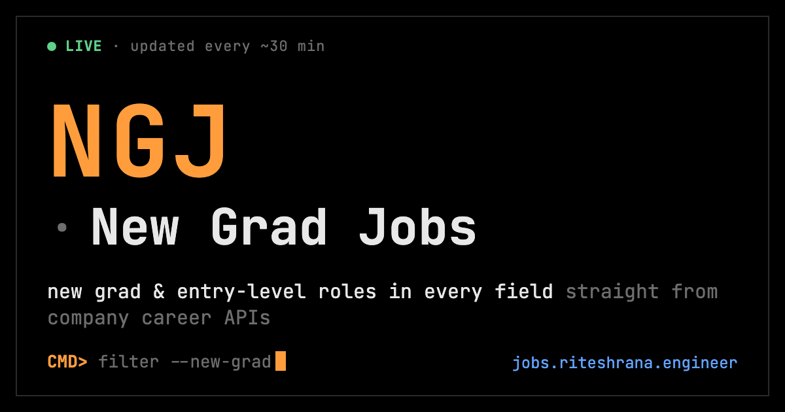

# 2026 New Grad Positions

**Fully automated** list of entry-level positions for 2025–2027 new graduates: software, data, engineering, finance, marketing, sales, healthcare and every other field, pulled straight from company career sites.

Unlike manually curated lists, this repository pulls directly from configured company APIs and refreshes **about every 30 minutes**, 24/7.

**[Open the live board →](https://jobs.riteshrana.engineer/)** · [Browse by role, company, city](https://jobs.riteshrana.engineer/jobs/) · [Guides](https://jobs.riteshrana.engineer/guides/) · [RSS alerts](https://jobs.riteshrana.engineer/feed.xml) · [How it works](https://jobs.riteshrana.engineer/about/)

**Contribute** by submitting an [issue](https://github.com/ambicuity/New-Grad-Jobs/issues/new/choose). See the [contribution guidelines](CONTRIBUTING.md) to get started.

> [!NOTE]
> **Solo-Maintained Project.** This repository is maintained by one person in spare time.
> PRs are reviewed within **1–2 weeks**. Bug fixes take priority over feature requests.
> Before opening an issue, read [SUPPORT.md](.github/SUPPORT.md).

---

## **Website & Autofill Extension**

Explore Zapply’s website and check out:
- Our Chrome extension, which autofills job applications in seconds.
- A dedicated job board featuring the latest openings across various roles.
- User accounts with multiple profiles for different resume types and roles.
- Job application tracking with streaks and commitment awards.

Experience an advanced career journey with us! 🚀

Sponsored by Zapply

---

## Sponsored by [Tailr](https://www.tailr.uk)

**[Tailr](https://www.tailr.uk) rewrites your résumé for each job posting and shows you the ATS match score** — so you stop getting auto-filtered by the same generic résumé. Free 10/day, no card required. This project is proudly sponsored by Tailr.

---

<!-- COUNTS:START - counts below are auto-synced from the scraper output jobs.json by scripts/sync_readme_counts.py -->
## Browse <!-- COUNT:total -->8542<!-- /COUNT --> Jobs by Category

| Category | Open Roles |
|----------|-----------:|
| [Software Engineering](#software-engineering) | <!-- COUNT:software_engineering -->2023<!-- /COUNT --> |
| [Frontend Engineering](#frontend-engineering) | <!-- COUNT:frontend -->33<!-- /COUNT --> |
| [Backend Engineering](#backend-engineering) | <!-- COUNT:backend -->42<!-- /COUNT --> |
| [Mobile Engineering](#mobile-engineering) | <!-- COUNT:mobile -->21<!-- /COUNT --> |
| [Security Engineering](#security-engineering) | <!-- COUNT:security -->231<!-- /COUNT --> |
| [Data Science & ML](#data-science--ml) | <!-- COUNT:data_ml -->333<!-- /COUNT --> |
| [Data Engineering](#data-engineering) | <!-- COUNT:data_engineering -->204<!-- /COUNT --> |
| [Data Analyst](#data-analyst) | <!-- COUNT:data_analyst -->43<!-- /COUNT --> |
| [Infrastructure & SRE](#infrastructure--sre) | <!-- COUNT:infrastructure_sre -->454<!-- /COUNT --> |
| [Product Management](#product-management) | <!-- COUNT:product_management -->26<!-- /COUNT --> |
| [Project Management](#project-management) | <!-- COUNT:project_management -->77<!-- /COUNT --> |
| [Quantitative Finance](#quantitative-finance) | <!-- COUNT:quant_finance -->25<!-- /COUNT --> |
| [Hardware Engineering](#hardware-engineering) | <!-- COUNT:hardware -->243<!-- /COUNT --> |
| [Engineering and Development](#engineering-and-development) | <!-- COUNT:engineering -->1141<!-- /COUNT --> |
| [Creatives and Design](#creatives-and-design) | <!-- COUNT:design -->50<!-- /COUNT --> |
| [Business Analyst](#business-analyst) | <!-- COUNT:business_analyst -->330<!-- /COUNT --> |
| [Marketing](#marketing) | <!-- COUNT:marketing -->91<!-- /COUNT --> |
| [Sales](#sales) | <!-- COUNT:sales -->603<!-- /COUNT --> |
| [Accounting and Finance](#accounting-and-finance) | <!-- COUNT:accounting_finance -->354<!-- /COUNT --> |
| [Consulting](#consulting) | <!-- COUNT:consulting -->144<!-- /COUNT --> |
| [Human Resources](#human-resources) | <!-- COUNT:human_resources -->118<!-- /COUNT --> |
| [Legal and Compliance](#legal-and-compliance) | <!-- COUNT:legal -->50<!-- /COUNT --> |
| [Customer Service and Support](#customer-service-and-support) | <!-- COUNT:customer_support -->177<!-- /COUNT --> |
| [Supply Chain](#supply-chain) | <!-- COUNT:supply_chain -->295<!-- /COUNT --> |
| [Healthcare](#healthcare) | <!-- COUNT:healthcare -->643<!-- /COUNT --> |
| [Education and Training](#education-and-training) | <!-- COUNT:education -->47<!-- /COUNT --> |
| [Public Sector and Government](#public-sector-and-government) | <!-- COUNT:public_sector -->18<!-- /COUNT --> |
| [Arts and Entertainment](#arts-and-entertainment) | <!-- COUNT:arts_entertainment -->5<!-- /COUNT --> |
| [Management and Executive](#management-and-executive) | <!-- COUNT:management -->128<!-- /COUNT --> |
| [Other](#other) | <!-- COUNT:other -->593<!-- /COUNT --> |
<!-- COUNTS:END -->

---

<!-- CATEGORY-LISTINGS:START - auto-generated from the scraper output jobs.json by scripts/sync_readme_jobs.py; do not edit by hand -->

> **Live listings** — the 10 most recently posted roles per category, refreshed about every 30 minutes. Browse and filter all **8,542** live roles on the **[live job board](https://jobs.riteshrana.engineer/)**.

## Software Engineering

[Back to top](#2026-new-grad-positions)

| Company | Role | Location | Posted | Apply |
|---------|------|----------|--------|-------|
| Leonardo DRS | Embedded Software Engineer - Sustaining Engineering | Danbury, CT, United States | Today | [Apply](<https://careers.leonardodrs.com/job/Danbury-Embedded-Software-Engineer-Sustaining-Engineering-CT-06810-8147/1415641900/>) |
| Bunge | Full Stack Software Engineer \(Omaha, NE\) | Omaha, NE -, United States | Today | [Apply](<https://jobs.bunge.com/job/Omaha-Full-Stack-Software-Engineer-%28Omaha%2C-NE%29-NE-68102/1443517133/>) |
| Zipline | Software Engineer, Production Test | South San Francisco, California, USA | Today | [Apply](<https://www.zipline.com/open-roles/8040735003?gh_jid=8040735003>) |
| ULTRA STONE IMPEX PVT LTD | Full Stack Developer - QA Tester / Junior Developer – ERP Implementation | KA, IN | Today | [Apply](<https://in.indeed.com/viewjob?jk=9892642b56ca48ec>) |
| Nokia | Software Engineer | India | Today | [Apply](<https://fa-evmr-saasfaprod1.fa.ocs.oraclecloud.com/hcmUI/CandidateExperience/en/sites/CX_1/job/37350>) |
| Raytheon | Cyber Software Engineer II | US-CA-ANAHEIM-406 ~ 160 N Riverview Dr ~ BLDG 406, Ste 150 | Today | [Apply](<https://globalhr.wd5.myworkdayjobs.com/REC_RTX_Ext_Gateway/job/US-CA-ANAHEIM-406--160-N-Riverview-Dr--BLDG-406-Ste-150/Cyber-Software-Engineer-II_01885961>) |
| Cisco | Software Engineer | Bangalore, India | Today | [Apply](<https://cisco.wd5.myworkdayjobs.com/Cisco_Careers/job/Bangalore-India/Software-Engineer_2027017>) |
| Cisco | Software Engineer, Hybrid | RTP, North Carolina, US; San Jose, California, US | Today | [Apply](<https://cisco.wd5.myworkdayjobs.com/Cisco_Careers/job/RTP-North-Carolina-US/Software-Engineer--Hybrid_2028283>) |
| Duck Creek Technologies | Associate Software Engineer | Bengaluru, India | Today | [Apply](<https://duckcreek.wd1.myworkdayjobs.com/duckcreekcareers/job/Bengaluru-India/Associate-Software-Engineer_REQID55233-1>) |
| Goldman Sachs | AM Public-Bengaluru-Associate-Software Engineering | KA, IN | Today | [Apply](<https://in.indeed.com/viewjob?jk=c9eb9a186d8024cf>) |

**[View all 2,023 Software Engineering roles on the live board](https://jobs.riteshrana.engineer/)**

## Frontend Engineering

[Back to top](#2026-new-grad-positions)

| Company | Role | Location | Posted | Apply |
|---------|------|----------|--------|-------|
| CACI | Front End Software Developer | Sterling, VA, US; Denver, CO, US | 1 day ago | [Apply](<https://caci.wd1.myworkdayjobs.com/External/job/Sterling-VA-US/Front-End-Software-Developer_334352>) |
| General Dynamics | Front-End Software Engineer- TS/SCI with Polygraph | USA VA Chantilly | 2 days ago | [Apply](<https://gdit.wd5.myworkdayjobs.com/External_Career_Site/job/USA-VA-Chantilly/Front-End-Software-Engineer--TS-SCI-with-Polygraph_RQ230792-2>) |
| Relativity Space | Front-End Software Engineer II | Long Beach, California, United States | 3 days ago | [Apply](<https://boards.greenhouse.io/relativity/jobs/8917327002?gh_jid=8917327002>) |
| Roblox | Software Engineer, Frontend - Economy | San Mateo, CA, United States | 3 days ago | [Apply](<https://careers.roblox.com/jobs/8259453?gh_jid=8259453>) |
| Amentum | Junior Web Developer | US-VA-Dahlgren | 4 days ago | [Apply](<https://pae.wd1.myworkdayjobs.com/Amentum_Careers/job/US-VA-Dahlgren/Junior-Web-Developer_R0172603>) |
| SBT Global | Jr. Front-End Developer\(Korean Bilingual\) | Remote, Plano, TX, United States | 6 days ago | [Apply](<https://jobs.smartrecruiters.com/SBTGlobalInc/3743990016381061>) |
| Accenture | Web Developer Associate | — | 2026-10-22 | [Apply](<https://accenture.wd103.myworkdayjobs.com/AccentureCareers/job/Mumbai/Web-Developer-Analyst_AIOC-S01660595-1>) |
| Tenet3 | Junior Frontend Software Engineer- Hybrid | Dayton, Ohio | 2026-10-19 | [Apply](<https://job-boards.greenhouse.io/tenet3/jobs/8894846002>) |
| Hive | Software Engineer - Frontend | San Francisco | 2026-10-15 | [Apply](<https://jobs.lever.co/hive/4947a174-d218-4c83-be26-89b1e889dc16>) |
| Hive | Software Engineer - Frontend | Seattle | 2026-10-15 | [Apply](<https://jobs.lever.co/hive/818e2024-c973-4cf7-84fd-7b14bd3a24f8>) |

**[View all 33 Frontend Engineering roles on the live board](https://jobs.riteshrana.engineer/)**

## Backend Engineering

[Back to top](#2026-new-grad-positions)

| Company | Role | Location | Posted | Apply |
|---------|------|----------|--------|-------|
| Morningstar | Software Engineer -Data Processing Backend | Toronto, ON, CA | 1 day ago | [Apply](<https://ca.indeed.com/viewjob?jk=fcaf48e7537bded0>) |
| Cisco | Software Engineer Full Stack / Backend II \(Full-Time\) - United States | RTP, North Carolina, US; Boulder, Colorado, US | 2 days ago | [Apply](<https://cisco.wd5.myworkdayjobs.com/Cisco_Careers/job/RTP-North-Carolina-US/Software-Engineer-Full-Stack---Backend-II--Full-Time----United-States_2026779>) |
| ATS Automation Tooling Systems Inc. | Backend Software Developer | Cambridge, ON, CA | 2 days ago | [Apply](<https://ca.indeed.com/viewjob?jk=4fb83f855bbcebbd>) |
| Superhuman | Software Engineer, Back-End - Mail \(Canada\) | Remote, CA | 2 days ago | [Apply](<https://ca.indeed.com/viewjob?jk=2cfcef8c4d5a4459>) |
| Mastercard | Software Engineer II \(Backend \_ Java\) | Vancouver, Canada | 2026-10-22 | [Apply](<https://mastercard.wd1.myworkdayjobs.com/CorporateCareers/job/Vancouver-Canada/Software-Engineer-II--Backend---Java-_R-291663>) |
| Mastercard | Software Engineer II \(Backend - Java\) | Vancouver, Canada | 2026-10-22 | [Apply](<https://mastercard.wd1.myworkdayjobs.com/CorporateCareers/job/Vancouver-Canada/Software-Engineer-II--Backend---Java-_R-291922>) |
| Uber | Software Engineer II \(Backend\) - Fares Platform | San Francisco, CA, United States | 2026-10-21 | [Apply](<https://iaziqy.fa.ocs.oraclecloud.com/hcmUI/CandidateExperience/en/sites/UberCareers/job/303472>) |
| Justworks | Software Engineer, Backend | New York, New York | 2026-10-20 | [Apply](<https://boards.greenhouse.io/justworks/jobs/8179714?gh_jid=8179714>) |
| Affirm | Software Engineer II, Backend \(Purchasing Power - Core\) | Remote Canada | 2026-10-20 | [Apply](<https://job-boards.greenhouse.io/affirm/jobs/8017509003>) |
| LaunchDarkly | Backend Software Engineer, SDK | Remote - US | 2026-10-19 | [Apply](<https://job-boards.greenhouse.io/launchdarkly/jobs/8015117003>) |

**[View all 42 Backend Engineering roles on the live board](https://jobs.riteshrana.engineer/)**

## Mobile Engineering

[Back to top](#2026-new-grad-positions)

| Company | Role | Location | Posted | Apply |
|---------|------|----------|--------|-------|
| Wipro | Software Engineer - C++ / Python / Android / Java L1 | Waterloo, ON, CA | 1 day ago | [Apply](<https://ca.indeed.com/viewjob?jk=2e989494c4111877>) |
| BJAK | iOS Software Engineer | United States, United States, United States | 4 days ago | [Apply](<https://jobs.ashbyhq.com/bjakcareer/b22150b6-5fa7-4842-b501-e5322f2f75b3>) |
| BJAK | Android Software Engineer | United States, United States, United States | 4 days ago | [Apply](<https://jobs.ashbyhq.com/bjakcareer/c4272eb4-56fc-4f3e-8d5a-cc14c7e7c4ef>) |
| BJAK | Android Software Engineer - AI Neobank App | India, India, India | 2026-10-23 | [Apply](<https://jobs.ashbyhq.com/bjakcareer/82349fdc-fc80-4da1-a39e-1f70dee09ba5>) |
| BJAK | Android Software Engineer - AI Neobank App | United States, United States, United States | 2026-10-23 | [Apply](<https://jobs.ashbyhq.com/bjakcareer/6cd46335-dae2-40e1-807a-b8f2dc18f618>) |
| Uber | Software Engineer II, iOS- Maps Mobile Platform | San Francisco, CA, United States | 2026-10-20 | [Apply](<https://iaziqy.fa.ocs.oraclecloud.com/hcmUI/CandidateExperience/en/sites/UberCareers/job/303601>) |
| DoorDash | Software Engineer, iOS | Sunnyvale, CA; San Francisco, CA; Seattle, WA; New York, NY | 2026-10-13 | [Apply](<https://job-boards.greenhouse.io/doordashusa/jobs/8141072>) |
| Uber | Software Engineer II - Android | Seattle, WA, United States | 2026-10-10 | [Apply](<https://iaziqy.fa.ocs.oraclecloud.com/hcmUI/CandidateExperience/en/sites/UberCareers/job/302639>) |
| Motorola Solutions | Android Software Engineer | Plantation, FL | 2026-10-06 | [Apply](<https://motorolasolutions.wd5.myworkdayjobs.com/Careers/job/Plantation-FL/Android-Software-Engineer_R62561>) |
| Match Group | Software Engineer, Android | Los Angeles, California | 2026-10-02 | [Apply](<https://jobs.lever.co/matchgroup/32b18f00-af1a-4067-ad7d-9cba43711d2e>) |

**[View all 21 Mobile Engineering roles on the live board](https://jobs.riteshrana.engineer/)**

## Security Engineering

[Back to top](#2026-new-grad-positions)

| Company | Role | Location | Posted | Apply |
|---------|------|----------|--------|-------|
| Noblis | Cleared - Cyber Security Engineer \(Multiple Levels\) | Bethesda, Maryland | Today | [Apply](<https://careers.noblis.org/jobs/28072>) |
| NCR Atleos | Information Security Engineer II | HR, IN | Today | [Apply](<https://in.indeed.com/viewjob?jk=a138842767f5d661>) |
| Westinghouse | Physical Security Engineer | Cranberry Township, NC, United States | 1 day ago | [Apply](<https://careers.westinghousenuclear.com/job/Cranberry-Township-Physical-Security-Engineer-NC/1389543400/>) |
| PeopleTec | Program Security SME II | El Segundo, CA, United States | 1 day ago | [Apply](<https://careers-peopletec.icims.com/jobs/5426/job>) |
| PeopleTec | Program Security Analyst II | El Segundo, CA, United States | 1 day ago | [Apply](<https://careers-peopletec.icims.com/jobs/5427/job>) |
| Lawrence Livermore National Laboratory | Center for Global Security Research \(CGSR\) Undergraduate Research Associate - Summer 2027 | Livermore, CA, United States | 1 day ago | [Apply](<https://jobs.smartrecruiters.com/LLNL/3743990016483776>) |
| Hewlett Packard Enterprise | Full Stack Software Developer Specialist \(Product Security\) | Bengaluru, Karnātaka, India | 1 day ago | [Apply](<https://hpe.wd5.myworkdayjobs.com/WFMathpe/job/Bengaluru-Karntaka-India/Full-Stack-Software-Developer-Specialist--Product-Security-_1217331-1>) |
| Lawrence Livermore National Laboratory | Center for Global Security Research \(CGSR\) Graduate Research Associate - Summer 2027 | Livermore, CA, United States | 1 day ago | [Apply](<https://jobs.smartrecruiters.com/LLNL/3743990016483046>) |
| ATOMS | Physical &amp; Facility Security Engineer | San Francisco, CA | 1 day ago | [Apply](<https://job-boards.greenhouse.io/cssmerge/jobs/8922802002>) |
| Emory University | IT Security Architecture Analyst II \(Cybersecurity\) | Atlanta, Georgia | 1 day ago | [Apply](<https://careers.emory.edu/jobs/175391>) |

**[View all 231 Security Engineering roles on the live board](https://jobs.riteshrana.engineer/)**

## Data Science & ML

[Back to top](#2026-new-grad-positions)

| Company | Role | Location | Posted | Apply |
|---------|------|----------|--------|-------|
| Viridien | Data Scientist | Airoli, India | Today | [Apply](<https://cgg.wd103.myworkdayjobs.com/viridiencareers/job/Airoli-India/Data-Scientist-1_JR101327-2>) |
| Zocdoc | Data Scientist | New York, NY | Today | [Apply](<https://job-boards.greenhouse.io/zocdoc/jobs/8335345>) |
| MIT Lincoln Laboratory | AI/ML Engineer - Weather &amp; Earth Systems | Lexington, MA, United States | 1 day ago | [Apply](<https://careers.ll.mit.edu/job/Lexington-AIML-Engineer-Weather-&-Earth-Systems-MA-02420/1435374500/>) |
| Northrop Grumman | Associate Data Scientist - Pathways - Aurora CO | United States-Colorado-Aurora | 1 day ago | [Apply](<https://ngc.wd1.myworkdayjobs.com/Northrop_Grumman_External_Site/job/United-States-Colorado-Aurora/Associate-Data-Scientist---Pathways---Aurora-CO_R10258253-1>) |
| Texas Instruments | Data Scientist \(Manufacturing/Facilities\) | Dallas, TX, United States | 1 day ago | [Apply](<https://edbz.fa.us2.oraclecloud.com/hcmUI/CandidateExperience/en/sites/CX/job/25016669>) |
| University of Ottawa | TA \(CUPE\) - MEM5300 A - Winter 2027 | Ottawa, ON, CA | 1 day ago | [Apply](<https://ca.indeed.com/viewjob?jk=ab783258f07e2522>) |
| Booz Allen Hamilton | Data Scientist | Albuquerque, NM | 1 day ago | [Apply](<https://bah.wd1.myworkdayjobs.com/BAH_Jobs/job/Albuquerque-NM/Data-Scientist_R0252615>) |
| Boeing | Experienced Data Scientist | USA - Hazelwood, MO | 1 day ago | [Apply](<https://boeing.wd1.myworkdayjobs.com/external_careers/job/USA---Hazelwood-MO/Experienced-Data-Scientist_JR2026520583-1>) |
| Venatore | Data Scientist | Tampa, FL, US | 1 day ago | [Apply](<https://www.indeed.com/viewjob?jk=89334da66ef90427>) |
| Happen Bank | Associate Data Scientist, Fraud Strategy | San Francisco, CA, US | 1 day ago | [Apply](<https://www.indeed.com/viewjob?jk=18019352f789a606>) |

**[View all 333 Data Science & ML roles on the live board](https://jobs.riteshrana.engineer/)**

## Data Engineering

[Back to top](#2026-new-grad-positions)

| Company | Role | Location | Posted | Apply |
|---------|------|----------|--------|-------|
| City of New York | Data Visualization Analyst Level I | New York City, NY, United States | Today | [Apply](<https://jobs.smartrecruiters.com/CityOfNewYork/3743990016518416>) |
| MIT Lincoln Laboratory | Software/Data Engineer | Lexington, MA, United States | 1 day ago | [Apply](<https://careers.ll.mit.edu/job/Lexington-SoftwareData-Engineer-MA-02420/1435221700/>) |
| Persistent Systems | Data Engineer | New York, NY, United States | 1 day ago | [Apply](<https://careers-persistentsystems.icims.com/jobs/2441/job>) |
| Steampunk | Data Engineer - Databricks | McLean, VA, United States | 1 day ago | [Apply](<https://careers-steampunk.icims.com/jobs/5998/job>) |
| Swiss Re | Application Engineer II | Hyderabad, TG, India | 1 day ago | [Apply](<https://careers.swissre.com/job/Hyderabad-Application-Engineer-II-TG/1452471633/>) |
| Raytheon | Data Engineer | US-AZ-REMOTE, United States of America; US-VA-REMOTE; US-MA-REMOTE; US-TX-REMOTE | 1 day ago | [Apply](<https://globalhr.wd5.myworkdayjobs.com/REC_RTX_Ext_Gateway/job/US-AZ-REMOTE/Data-Engineer_01883619-1>) |
| Booz Allen Hamilton | Data Engineer, Mid | Aurora, CO, US | 1 day ago | [Apply](<https://www.indeed.com/viewjob?jk=a4b9ea0195f8779d>) |
| Greenshades Software | Data Engineer I | Remote, US | 1 day ago | [Apply](<https://www.indeed.com/viewjob?jk=97ceea1f16ac5a53>) |
| Accenture Federal Services | Data Transfer Workstation Support Technician II | Lorton, VA | 1 day ago | [Apply](<https://boards.greenhouse.io/accenturefederalservices/jobs/4725591006?gh_jid=4725591006>) |
| SMX | Cleared Data Engineer \(5786\) | United States | 1 day ago | [Apply](<https://www.smxtech.com/careers/?gh_jid=8047200003>) |

**[View all 204 Data Engineering roles on the live board](https://jobs.riteshrana.engineer/)**

## Data Analyst

[Back to top](#2026-new-grad-positions)

| Company | Role | Location | Posted | Apply |
|---------|------|----------|--------|-------|
| Fidelity Canada | Business Analyst - Data Warehouse &amp; Business Intelligence | Toronto, ON, CA | 1 day ago | [Apply](<https://ca.indeed.com/viewjob?jk=5834a0a7b3eb7788>) |
| University of Miami | Postdoctoral Associate - Cancer, Lifestyle Medicine &amp; Data Analytics | Miami, FL | 1 day ago | [Apply](<https://umiami.wd1.myworkdayjobs.com/UMCareerStaff/job/Miami-FL/Postdoctoral-Associate---CRANE-Lab_R100096161>) |
| Caesars Entertainment | Analyst II, Operations Analytics \(Central Region\) - Corporate \(St. Louis\) | St Louis, MO, United States | 1 day ago | [Apply](<https://edmn.fa.us2.oraclecloud.com/hcmUI/CandidateExperience/en/sites/CX_1/job/91360>) |
| CORE Foodservice | Client Data Analyst II | Remote, Dallas, TX, United States | 1 day ago | [Apply](<https://eczy.fa.us2.oraclecloud.com/hcmUI/CandidateExperience/en/sites/CX_1/job/43302>) |
| Mosaic North America | Client Data Analyst II | Mississauga, ON, CA | 1 day ago | [Apply](<https://ca.indeed.com/viewjob?jk=8554cdb4ab6a2c51>) |
| Guidehouse | Program Analytics &amp; Data Visualization Specialist I | US - TX, San Antonio, United States of America; US - OH, Beavercreek; US - TX, Houston; US - NC, Charlotte; US - AL, Huntsville; US - GA, Atlanta | 2 days ago | [Apply](<https://guidehouse.wd1.myworkdayjobs.com/External/job/US---TX-San-Antonio/Program-Analytics---Data-Visualization-Specialist-I_43044>) |
| Grand Mental Health | Data Analyst I | Tulsa, OK, US | 2 days ago | [Apply](<https://www.indeed.com/viewjob?jk=da1f150963691d74>) |
| UC San Francisco | Research Data Analyst I | San Francisco, CA, United States | 3 days ago | [Apply](<https://iazuqy.fa.ocs.oraclecloud.com/hcmUI/CandidateExperience/en/sites/CX_1/job/10802>) |
| Berkshire Hathaway Energy | Data Analyst II CPS | Las Vegas, NV, United States | 3 days ago | [Apply](<https://fa-essf-saasfaprod1.fa.ocs.oraclecloud.com/hcmUI/CandidateExperience/en/sites/CX_1/job/10005959>) |
| PwC | Data and Analytics Engineering - Data Engineering - Associate - CS - G | Pune | 3 days ago | [Apply](<https://pwc.wd3.myworkdayjobs.com/Global_Experienced_Careers/job/Pune/Data-and-Analytics-Engineering---Data-Engineering---Associate---CS---G_DB_002691-1>) |

**[View all 43 Data Analyst roles on the live board](https://jobs.riteshrana.engineer/)**

## Infrastructure & SRE

[Back to top](#2026-new-grad-positions)

| Company | Role | Location | Posted | Apply |
|---------|------|----------|--------|-------|
| Hatch | Mine Mechanical Infrastructure Engineer | Sudbury, ON, Canada | Today | [Apply](<https://jobs.hatch.com/job/Sudbury-Mine-Mechanical-Infrastructure-Engineer-ON/1436001000/>) |
| Hatch | Mine Electrical Infrastructure Engineer | Sudbury, ON, Canada | Today | [Apply](<https://jobs.hatch.com/job/Sudbury-Mine-Electrical-Infrastructure-Engineer-ON/1436002000/>) |
| Hatch | Mine Structural Infrastructure Engineer | Sudbury, ON, Canada | Today | [Apply](<https://jobs.hatch.com/job/Sudbury-Mine-Structural-Infrastructure-Engineer-ON/1435882600/>) |
| Verizon | Archt I-DevOps | Chennai, India; Hyderabad, India | Today | [Apply](<https://verizon.wd12.myworkdayjobs.com/verizon-careers/job/Chennai-India/Archt-I-DevOps_R-1102713>) |
| Raytheon | Software Engineer II \(Cybersecurity / Networking\) | US-MD-ANNAPOLIS JUNCTION-339 ~ 306 Sentinel Dr ~ 339 BLDG | Today | [Apply](<https://globalhr.wd5.myworkdayjobs.com/REC_RTX_Ext_Gateway/job/US-MD-ANNAPOLIS-JUNCTION-339--306-Sentinel-Dr--339-BLDG/Software-Engineer-II--Cybersecurity---Networking-_01885972>) |
| Verizon | Archt I-DevOps | Hyderabad, India; Chennai, India | Today | [Apply](<https://verizon.wd12.myworkdayjobs.com/verizon-careers/job/Hyderabad-India/Archt-I-DevOps_R-1102716>) |
| SpaceX | IT Network Engineer | Memphis, TN | Today | [Apply](<https://boards.greenhouse.io/spacex/jobs/8924393002?gh_jid=8924393002>) |
| Noblis | Cloud / SRE Engineer | Atlantic City, New Jersey | Today | [Apply](<https://careers.noblis.org/jobs/28066>) |
| SpaceX | IT Wireless Network Engineer | Memphis, TN | Today | [Apply](<https://boards.greenhouse.io/spacex/jobs/8924320002?gh_jid=8924320002>) |
| Rocket Lab | Flight Dynamics Engineer II | Long Beach, CA | Today | [Apply](<https://job-boards.greenhouse.io/rocketlab/jobs/8081555003>) |

**[View all 454 Infrastructure & SRE roles on the live board](https://jobs.riteshrana.engineer/)**

## Product Management

[Back to top](#2026-new-grad-positions)

| Company | Role | Location | Posted | Apply |
|---------|------|----------|--------|-------|
| Wise | Graduate Analyst | Austin, TX, US | Today | [Apply](<https://www.indeed.com/viewjob?jk=1c6cf7729f70b491>) |
| Lear | Continuous Improvement Specialist I | Flint, MI, United States | 1 day ago | [Apply](<https://jobs.lear.com/job/Flint-Continuous-Improvement-Specialist-I-MI-48505/1426304733/>) |
| Google | Associate Product Manager, University Graduate, 2027 Start | KA, IN | 1 day ago | [Apply](<https://in.indeed.com/viewjob?jk=ed6058a434c9ce75>) |
| T-Mobile | Associate Product Manager - App | Bellevue, Washington | 2 days ago | [Apply](<https://tmobile.wd1.myworkdayjobs.com/External/job/Bellevue-Washington/Associate-Product-Manager---App_REQ373263-1>) |
| Abbott | Associate Product Manager | United States &gt; Madison : 1 Exact Lane | 3 days ago | [Apply](<https://abbott.wd5.myworkdayjobs.com/abbottcareers2/job/United-States--Madison--1-Exact-Lane/Associate-Product-Manager_31165659-1>) |
| Abbott | Associate Product Manager | United States &gt; Madison : 1 Exact Lane | 3 days ago | [Apply](<https://abbott.wd5.myworkdayjobs.com/abbottcareers2/job/United-States--Madison--1-Exact-Lane/Associate-Product-Manager_31165697>) |
| PBS Systems | Associate Product Manager | Calgary, AB, CA | 3 days ago | [Apply](<https://ca.indeed.com/viewjob?jk=a4b7bf23a82a8506>) |
| Supermicro | Associate Product Manager - Key Components | San Jose, Cali, Un | 3 days ago | [Apply](<https://jobs.supermicro.com/job/San-Jose-Associate-Product-Manager-Key-Components-Cali/1443917000/>) |
| ABB | Discovery Information Systems Track - 2027 | Cary, NC, US | 5 days ago | [Apply](<https://www.indeed.com/viewjob?jk=01bf2931ef77360c>) |
| Toast | Associate Product Manager, Data Governance | Remote, US | 6 days ago | [Apply](<https://careers.toasttab.com/jobs?gh_jid=8305972>) |

**[View all 26 Product Management roles on the live board](https://jobs.riteshrana.engineer/)**

## Project Management

[Back to top](#2026-new-grad-positions)

| Company | Role | Location | Posted | Apply |
|---------|------|----------|--------|-------|
| The State Group | Project Coordinator II | Hawesville, KY, US | 1 day ago | [Apply](<https://www.indeed.com/viewjob?jk=488cc030110b0791>) |
| JLL | Associate Project Manager | San Francisco, CA; Menlo Park, CA | 1 day ago | [Apply](<https://jll.wd1.myworkdayjobs.com/jllcareers/job/San-Francisco-CA/Associate-Project-Manager_REQ545168>) |
| Light &amp; Wonder | Associate Project Manager | USA-NC-Raleigh-1 Glenwood Ave Ste 600 | 1 day ago | [Apply](<https://lnw.wd5.myworkdayjobs.com/LightWonderExternalCareers/job/USA-NC-Raleigh-1-Glenwood-Ave-Ste-600/Associate-Project-Manager_R322993>) |
| ICF | Associate Program Manager – Home Weatherization Program | Newark, NJ | 1 day ago | [Apply](<https://icf.wd5.myworkdayjobs.com/ICFExternal_Career_Site/job/Newark-NJ/Associate-Program-Manager---Home-Weatherization-Program_R2603660>) |
| Symbotic | New Grad- Project Coordinator | USA Remote &amp; Travel | 1 day ago | [Apply](<https://symbotic.wd504.myworkdayjobs.com/Symbotic/job/USA-Remote--Travel/New-Grad--Project-Coordinator_R8277>) |
| City of New York | IPS Analysis Chief \(Associate Project Manager 2\) | Queens, NY, United States | 2 days ago | [Apply](<https://jobs.smartrecruiters.com/CityOfNewYork/3743990016455816>) |
| JLL | Associate Project Manager | McLean, VA | 2 days ago | [Apply](<https://jll.wd1.myworkdayjobs.com/jllcareers/job/McLean-VA/Associate-Project-Manager_REQ543371>) |
| Ledcor | Project Coordinator - Energy and Petrochemicals \(New Grad\) | Edmonton, AB, CA | 2 days ago | [Apply](<https://ca.indeed.com/viewjob?jk=af554485e014e457>) |
| Wdk Management Inc | Junior Project Coordinator | Greater Toronto Area, ON, CA | 2 days ago | [Apply](<https://ca.indeed.com/viewjob?jk=769db899a682cc38>) |
| State of Illinois | EXECUTIVE I \(Environmental Justice Program Coordinator\) | Chicago, IL, United States | 2 days ago | [Apply](<https://illinois.jobs2web.com/job/Chicago-EXECUTIVE-I-%28Environmental-Justice-Program-Coordinator%29-IL-60603/1444631700/>) |

**[View all 77 Project Management roles on the live board](https://jobs.riteshrana.engineer/)**

## Quantitative Finance

[Back to top](#2026-new-grad-positions)

| Company | Role | Location | Posted | Apply |
|---------|------|----------|--------|-------|
| Duke University | Laboratory Research Analyst II | Durham, NC, United States | Today | [Apply](<https://careers.duke.edu/job/Durham-Laboratory-Research-Analyst-II-NC-27710/1435925700/>) |
| Mastercard | Creative Data Strategist \(Associate Managing Consultant\(-1 | Gurgaon, India | Today | [Apply](<https://mastercard.wd1.myworkdayjobs.com/CorporateCareers/job/Gurgaon-India/Creative-Data-Strategist--Associate-Managing-Consultant--1_R-294084>) |
| Western Governors University | Email Marketing Strategist II | Salt Lake City, UT | 1 day ago | [Apply](<https://wgu.wd5.myworkdayjobs.com/External/job/Salt-Lake-City-UT/Email-Marketing-Strategist-II_JR-025926>) |
| AAA Auto Club Enterprises | Digital Marketing Associate Strategist | Costa Mesa, CA, US | 1 day ago | [Apply](<https://www.indeed.com/viewjob?jk=86cdcaad6a0d5afb>) |
| TD | Associate, Commercial National Accounts | Toronto, ON, CA | 1 day ago | [Apply](<https://ca.indeed.com/viewjob?jk=6bd93c4742225756>) |
| Mastercard | Creative Data Strategist \(Associate Managing Consultant\(-2 | Gurgaon, India | 2 days ago | [Apply](<https://mastercard.wd1.myworkdayjobs.com/CorporateCareers/job/Gurgaon-India/Creative-Data-Strategist--Associate-Managing-Consultant--2_R-294085>) |
| Hatch | Stagiaire en ingénierie des barrages et de l'hydroélectricité - Hiver 2027 | St. John's, NL, Canada | 4 days ago | [Apply](<https://jobs.hatch.com/job/St_-John&apos;s-Stagiaire-en-ing%C3%A9nierie-des-barrages-et-de-l&apos;hydro%C3%A9lectricit%C3%A9-Hiver-2027-NL/1443586000/>) |
| Gas South | Commodity Supply Analyst I | Gainesville, FL, US | 2026-10-23 | [Apply](<https://www.indeed.com/viewjob?jk=4cc045c217878c9b>) |
| Palantir | Deployment Strategist, New Grad - Warp Speed | New York, NY | 2026-10-22 | [Apply](<https://jobs.lever.co/palantir/37780e70-c7af-45e1-9be7-071df201c387>) |
| AQR Capital Management | RFP Analyst/Associate | Greenwich, CT | 2026-10-22 | [Apply](<https://careers.aqr.com/jobs?gh_jid=8274077&gh_jid=8274077>) |

**[View all 25 Quantitative Finance roles on the live board](https://jobs.riteshrana.engineer/)**

## Hardware Engineering

[Back to top](#2026-new-grad-positions)

| Company | Role | Location | Posted | Apply |
|---------|------|----------|--------|-------|
| Bosch | ASIC Verification EEJ 2026 | bengaluru, , India | Today | [Apply](<https://jobs.smartrecruiters.com/BoschGroup/744000158686196>) |
| Qualcomm | Associate Engineer - WLAN Firmware | KA, IN | Today | [Apply](<https://in.indeed.com/viewjob?jk=6699ce330ddbd988>) |
| Raytheon | Electrical Engineer II, Computing Products \(Onsite\) | US-IA-CEDAR RAPIDS-193 ~ 1120 Collins Rd NE ~ BLDG193 | Today | [Apply](<https://globalhr.wd5.myworkdayjobs.com/REC_RTX_Ext_Gateway/job/US-IA-CEDAR-RAPIDS-193--1120-Collins-Rd-NE--BLDG193/Electrical-Engineer-II--Computing-Products---Onsite-_01886054>) |
| ALZA INCORPORATION | Immediate Hiring Business Associate BA/BBA/BCOM/MBA/MSW/BTECH | KL, IN | Today | [Apply](<https://in.indeed.com/viewjob?jk=9d580ecc11b0fd75>) |
| Voyager Technologies | Electrical Hardware Engineer I | Pittsburgh, PA | Today | [Apply](<https://job-boards.greenhouse.io/voyagertechnologiesinc/jobs/4455215009>) |
| Alarm.com | Device Engineer II \(RF/EMC\) | Tysons, Virginia | Today | [Apply](<https://job-boards.greenhouse.io/alarmcom/jobs/8924631002>) |
| Rocket Lab | Electrical Engineer I | Pasadena, CA | Today | [Apply](<https://job-boards.greenhouse.io/rocketlab/jobs/8057261003>) |
| Westinghouse | Electrical Engineer II | Cranberry Township, NC, United States | 1 day ago | [Apply](<https://careers.westinghousenuclear.com/job/Rock-Hill-Electrical-Engineer-II-SC-29730/1425514300/>) |
| Leonardo DRS | Scientist II - Semiconductor Process | Dallas, TX, United States | 1 day ago | [Apply](<https://careers.leonardodrs.com/job/Dallas-Scientist-II-Semiconductor-Process-TX-75243/1425552900/>) |
| Leonardo DRS | Scientist I - Semiconductor Process | Dallas, TX, United States | 1 day ago | [Apply](<https://careers.leonardodrs.com/job/Dallas-Scientist-I-Semiconductor-Process-TX-75243/1425553900/>) |

**[View all 243 Hardware Engineering roles on the live board](https://jobs.riteshrana.engineer/)**

## Engineering and Development

[Back to top](#2026-new-grad-positions)

| Company | Role | Location | Posted | Apply |
|---------|------|----------|--------|-------|
| Ramboll | Graduate Detailing Engineer - Hyderabad | Madhapur, , India | Today | [Apply](<https://jobs.smartrecruiters.com/Ramboll3/744000158678279>) |
| Boston Scientific | Quality Engineer II - Defined Term | Quincy, MA, United States | Today | [Apply](<https://jobs.bostonscientific.com/job/Quincy-Quality-Engineer-II-Defined-Term-MA-02171/1416696000/>) |
| Wabtec | Trainee Junior Engineer | Shahjahanpur, UP, India | Today | [Apply](<https://jobs.smartrecruiters.com/Wabtec/3743990016515286>) |
| Wabtec | Trainee Junior Engineer | Shahjahanpur, UP, India | Today | [Apply](<https://jobs.smartrecruiters.com/Wabtec/3743990016515236>) |
| Wabtec | Trainee Junior Engineer | Shahjahanpur, UP, India | Today | [Apply](<https://jobs.smartrecruiters.com/Wabtec/3743990016515186>) |
| Zipline | Manufacturing Engineer, Early Career | South San Francisco, California, USA | Today | [Apply](<https://www.zipline.com/open-roles/8040731003?gh_jid=8040731003>) |
| Leonardo DRS | Test Engineer II | Menomonee Falls, WI, United States | Today | [Apply](<https://careers.leonardodrs.com/job/Menomonee-Falls-Test-Engineer-II-WI-53051/1445237700/>) |
| Verizon | Engineer I-Systems Engineering | Temple Terrace, Florida | Today | [Apply](<https://verizon.wd12.myworkdayjobs.com/verizon-careers/job/Temple-Terrace-Florida/Engineer-I-Systems-Engineering_R-1103177-1>) |
| Pima County | Engineering Assistant II - Development Services | Tucson, AZ | Today | [Apply](<https://pimacounty.wd5.myworkdayjobs.com/pimacareers/job/Tucson-AZ/Engineering-Assistant-II---Development-Services_JR104761-1>) |
| The Cigna Group | Automation Engineer Associate Analyst | Bengaluru, India | Today | [Apply](<https://cigna.wd5.myworkdayjobs.com/cignacareers/job/Bengaluru-India/Automation-Engineer-Associate-Analyst_26012812>) |

**[View all 1,141 Engineering and Development roles on the live board](https://jobs.riteshrana.engineer/)**

## Creatives and Design

[Back to top](#2026-new-grad-positions)

| Company | Role | Location | Posted | Apply |
|---------|------|----------|--------|-------|
| State of Florida | DRAINAGE DESIGNER II - 55008169 | FT LAUDERDALE, FL, United States | 1 day ago | [Apply](<https://jobs.myflorida.com/job/FT-LAUDERDALE-DRAINAGE-DESIGNER-II-55008169-FL-33309/1445132900/>) |
| ACSASS IT | UI/UX &amp; DIGITAL MARKETING ASSOCIATE | TN, IN | 1 day ago | [Apply](<https://in.indeed.com/viewjob?jk=5ab48d82f758110c>) |
| Accenture | Junior Content Designer | — | 1 day ago | [Apply](<https://accenture.wd103.myworkdayjobs.com/AccentureCareers/job/London/Junior-Content-Designer_R00348802>) |
| Framar | Jr. Designer | Niagara Falls, ON, CA | 2 days ago | [Apply](<https://ca.indeed.com/viewjob?jk=bfe69b7d67bbccc8>) |
| Target | Associate Designer, Home | 1000 Nicollet Mall, Minneapolis,MN 55403-2542 | 2 days ago | [Apply](<https://target.wd5.myworkdayjobs.com/targetcareers/job/1000-Nicollet-Mall-MinneapolisMN-55403-2542/Associate-Designer--Home_R0000478270>) |
| Tulane University | Graphic Designer II | New Orleans, LA, United States | 2 days ago | [Apply](<https://tulane-ibqejb.fa.ocs.oraclecloud.com/hcmUI/CandidateExperience/en/sites/CX_1/job/2234>) |
| Unknown | Junior Graphic Designer | Remote, IN | 3 days ago | [Apply](<https://in.indeed.com/viewjob?jk=23c90b705a08b05f>) |
| Accenture | Visual Design Associate | — | 3 days ago | [Apply](<https://accenture.wd103.myworkdayjobs.com/AccentureCareers/job/Bengaluru/Visual-Design-Associate_AIOC-S01657727-1>) |
| Emily Carr University of Art and Design | Non-Regular \(Sessional\) Faculty - INDD 213 \(Computer Aided Design I\) Spring 2027 | Vancouver, BC, CA | 3 days ago | [Apply](<https://ca.indeed.com/viewjob?jk=6db956ea71b94e8e>) |
| Bennett Awards | Junior Industrial Designer – Awards &amp; Recognition | Remote, US | 3 days ago | [Apply](<https://www.indeed.com/viewjob?jk=c862388de0ec26a4>) |

**[View all 50 Creatives and Design roles on the live board](https://jobs.riteshrana.engineer/)**

## Business Analyst

[Back to top](#2026-new-grad-positions)

| Company | Role | Location | Posted | Apply |
|---------|------|----------|--------|-------|
| Lawrence Livermore National Laboratory | Business Analyst | Livermore, CA, United States | Today | [Apply](<https://jobs.smartrecruiters.com/LLNL/3743990016514586>) |
| Fraser Health | Business Analyst | Surrey, BC, CA | Today | [Apply](<https://ca.indeed.com/viewjob?jk=4e65181251b26377>) |
| Enviri Global Service Centre | HRSS Analyst - I | TS, IN | Today | [Apply](<https://in.indeed.com/viewjob?jk=896be8b971d9064a>) |
| DHANU GLOBAL ENTERPRISES, INC. | Business Analyst - Level 2 | St. John's, NL, CA | Today | [Apply](<https://ca.indeed.com/viewjob?jk=03c84fea4d6884f6>) |
| KION Group | SAP MM-PP Business Analyst | Grand Rapids, MI, United States; Atlanta, GA, United States; Dallas, TX, United States | Today | [Apply](<https://kiongroup.wd3.myworkdayjobs.com/KIONGroup/job/Grand-Rapids-MI-United-States/SAP-MM-PP-Business-Analyst_JR-0088686-1>) |
| Pima County | Business Systems Analyst I - Information Technology | Tucson, AZ | Today | [Apply](<https://pimacounty.wd5.myworkdayjobs.com/pimacareers/job/Tucson-AZ/Business-Systems-Analyst-I---Information-Technology_JR104776-1>) |
| Dematic | SAP MM-PP Business Analyst | Grand Rapids, MI, United States; Atlanta, GA, United States; Dallas, TX, United States | Today | [Apply](<https://kiongroup.wd3.myworkdayjobs.com/KION_SCS/job/Grand-Rapids-MI-United-States/SAP-MM-PP-Business-Analyst_JR-0088686>) |
| State of Florida | 886376-COMMERCE-DISTRIBUTED COMPUTER SYSTEMS ANALYST II - 40046205 | TALLAHASSEE, FL, United States | Today | [Apply](<https://jobs.myflorida.com/job/TALLAHASSEE-886376-COMMERCE-DISTRIBUTED-COMPUTER-SYSTEMS-ANALYST-II-40046205-FL-32399/1446291200/>) |
| Emory University | EPIC Analyst II \(Beacon\) | Atlanta, Georgia | Today | [Apply](<https://careers.emory.edu/jobs/173920>) |
| SMX | Junior Business Analyst/Functional Systems Analyst \(5800\) | Arlington, VA | Today | [Apply](<https://www.smxtech.com/careers/?gh_jid=8078006003>) |

**[View all 330 Business Analyst roles on the live board](https://jobs.riteshrana.engineer/)**

## Marketing

[Back to top](#2026-new-grad-positions)

| Company | Role | Location | Posted | Apply |
|---------|------|----------|--------|-------|
| Unknown | Entry Level Marketing and Sales Assistant | Killeen, TX, US | 1 day ago | [Apply](<https://www.indeed.com/viewjob?jk=ba788d9956e1ac90>) |
| Inspired Marketing Associates | Junior Marketing Associate | New York, NY, US | 1 day ago | [Apply](<https://www.indeed.com/viewjob?jk=d92e5d5789eff12d>) |
| LANDOCS | Jr. Digital Marketing Executive | KL, IN | 1 day ago | [Apply](<https://in.indeed.com/viewjob?jk=7b93023924232f7f>) |
| Kraft Heinz | Analyst II - Marketing Ops | KA, IN | 1 day ago | [Apply](<https://in.indeed.com/viewjob?jk=b25ad4fb3f82cd8c>) |
| Amplyfy, Inc. | Junior Marketing Assistant - Entry Level | Edison, NJ, US | 1 day ago | [Apply](<https://www.indeed.com/viewjob?jk=fe385c88ba9fc0ed>) |
| Caesars Entertainment | Marketing Campaign Associate I | Council Bluffs, IA, United States | 1 day ago | [Apply](<https://edmn.fa.us2.oraclecloud.com/hcmUI/CandidateExperience/en/sites/CX_1/job/91328>) |
| Whataburger | Field Marketing Associate | 300 Concord Plaza Dr San Antonio TX 78216-6903 | 1 day ago | [Apply](<https://whataburger.wd5.myworkdayjobs.com/WAB_CAREERS/job/300-Concord-Plaza-Dr-San-Antonio-TX-78216-6903/Field-Marketing-Associate_JR10014049>) |
| Independent Contractor/Consultant | Entry Level Sales and Marketing Representative | Remote, US | 1 day ago | [Apply](<https://www.indeed.com/viewjob?jk=2fc0bb14f273d636>) |
| hhv | Marketing Communications Assistant - Entry Level | Hayward, CA, US | 1 day ago | [Apply](<https://www.indeed.com/viewjob?jk=92b5d3e4f29364b2>) |
| StubHub | Marketing Operations Associate, Direct Marketing | Los Angeles, California, United States | 1 day ago | [Apply](<https://job-boards.eu.greenhouse.io/stubhubinc/jobs/5020009101>) |

**[View all 91 Marketing roles on the live board](https://jobs.riteshrana.engineer/)**

## Sales

[Back to top](#2026-new-grad-positions)

| Company | Role | Location | Posted | Apply |
|---------|------|----------|--------|-------|
| Affirm | Compensation Analyst II \(Programs &amp; Partnerships\) | Remote Canada | Today | [Apply](<https://job-boards.greenhouse.io/affirm/jobs/8048121003>) |
| Affirm | Compensation Analyst II \(Programs &amp; Partnerships\) | Remote US | Today | [Apply](<https://job-boards.greenhouse.io/affirm/jobs/8048119003>) |
| Lowe's | Full Time - Sales Associate - Electrical &amp; Lighting - Opening | Martinsburg, WV 0627 | Today | [Apply](<https://lowes.wd5.myworkdayjobs.com/LWS_External_CS/job/Martinsburg-WV-0627/Full-Time---Sales-Associate---Electrical---Lighting---Opening_JR-02687598>) |
| Lowe's | Full Time - Sales Associate - Hardware - Closing | Essex Junction, VT 2693 | Today | [Apply](<https://lowes.wd5.myworkdayjobs.com/LWS_External_CS/job/Essex-Junction-VT-2693/Full-Time---Sales-Associate---Hardware---Closing_JR-02687632>) |
| Maakhan Bhog | Associate Sales Consultant | GJ, IN | Today | [Apply](<https://in.indeed.com/viewjob?jk=6e5c80b818d8364b>) |
| Lowe's | Full Time - Sales Associate - Building Materials - Closing | Morganton, NC 1097 | Today | [Apply](<https://lowes.wd5.myworkdayjobs.com/LWS_External_CS/job/Morganton-NC-1097/Full-Time---Sales-Associate---Building-Materials---Closing_JR-02687612>) |
| TJX Companies | Retail Sales Associate | Delafield, WI 53018 | Today | [Apply](<https://tjx.wd1.myworkdayjobs.com/TJX_EXTERNAL/job/Delafield-WI-53018/Retail-Sales-Associate_REQ172735>) |
| Lowe's | Full Time - Sales Associate - Internet Fulfillment - Day | Hagerstown, MD \(N Hagerstown\) 2357 | Today | [Apply](<https://lowes.wd5.myworkdayjobs.com/LWS_External_CS/job/Hagerstown-MD-N-Hagerstown-2357/Full-Time---Sales-Associate---Internet-Fulfillment---Day_JR-02687592>) |
| Lowe's | Full Time - Sales Associate - Tools - Closing | Naples, FL \(S Naples\) 2261 | Today | [Apply](<https://lowes.wd5.myworkdayjobs.com/LWS_External_CS/job/Naples-FL-S-Naples-2261/Full-Time---Sales-Associate---Tools---Closing_JR-02687627>) |
| Verizon | Retail Sales Associate | 7720 W Broad ST, Richmond, Virginia | Today | [Apply](<https://verizon.wd12.myworkdayjobs.com/verizon-careers/job/7720-W-Broad-ST-Richmond-Virginia/Retail-Sales-Associate_R-1099330-1>) |

**[View all 603 Sales roles on the live board](https://jobs.riteshrana.engineer/)**

## Accounting and Finance

[Back to top](#2026-new-grad-positions)

| Company | Role | Location | Posted | Apply |
|---------|------|----------|--------|-------|
| Coinbase | Payments Risk Analyst II | Hyderabad, India | Today | [Apply](<https://www.coinbase.com/careers/positions/8334161?gh_jid=8334161>) |
| Coinbase | Payments Risk Analyst II | Hyderabad, India | Today | [Apply](<https://www.coinbase.com/careers/positions/8334164?gh_jid=8334164>) |
| State of Florida | 68063610 - ACCOUNTANT II | TALLAHASSEE, FL, United States | Today | [Apply](<https://jobs.myflorida.com/job/TALLAHASSEE-68063610-ACCOUNTANT-II-FL-32308/1436022600/>) |
| Duke University | Associate Controller, Payroll &amp; Tax Compliance | Durham, NC, United States | Today | [Apply](<https://careers.duke.edu/job/Durham-Associate-Controller%2C-Payroll-&-Tax-Compliance-NC-27710/1405907100/>) |
| Accenture | Banking Operations New Associate | — | Today | [Apply](<https://accenture.wd103.myworkdayjobs.com/AccentureCareers/job/Chennai/Banking-Operations-New-Associate_AIOC-S01669680-1>) |
| The Cigna Group | Accounting Associate Analyst - Cigna Healthcare | Bengaluru, India | Today | [Apply](<https://cigna.wd5.myworkdayjobs.com/cignacareers/job/Bengaluru-India/Accounting-Associate-Analyst---Cigna-Healthcare_26012965>) |
| Accenture | Banking Operations New Associate | — | Today | [Apply](<https://accenture.wd103.myworkdayjobs.com/AccentureCareers/job/Chennai/Banking-Operations-New-Associate_AIOC-S01669681-1>) |
| Pima County | Financial Systems Analyst II - Finance &amp; Risk Management | Tucson, AZ | Today | [Apply](<https://pimacounty.wd5.myworkdayjobs.com/pimacareers/job/Tucson-AZ/Financial-Systems-Analyst-II---Finance---Risk-Management_JR104772>) |
| Harvard University | Financial Analyst II | Cambridge, MA, United States | Today | [Apply](<https://jobs.smartrecruiters.com/HarvardUniversity/3743990016503116>) |
| Milliman | Spring or Summer 2027 Actuarial Analyst - Atlantic Region Property and Casualty - Hybrid U.S. | Wakefield, MA, United States; South Burlington, VT, United States | Today | [Apply](<https://recruiting2.ultipro.com/MIL1017/JobBoard/f54234e9-dfde-b183-fd20-4fbdb19cba7a/OpportunityDetail?opportunityId=5cfc0b71-0ff2-4034-b8f2-62047435317d>) |

**[View all 354 Accounting and Finance roles on the live board](https://jobs.riteshrana.engineer/)**

## Consulting

[Back to top](#2026-new-grad-positions)

| Company | Role | Location | Posted | Apply |
|---------|------|----------|--------|-------|
| State of Florida | DOS - GOVERNMENT OPERATIONS CONSULTANT I - 45000016 | TALLAHASSEE, FL, United States | Today | [Apply](<https://jobs.myflorida.com/job/TALLAHASSEE-DOS-GOVERNMENT-OPERATIONS-CONSULTANT-I-45000016-FL-32301/1425898600/>) |
| State of Florida | GOVERNMENT OPERATIONS CONSULTANT I - 67013119 | GAINESVILLE, FL, United States | 1 day ago | [Apply](<https://jobs.myflorida.com/job/GAINESVILLE-GOVERNMENT-OPERATIONS-CONSULTANT-I-67013119-FL-32609/1435564700/>) |
| Bank of America | Process Design Consultant I | Charlotte, United States of America; Newark; Jacksonville; Addison; Chandler | 1 day ago | [Apply](<https://ghr.wd1.myworkdayjobs.com/Lateral-US/job/Charlotte/Process-Design-Consultant-I_26039472>) |
| Accenture | Entry Level Advisory Program - Sourcing &amp; Procurement Analyst - NAELFY27 | — | 1 day ago | [Apply](<https://accenture.wd103.myworkdayjobs.com/AccentureCareers/job/Chicago-Accenture-Tower-Corp/Entry-Level-Advisory-Program---Sourcing---Procurement-Analyst---NAELFY27_R00367105>) |
| Salesforce | Associate Solution Consultant | Illinois - Chicago | 1 day ago | [Apply](<https://salesforce.wd12.myworkdayjobs.com/External_Career_Site/job/Illinois---Chicago/Associate-Solution-Consultant_JR365267-1>) |
| Guidehouse | Consultant - Energy Providers - Campus 2027 | US - GA, Atlanta, United States of America; US - NY, New York; US - Remote \(Any location\); US - VA, Arlington; US - TX, Austin; US - IL, Chicago; US - CO, Boulder; US - TX, Houston; US - TX, San Antonio; US - MA, Boston | 1 day ago | [Apply](<https://guidehouse.wd1.myworkdayjobs.com/External/job/US---GA-Atlanta/Consultant---Energy-Providers---Campus-2027_43483>) |
| Accenture | Business Advisory Associate | — | 1 day ago | [Apply](<https://accenture.wd103.myworkdayjobs.com/AccentureCareers/job/Hyderabad/Business-Advisory-Analyst_AIOC-S01663037-1>) |
| State of Florida | OPERATIONS &amp; MGMT CONSULTANT II - SES - 64005421 | TALLAHASSEE, FL, United States | 1 day ago | [Apply](<https://jobs.myflorida.com/job/TALLAHASSEE-OPERATIONS-&-MGMT-CONSULTANT-II-SES-64005421-FL-32399/1444995800/>) |
| Accenture | Business Advisory Associate | — | 1 day ago | [Apply](<https://accenture.wd103.myworkdayjobs.com/AccentureCareers/job/Hyderabad/Business-Advisory-Associate_AIOC-S01663012-1>) |
| Adobe | 2027 University Graduate - Technical Support Consultant | San Jose | 1 day ago | [Apply](<https://adobe.wd5.myworkdayjobs.com/external_experienced/job/San-Jose/XMLNAME-2027-University-Graduate---Technical-Support-Consultant_R172786>) |

**[View all 144 Consulting roles on the live board](https://jobs.riteshrana.engineer/)**

## Human Resources

[Back to top](#2026-new-grad-positions)

| Company | Role | Location | Posted | Apply |
|---------|------|----------|--------|-------|
| Leonardo DRS | Associate Recruiter | Johnstown, PA, United States | Today | [Apply](<https://careers.leonardodrs.com/job/Largo-Associate-Recruiter-FL-33773/1425884600/>) |
| Pima County | Administrative Specialist I - Community &amp; Workforce Development | Tucson, AZ | Today | [Apply](<https://pimacounty.wd5.myworkdayjobs.com/pimacareers/job/Tucson-AZ/Administrative-Specialist-I---Community---Workforce-Development_JR104765>) |
| StubHub | People Operations Associate | New York, New York, United States | Today | [Apply](<https://job-boards.eu.greenhouse.io/stubhubinc/jobs/4987885101>) |
| Bosch | Junior Management Program – HR – Corporate | Farmington Hills, MI, United States | Today | [Apply](<https://jobs.smartrecruiters.com/BoschGroup/744000158534883>) |
| Kimley-Horn | Campus Recruiter | The Woodlands, TX, United States | 1 day ago | [Apply](<https://careers-kimley-horn.icims.com/jobs/27442/job>) |
| Kimley-Horn | Campus Recruiter | Houston, TX, United States | 1 day ago | [Apply](<https://careers-kimley-horn.icims.com/jobs/27443/job>) |
| Vertiv | Human Resources Business Partner II | Ambernath, India | 1 day ago | [Apply](<https://egup.fa.us2.oraclecloud.com/hcmUI/CandidateExperience/en/sites/CX/job/20276231>) |
| Accenture | Recruiting Associate | — | 1 day ago | [Apply](<https://accenture.wd103.myworkdayjobs.com/AccentureCareers/job/Bengaluru/Recruiting-Associate_AIOC-S01672608-1>) |
| NextEra Energy | HR Service Specialist II | Juno Beach, FL, United States | 1 day ago | [Apply](<https://jobs.nexteraenergy.com/job/Juno-Beach-HR-Service-Specialist-II-FL-33408/1445174600/>) |
| Bunge | North America Emerging Talent Program 2027 | Multiple Locations, TX -, United States | 2 days ago | [Apply](<https://jobs.bunge.com/job/Multiple-Locations-North-America-Emerging-Talent-Program-2027-MO-63017/1432032933/>) |

**[View all 118 Human Resources roles on the live board](https://jobs.riteshrana.engineer/)**

## Legal and Compliance

[Back to top](#2026-new-grad-positions)

| Company | Role | Location | Posted | Apply |
|---------|------|----------|--------|-------|
| CU\*Answers | Entry-Level Compliance Support Associate | Grand Rapids, MI, USA | Today | [Apply](<https://recruiting.paylocity.com/Recruiting/Jobs/Details/4356954>) |
| Arista Networks | Contracts Associate/Administrator | KA, IN | Today | [Apply](<https://in.indeed.com/viewjob?jk=8f545593dc65ab8f>) |
| Abbott | Associate Customs Trade Compliance Analyst | United States - Texas - Irving | 1 day ago | [Apply](<https://abbott.wd5.myworkdayjobs.com/abbottcareers2/job/United-States---Texas---Irving/Associate-Customs-Trade-Compliance-Analyst_31166299>) |
| Accenture | Analista de Compliance Junior - Inglês Avançado | — | 1 day ago | [Apply](<https://accenture.wd103.myworkdayjobs.com/AccentureCareers/job/Sao-Paulo-Torre-Paineira/Analista-de-Compliance---Ingls-Avanado_R00321483>) |
| Medtronic | Associate Regulatory Affairs Specialist - Onsite | Memphis, Tennessee, United States of America | 1 day ago | [Apply](<https://medtronic.wd1.myworkdayjobs.com/MedtronicCareers/job/Memphis-Tennessee-United-States-of-America/Associate-Regulatory-Affairs-Specialist---Onsite_R80469-1>) |
| Abbott | Regulatory Affairs Specialist II – Structural Heart \(on-site\) | United States - California - Santa Clara | 1 day ago | [Apply](<https://abbott.wd5.myworkdayjobs.com/abbottcareers2/job/United-States---California---Santa-Clara/Regulatory-Affairs-Specialist-II---Structural-Heart--on-site-_31165800-1>) |
| University Health Network | Clinical Study and Regulatory Specialist I | Toronto, ON, CA | 2 days ago | [Apply](<https://ca.indeed.com/viewjob?jk=81e3171ad4dec971>) |
| State of Illinois | EXECUTIVE II \(TESTING CONTRACTOR COMPLIANCE OFFICER\) | Des Plaines, IL, United States | 2 days ago | [Apply](<https://illinois.jobs2web.com/job/Des-Plaines-EXECUTIVE-II-%28TESTING-CONTRACTOR-COMPLIANCE-OFFICER%29-IL-60016/1444626400/>) |
| Emory University | Associate Sponsored Research Analyst \(Contracts\) | Atlanta, Georgia | 2 days ago | [Apply](<https://careers.emory.edu/jobs/175745>) |
| CACI | Document Management Technician \(Entry Level Legal Support\) | Detroit, MI, US | 3 days ago | [Apply](<https://caci.wd1.myworkdayjobs.com/External/job/Detroit-MI-US/Document-Management-Technician--Entry-Level-Legal-Support-_334239>) |

**[View all 50 Legal and Compliance roles on the live board](https://jobs.riteshrana.engineer/)**

## Customer Service and Support

[Back to top](#2026-new-grad-positions)

| Company | Role | Location | Posted | Apply |
|---------|------|----------|--------|-------|
| Exotic India Art Pvt. Ltd. | Customer Care Associate | DL, IN | Today | [Apply](<https://in.indeed.com/viewjob?jk=2ead2180b5a4b8a5>) |
| Accenture | Customer Service New Associate | — | Today | [Apply](<https://accenture.wd103.myworkdayjobs.com/AccentureCareers/job/Pune/Customer-Service-New-Associate_AIOC-S01673069-1>) |
| Esri | Customer Success Associate | Redlands, CA | Today | [Apply](<https://www.esri.com/careers/5279538007?gh_jid=5279538007>) |
| AbbVie | Customer Experience Rep II | Austin, TX, United States | Today | [Apply](<https://jobs.smartrecruiters.com/AbbVie/3743990016505756>) |
| Eurofins | Operational Support Specialist I \(On-Site/Entry Level\) | River Falls, WI, United States | Today | [Apply](<https://jobs.smartrecruiters.com/Eurofins/744000158585949>) |
| Coinbase | Customer Support Specialist II | Hyderabad, India | Today | [Apply](<https://www.coinbase.com/careers/positions/8334152?gh_jid=8334152>) |
| Coinbase | Customer Support Specialist II | Hyderabad, India | Today | [Apply](<https://www.coinbase.com/careers/positions/8333981?gh_jid=8333981>) |
| Coinbase | Customer Support Specialist II | Hyderabad, India | 1 day ago | [Apply](<https://www.coinbase.com/careers/positions/8333273?gh_jid=8333273>) |
| Boeing | Associate Business Support Specialist | IND - Bangalore, India | 1 day ago | [Apply](<https://boeing.wd1.myworkdayjobs.com/external_careers/job/IND---Bangalore-India/Associate-Business-Support-Specialist_JR2026520990-1>) |
| Sherwin-Williams | Customer Service Associate - Automotive Finishes | Jonesboro, AR, United States | 1 day ago | [Apply](<https://ejhp.fa.us6.oraclecloud.com/hcmUI/CandidateExperience/en/sites/CX_2/job/2624937>) |

**[View all 177 Customer Service and Support roles on the live board](https://jobs.riteshrana.engineer/)**

## Supply Chain

[Back to top](#2026-new-grad-positions)

| Company | Role | Location | Posted | Apply |
|---------|------|----------|--------|-------|
| Invesco | Associate – GRE Operations | Hyderabad, Telangana | Today | [Apply](<https://invesco.wd1.myworkdayjobs.com/IVZ/job/Hyderabad-Telangana/Associate---GRE-Operations_R-15460-1>) |
| Lowe's | IND-Associate Analyst Supply Chain | Bengaluru | Today | [Apply](<https://lowes.wd5.myworkdayjobs.com/LWS_External_CS/job/Bengaluru/IND-Associate-Analyst-Supply-Chain_JR-02686515>) |
| Fehr &amp; Peers | Entry-level Transportation Engineer/Planner | San Francisco, California | Today | [Apply](<https://jobs.lever.co/fehrandpeers/5de0ca9f-2358-4c2e-893e-424b64b1fdb8>) |
| Fehr &amp; Peers | Entry-level Transportation Engineer/Planner | Seattle, Washington | Today | [Apply](<https://jobs.lever.co/fehrandpeers/e8b4a2be-effb-4f81-989b-681b61b3d50a>) |
| Fehr &amp; Peers | Entry-level Transportation Engineer/Planner | Washington, District of Columbia | Today | [Apply](<https://jobs.lever.co/fehrandpeers/283dc026-3eaa-4b9a-a791-3a41d20c4dc9>) |
| Fehr &amp; Peers | Entry-level Transportation Engineer/Planner | Denver, Colorado | Today | [Apply](<https://jobs.lever.co/fehrandpeers/a1785794-bbb0-4ea8-9fcd-f4958cf20c4f>) |
| Fehr &amp; Peers | Entry-level Transportation Engineer/Planner | San Diego, California | Today | [Apply](<https://jobs.lever.co/fehrandpeers/5086a4e3-5803-48cf-95d6-e2f179402b92>) |
| Fehr &amp; Peers | Entry-level Transportation Engineer/Planner | Riverside, California | Today | [Apply](<https://jobs.lever.co/fehrandpeers/4ca91de4-b7a8-45a1-8925-051a3d04d695>) |
| Fehr &amp; Peers | Entry-level Transportation Engineer/Planner | Orange County, California | Today | [Apply](<https://jobs.lever.co/fehrandpeers/4e3a12ee-9846-4145-8cf4-9c777222dee5>) |
| Fehr &amp; Peers | Entry-level Transportation Engineer/Planner | Los Angeles, California | Today | [Apply](<https://jobs.lever.co/fehrandpeers/5e64c7a0-ab64-476e-9cc5-106195496e35>) |

**[View all 295 Supply Chain roles on the live board](https://jobs.riteshrana.engineer/)**

## Healthcare

[Back to top](#2026-new-grad-positions)

| Company | Role | Location | Posted | Apply |
|---------|------|----------|--------|-------|
| Duke University | Registered Nurse \(RN\) - Duke Raleigh Campus-Operating Room | Raleigh, NC, United States | Today | [Apply](<https://careers.duke.edu/job/Raleigh-Registered-Nurse-%28RN%29-Duke-Raleigh-Campus-Operating-Room-NC-27710/1435996700/>) |
| Duke University | Professional Nursing Assistant \(PNA\) Summer 2027 Externship Program | Durham, NC, United States | Today | [Apply](<https://careers.duke.edu/job/Durham-Professional-Nursing-Assistant-%28PNA%29-Summer-2027-Externship-Program-NC-27609/1218511100/>) |
| Duke University | Registered Nurse II \(RN\) Ambulatory Clinic - Float Pool | Durham, NC, United States | Today | [Apply](<https://careers.duke.edu/job/Durham-Registered-Nurse-II-%28RN%29-Ambulatory-Clinic-Float-Pool-NC-27710/1426147200/>) |
| Accenture | Health Operations New Associate | — | Today | [Apply](<https://accenture.wd103.myworkdayjobs.com/AccentureCareers/job/Chennai/Health-Operations-New-Associate_AIOC-S01673068>) |
| Accenture | Health Operations New Associate | — | Today | [Apply](<https://accenture.wd103.myworkdayjobs.com/AccentureCareers/job/Chennai/Health-Operations-New-Associate_AIOC-S01673046>) |
| Accenture | Health Operations New Associate | — | Today | [Apply](<https://accenture.wd103.myworkdayjobs.com/AccentureCareers/job/Chennai/Health-Operations-New-Associate_AIOC-S01673059>) |
| Accenture | Health Operations New Associate | — | Today | [Apply](<https://accenture.wd103.myworkdayjobs.com/AccentureCareers/job/Chennai/Health-Operations-New-Associate_AIOC-S01673065>) |
| Abbott | Clinical Associate | United States - California - San Diego | Today | [Apply](<https://abbott.wd5.myworkdayjobs.com/abbottcareers2/job/United-States---California---San-Diego/Clinical-Associate_31161700>) |
| Accenture | Health Operations New Associate | — | Today | [Apply](<https://accenture.wd103.myworkdayjobs.com/AccentureCareers/job/Chennai/Health-Operations-New-Associate_AIOC-S01673067>) |
| Accenture | Health Operations New Associate | — | Today | [Apply](<https://accenture.wd103.myworkdayjobs.com/AccentureCareers/job/Chennai/Health-Operations-New-Associate_AIOC-S01673021>) |

**[View all 643 Healthcare roles on the live board](https://jobs.riteshrana.engineer/)**

## Education and Training

[Back to top](#2026-new-grad-positions)

| Company | Role | Location | Posted | Apply |
|---------|------|----------|--------|-------|
| State of Illinois | Orientation and Mobility Instructor Trainee | Belleville, IL, United States | Today | [Apply](<https://illinois.jobs2web.com/job/Belleville-Orientation-and-Mobility-Instructor-Trainee-IL-62220/1389201900/>) |
| Lawrence Livermore National Laboratory | SI/ML Computational Biologist - Academic Graduate Appointee | Livermore, CA, United States | Today | [Apply](<https://jobs.smartrecruiters.com/LLNL/3743990016508836>) |
| Newport News Public Schools | 2026-2027 English Teacher - Hines MS | Newport News, VA, US | 1 day ago | [Apply](<https://www.indeed.com/viewjob?jk=960786771db06776>) |
| University of Regina | Sessional Lecturer BUS 386 001 \(Auditing Theory &amp; Application\) - Winter 2027 | Regina, SK, CA | 1 day ago | [Apply](<https://ca.indeed.com/viewjob?jk=f214caf7983f1ee5>) |
| South San Antonio Independent School District | 2026-2027 Third Grade Teacher | San Antonio, TX, US | 1 day ago | [Apply](<https://www.indeed.com/viewjob?jk=8bf5a25b78e28084>) |
| Toronto Metropolitan University | Mathematics - Winter 2027 - MTH810 \(RESTRICTED\) - Contract Lecturer - Unit 1 | Toronto, ON, CA | 2 days ago | [Apply](<https://ca.indeed.com/viewjob?jk=d334c566e2166ad8>) |
| Toronto Metropolitan University | Tourism, Hosp. &amp; Event Mgt. Contract Lecturer Job Posting Winter 2027 | Toronto, ON, CA | 2 days ago | [Apply](<https://ca.indeed.com/viewjob?jk=b53bdbea9b525a69>) |
| Sam Houston State University | Admissions Analyst I | Huntsville, TX, US | 2 days ago | [Apply](<https://www.indeed.com/viewjob?jk=9e738cc1df022c0d>) |
| The Citadel, the Military College of South Carolina | Instructional Designer and Technologist I | Charleston, SC, US | 2 days ago | [Apply](<https://www.indeed.com/viewjob?jk=81b6dc806af67ccd>) |
| Toronto Metropolitan University | Contract Lecturer Winter 2027 Psychology Department PSY 102 sec 6 | Toronto, ON, CA | 2 days ago | [Apply](<https://ca.indeed.com/viewjob?jk=4c2d2357390a5228>) |

**[View all 47 Education and Training roles on the live board](https://jobs.riteshrana.engineer/)**

## Public Sector and Government

[Back to top](#2026-new-grad-positions)

| Company | Role | Location | Posted | Apply |
|---------|------|----------|--------|-------|
| State of Florida | GOVERNMENT ANALYST I - 64053692 | TALLAHASSEE, FL, United States | 1 day ago | [Apply](<https://jobs.myflorida.com/job/TALLAHASSEE-GOVERNMENT-ANALYST-I-64053692-FL-32301/1445167600/>) |
| UC San Francisco | Project Policy Analyst II | San Francisco, CA, United States | 1 day ago | [Apply](<https://iazuqy.fa.ocs.oraclecloud.com/hcmUI/CandidateExperience/en/sites/CX_1/job/11005>) |
| State of Florida | 68055472 - GOVERNMENT ANALYST II | TALLAHASSEE, FL, United States | 3 days ago | [Apply](<https://jobs.myflorida.com/job/TALLAHASSEE-68055472-GOVERNMENT-ANALYST-II-FL-32308/1414163000/>) |
| State of Florida | GOVERNMENT ANALYST I - 42003912 | TALLAHASSEE, FL, United States | 3 days ago | [Apply](<https://jobs.myflorida.com/job/TALLAHASSEE-GOVERNMENT-ANALYST-I-42003912-FL-32399/1434506400/>) |
| Leonardo DRS | Government Property Administrator I | Bridgeton, MO, United States | 3 days ago | [Apply](<https://careers.leonardodrs.com/job/Bridgeton-Government-Property-Administrator-I-MO-63044/1434314100/>) |
| State of Florida | 886399 - DVOP/LVER GOVERNMENT OP CONSULT II - 40046156 1 | KEY WEST, FL, United States | 4 days ago | [Apply](<https://jobs.myflorida.com/job/KEY-WEST-886399-DVOPLVER-GOVERNMENT-OP-CONSULT-II-40046156-1-FL-33040/1443830000/>) |
| State of Florida | GOVERNMENT ANALYST II - 60070431 | TALLAHASSEE, FL, United States | 2026-10-22 | [Apply](<https://jobs.myflorida.com/job/TALLAHASSEE-GOVERNMENT-ANALYST-II-60070431-FL-32303/1442897000/>) |
| State of Florida | 68048558 - GOVERNMENT ANALYST II | TALLAHASSEE, FL, United States | 2026-10-22 | [Apply](<https://jobs.myflorida.com/job/TALLAHASSEE-68048558-GOVERNMENT-ANALYST-II-FL-32308/1442792600/>) |
| Duke University | Policy Research Associate, Duke Margolis Institute \(Hybrid - Washington, DC or Durham, NC\) | Durham, NC, United States | 2026-10-21 | [Apply](<https://careers.duke.edu/job/Durham-Policy-Research-Associate%2C-Duke-Margolis-Institute-%28Hybrid-Washington%2C-DC-or-Durham%2C-NC%29-NC-27710/1432711600/>) |
| WSP | Junior Federal Interior Designer | Arlington, VA, United States | 2026-10-21 | [Apply](<https://emit.fa.ca3.oraclecloud.com/hcmUI/CandidateExperience/en/sites/CX_2001/job/98030>) |

**[View all 18 Public Sector and Government roles on the live board](https://jobs.riteshrana.engineer/)**

## Arts and Entertainment

[Back to top](#2026-new-grad-positions)

| Company | Role | Location | Posted | Apply |
|---------|------|----------|--------|-------|
| Oceaneering | Visual Media Specialist I | Hanover, MD, United States | 1 day ago | [Apply](<https://ebfr.fa.us2.oraclecloud.com/hcmUI/CandidateExperience/en/sites/jobs/job/11819>) |
| Teradyne | Technical Writer, New College Graduate, \(Teradyne, North Reading, MA\) | North Reading, MA, United States | 2 days ago | [Apply](<https://jobs.teradyne.com/Teradyne/job/North-Reading-Technical-Writer%2C-New-College-Graduate%2C-%28Teradyne%2C-North-Reading%2C-MA%29-MA/1444529800/>) |
| Exafluence | Associate - AI Content &amp; Digital Media | AP, IN | 2026-10-23 | [Apply](<https://in.indeed.com/viewjob?jk=042c93db30e5a7eb>) |
| Cars Commerce | Digital Media Services Specialist II | United States, Remote | 2026-10-22 | [Apply](<https://cars.wd12.myworkdayjobs.com/cars/job/United-States-Remote/Digital-Media-Services-Specialist-II_JR11334>) |
| The Walt Disney Company | Media Engineer II | The Woodlands, TX, USA | 2026-10-07 | [Apply](<https://disney.wd5.myworkdayjobs.com/disneycareer/job/The-Woodlands-TX-USA/Media-Engineer-II_10160054-1>) |

## Management and Executive

[Back to top](#2026-new-grad-positions)

| Company | Role | Location | Posted | Apply |
|---------|------|----------|--------|-------|
| Affirm | Customer Operations Associate I | Remote US | Today | [Apply](<https://job-boards.greenhouse.io/affirm/jobs/8040790003>) |
| Accenture | Insurance Operations Associate - Cantonese Speaking \(Fresh Graduates Welcomed\) | — | Today | [Apply](<https://accenture.wd103.myworkdayjobs.com/AccentureCareers/job/Selangor-Sunway-Geo-Tower/Insurance-Operations-Associate--Fresh-Graduates-Welcomed-_R00366373>) |
| Flex | Junior Executive- Program Management | India, Chennai | Today | [Apply](<https://flextronics.wd1.myworkdayjobs.com/Careers/job/India-Chennai/Junior-Executive--Program-Management_WD226605-1>) |
| Kerry | Manufacturing Leadership Development Program | Jackson, WI, US | 1 day ago | [Apply](<https://www.indeed.com/viewjob?jk=3dde38d4de7fd16e>) |
| Boeing | Entry Level Engineers - Satellite/Space Systems Rotational Program | USA - El Segundo, CA; USA - Seal Beach, CA; USA - Huntington Beach, CA | 1 day ago | [Apply](<https://boeing.wd1.myworkdayjobs.com/external_careers/job/USA---El-Segundo-CA/Entry-Level-Engineers---Satellite-Space-Systems-Rotational-Program_JR2026519985-1>) |
| MIT Lincoln Laboratory | Cyber Resilience and Operations Associate Researcher | Lexington, MA, United States | 2 days ago | [Apply](<https://careers.ll.mit.edu/job/Lexington-Cyber-Resilience-and-Operations-Associate-Researcher-MA-02420/1380590500/>) |
| Ryder | Operations Management Trainee | USA - West Sacramento CA 95691 | 2 days ago | [Apply](<https://ryder.wd5.myworkdayjobs.com/rydercareers/job/USA---West-Sacramento-CA-95691/Operations-Management-Trainee_R187576>) |
| Citi | Business Associate - Workplace Management | New York New York United States | 2 days ago | [Apply](<https://citi.wd5.myworkdayjobs.com/2/job/New-York-New-York-United-States/Business-Associate---Workplace-Management_261004310>) |
| Eaton | Early Career Leadership Development Program: Information Technology | Sumter, SC, US | 2 days ago | [Apply](<https://www.indeed.com/viewjob?jk=b668a6a43822b8bb>) |
| Cleveland Clinic | Epic Access Optimization Analyst I - Capacity Management | Remote Location | 2 days ago | [Apply](<https://ccf.wd1.myworkdayjobs.com/ClevelandClinicCareers/job/Remote-Location/Epic-Access-Optimization-Analyst-I---Capacity-Management_351650>) |

**[View all 128 Management and Executive roles on the live board](https://jobs.riteshrana.engineer/)**

## Other

[Back to top](#2026-new-grad-positions)

| Company | Role | Location | Posted | Apply |
|---------|------|----------|--------|-------|
| City of New York | Junior Contract Specialist | New York City, NY, United States | Today | [Apply](<https://jobs.smartrecruiters.com/CityOfNewYork/3743990016517516>) |
| State of Florida | ELIGIBILITY SPECIALIST I - 60044879 1 | LAKE CITY, FL, United States | Today | [Apply](<https://jobs.myflorida.com/job/LAKE-CITY-ELIGIBILITY-SPECIALIST-I-60044879-1-FL-32055/1436010900/>) |
| J.R. Simplot | General Laborer - Moses Lake Production Campus | Moses Lake, WA, United States | Today | [Apply](<https://careers.simplot.com/job/Moses-Lake-General-Laborer-Moses-Lake-Production-Campus-WA-98837-9119/1435944600/>) |
| State of Florida | ELIGIBILITY SPECIALIST I - 60042285 | DAYTONA BEACH, FL, United States | Today | [Apply](<https://jobs.myflorida.com/job/DAYTONA-BEACH-ELIGIBILITY-SPECIALIST-I-60042285-FL-32114/1435697700/>) |
| J.R. Simplot | Electrician - Moses Lake Production Campus \(Columbia Basin Facility\) | Moses Lake, WA, United States | Today | [Apply](<https://careers.simplot.com/job/Moses-Lake-Electrician-Moses-Lake-Production-Campus-%28Columbia-Basin-Facility%29-WA-98837/1435836200/>) |
| J.R. Simplot | Packaging Machine Operator - Moses Lake Production Campus | Moses Lake, WA, United States | Today | [Apply](<https://careers.simplot.com/job/Moses-Lake-Packaging-Machine-Operator-Moses-Lake-Production-Campus-WA-98837/1426156700/>) |
| Bank of Canada | PhD Researcher \(2026-2027 PhD Job Market\) | Ottawa \(Downtown\), ON, Canada | Today | [Apply](<https://careers.bankofcanada.ca/job/Ottawa-%28Downtown%29-PhD-Researcher-%282026-2027-PhD-Job-Market%29-ON/606660617/>) |
| Pima County | Administrative Specialist II - Joel D. Valdez Main Library | Tucson, AZ | Today | [Apply](<https://pimacounty.wd5.myworkdayjobs.com/pimacareers/job/Tucson-AZ/Administrative-Specialist-II---Joel-D-Valdez-Main-Library_JR104737>) |
| Guidehouse | Process Associate | IN - Chennai, India; IN - Hyderabad | Today | [Apply](<https://guidehouse.wd1.myworkdayjobs.com/External/job/IN---Chennai/Process-Associate_46082>) |
| Boston Scientific | EP Mapping Specialist II - Lufkin, TX | East/Tyler/Beaumont, TX, United States | Today | [Apply](<https://jobs.bostonscientific.com/job/EastTylerBeaumont-EP-Mapping-Specialist-II-Lufkin%2C-TX-TX-75701/1446285200/>) |

**[View all 593 Other roles on the live board](https://jobs.riteshrana.engineer/)**

<!-- CATEGORY-LISTINGS:END -->
---

## About This Repository

This repository automatically scrapes new graduate job opportunities from various company job boards **about every 30 minutes** using multiple data sources and APIs.

### Data Sources

- **Greenhouse**: <!-- COUNT:boards_greenhouse -->289<!-- /COUNT --> configured boards (e.g. Stripe, Affirm, Lyft, Anduril, xAI, Block, Jane Street, Point72).
- **Ashby**: <!-- COUNT:boards_ashby -->126<!-- /COUNT --> configured boards covering AI labs and modern devtools (OpenAI, Notion, Cursor, Mistral AI, Cohere, Perplexity, Linear, Snowflake, Plaid, ElevenLabs, …). Returns structured compensation when companies opt in.
- **Workday**: <!-- COUNT:boards_workday -->214<!-- /COUNT --> configured boards (Boeing, Lockheed, Citi, The Home Depot, GE Aerospace, etc.). A cohort of enterprise tenants rejects the public jobs API (HTTP 422/400); per-company errors are reported in [`health.json`](https://jobs.riteshrana.engineer/health.json) — see [`docs/operations.md`](docs/operations.md#a-source-returns-far-fewer-jobs).
- **Lever**: <!-- COUNT:boards_lever -->56<!-- /COUNT --> active boards (Palantir, Spotify, Layup Parts, …) — most legacy Lever boards have migrated to other ATSes; see [`docs/removed-companies.md`](docs/removed-companies.md).
- **SmartRecruiters**: <!-- COUNT:boards_smartrecruiters -->43<!-- /COUNT --> configured companies (AbbVie, Bosch, ServiceNow, Western Digital, LinkedIn, …), queried once per target country (US, Canada, India).
- **Oracle HCM**: <!-- COUNT:boards_oracle_hcm -->36<!-- /COUNT --> configured careers sites (Texas Instruments, American Express, Uber, Nokia, Mayo Clinic, …), queried once per target country (US, Canada, India).
- **Rippling**: <!-- COUNT:boards_rippling -->16<!-- /COUNT --> configured boards (Rippling, Webull, Lyte, Eridu, …); postings that can pass the filter get their date, description and pay from the detail endpoint.
- **UKG Pro Recruiting**: <!-- COUNT:boards_ukg -->22<!-- /COUNT --> configured job boards (AFL, Gray Media, Brown and Caldwell, Scripps Research, Toshiba America, …), searched newest first.
- **ADP Workforce Now**: <!-- COUNT:boards_adp -->3<!-- /COUNT --> configured career centers (Moran Environmental Recovery, Arcarithm, nou Systems).
- **Workable**: <!-- COUNT:boards_workable -->6<!-- /COUNT --> configured direct employers (Credence, TP-Link Systems, Zifo, …); recruiters posting for unnamed clients are not included.
- **Paylocity**: <!-- COUNT:boards_paylocity -->11<!-- /COUNT --> configured direct employers (Interclypse, Concept Solutions, Trean, …), read from each public board page.
- **SuccessFactors**: <!-- COUNT:boards_successfactors -->32<!-- /COUNT --> configured careers sites (Duke University, Boston Scientific, Leonardo DRS, …), read from each SAP SuccessFactors Career Site Builder search page.
- **iCIMS**: <!-- COUNT:boards_icims -->28<!-- /COUNT --> configured career sites and portals (AMD, PepsiCo, RoviSys, Kimley-Horn, …), read from each career site's public job search API or each classic portal's search pages.
- **JobSpy**: aggregation layer over Indeed (LinkedIn is disabled because of rate limits), searched in the US, Canada and India.
- **Community Submissions**: User-submitted jobs via GitHub Issues.

The complete authoritative source list lives in [`config.yml`](config.yml); the snapshot in [`docs/removed-companies.md`](docs/removed-companies.md) documents why entries were pruned or added.

### Key Features

- **Terminal-aesthetic frontend (NGJ)** at [jobs.riteshrana.engineer](https://jobs.riteshrana.engineer/) — dense tabular layout rendered with JetBrains Mono, sortable by posted date / compensation / company, filterable by role (30 categories, from Software Engineering, Data Science & ML and Hardware to Finance, Marketing, Sales, Healthcare, Legal and Supply Chain), remote / hybrid / onsite, stated visa or citizenship restrictions, and company tier. A contributors view shares the same chrome, every open job has its own shareable page (`/job/<job_id>/`), and [`/jobs/`](https://jobs.riteshrana.engineer/jobs/) has static landing pages by role, company, city, country, remote, visa status and "new this week", all with live counts.
- **Real compensation ranges** extracted from each posting where US pay-transparency laws make them available. Ashby's structured `compensationTiers` is preferred when present; otherwise regex-parses CA/NY/CO/WA disclosure text from the description body.
- **Real "About the role"** copy from each posting (Greenhouse / Ashby / Lever) is published in `descriptions/*.json` (lazy-loaded) and rendered in the detail panel.
- **Real-time Updates**: Automatic refresh about every 30 minutes via `.github/workflows/update-jobs.yml`.
- **Smart Filtering**: new-grad signal detection + US / Canada / India locations + 60-day recency.
- **Company Badges**: FAANG+ and unicorn companies highlighted.

### Filtering Criteria

- **New Grad Signals**: new grad, entry-level, junior, associate, campus, early career, graduate programs, entry levels ("Engineer I/II", L3/L4); titles at level III and above, senior, staff, lead, manager, intern, co-op, student and summer-analyst roles are excluded
- **Track Focus**: every profession, from software, data and engineering to finance, marketing, sales, HR, legal, healthcare, education and the public sector. A title needs both a new-grad signal and a recognisable role word, so a bare "Associate" never passes
- **Recency**: Jobs posted within the last 60 days
- **Location**: United States, Canada and India (including remote roles there)

### `jobs.json` schema

The full dataset is published at [`https://jobs.riteshrana.engineer/jobs.json`](https://jobs.riteshrana.engineer/jobs.json) (also as an RSS feed with per-category, remote and no-visa-restriction slices under [`feeds/`](https://jobs.riteshrana.engineer/feeds/software-engineering.xml), [`feed.xml`](https://jobs.riteshrana.engineer/feed.xml), and run telemetry in [`health.json`](https://jobs.riteshrana.engineer/health.json)). Each entry is consumed by the [NGJ frontend](site/) and is also stable for third-party use.
`meta` carries `schema_version` (currently `"1.1"`), `generated_at`, `total_jobs` and `categories`
(every category with its `count`, zero counts included). Jobs are ordered by `posted_at` (newest first), ties by `job_id`.

| Field | Type | Notes |
|---|---|---|
| `job_id` | string | stable, unique `job_<20 hex>` hash of `source` + canonical posting URL (tracking params stripped; company/title/location when there is no URL); keys the description shards and the RSS guid |
| `id` | string | same value as `job_id` (kept for backward compatibility; was a `company-title-location` slug before schema 1.1) |
| `company` | string | |
| `title` | string | |
| `location` | string | |
| `url` | string | direct link to the posting on the source ATS |
| `posted_at` | ISO 8601 | when the employer posted the role |
| `first_seen` | ISO 8601 | when this board first saw the job (carried forward across runs; orders `feed.xml`) |
| `source` | string | one of `Greenhouse`, `Ashby`, `Workday`, `Lever`, `SmartRecruiters`, `Oracle HCM`, `Rippling`, `UKG`, `ADP`, `Workable`, `Paylocity`, `SuccessFactors`, `iCIMS`, `JobSpy (Indeed)` (`GraphQL` when enabled) |
| `category` | object | `{id, name, emoji}` — one of the 30 categories (`CATEGORY_PATTERNS` in `scripts/ngj/taxonomy.py`) |
| `company_tier` | object | `{tier, emoji, label, sectors}` — FAANG+ / unicorn / other |
| `flags` | object | `{no_sponsorship, us_citizenship_required}` |
| `is_closed` | bool | |
| `comp` | object\|null | `{min, max, currency: "USD", source: "ashby"\|"posting"}` when extractable; null otherwise |
| `description` | string | clean-text snippet (≤ 3000 chars) of the posting body, "" for Workday |

The site itself loads two lighter artifacts generated alongside it:

- [`jobs-index.json`](https://jobs.riteshrana.engineer/jobs-index.json): the same `meta` and jobs, minus `description`, minified. This is what the terminal UI fetches on page load.
- `descriptions/<0-f>.json`: `{job_id: full "About the role" text}`, sharded by the first hex digit of `job_id`. The UI fetches one shard the first time a job's detail pane opens.
- [`jobs-extended.json`](https://jobs.riteshrana.engineer/jobs-extended.json): the **near-miss tier**. Postings that pass every hard rule but fail a soft one (internship or co-op, level III+, outside US/CA/IN, posted 60–120 days ago) with `near_miss.reasons` attached, newest first, capped, without descriptions. The board fetches it only when a WIDEN SCOPE toggle is on and shows a row only when every one of its reasons is toggled on; every count elsewhere is the curated set.
- [`corpus-index.json`](https://jobs.riteshrana.engineer/corpus-index.json): every unique posting the run saw (about 54k), titles only, as compact rows tagged with the tier they landed in (curated / near miss / out). Research and "bring your own signal" material; nothing on the site loads it by default.
- Each of the three data files also has a Brotli sibling (`<file>.br`) that the site prefers when the browser can decode it natively; GitHub Pages itself only gzips.

### Companies Monitored

Click to expand the configured list (<!-- COUNT:boards_total -->882<!-- /COUNT --> boards)

<!-- COMPANY-LISTINGS:START - auto-generated from config.yml by scripts/sync_readme_companies.py; do not edit by hand -->

**Greenhouse (289)**: 10Beauty, Abnormal Security, Accenture Federal Services, Advanced Space, Adyen, Affirm, Airbnb, Airtable, Akuna Capital, Alarm.com, AlayaCare, Algolia, Allen Control Systems, Alo Yoga, ALTEN Technology USA, Anduril Industries, Anthropic, AppDirect, AppLovin, AQR Capital Management, Archer Aviation, ARCO, Astranis, ATOMS, Axon, Baselayer, BathWorks of Michigan, Betterment, Beyond Finance, Bitwarden, Black Canyon Consulting, Blend, Block, Bot Auto, Braze, Brex, BridgeBio, C5MI Insight, Cadwell, Calm, Captivation Software, CareDx, CarGurus, Carta, CentralReach, Chainguard, CHAOS Industries, ChargePoint, CharterUP, Checkr, Chime, CircleCI, Civic Nation, Clarity Innovations, ClinChoice, Cloudflare, Coalition, Cockroach Labs, Cognite, Coinbase, Contentful, CoreWeave, Cottingham &amp; Butler, Coursera, Cribl, Crunchyroll, Culture Amp, D2 Consulting, Dark Wolf Solutions, Databento, Databricks, Datadog, DHI Group, Dialpad, DigiCert, DigitalOcean, Discord, Domino Data Lab, DoorDash, Dropbox, DRW, Duolingo, DV Trading, Elastic, ELEVI Associates, Epic Games, Esri, Extend, ExtraHop, Faire, FanDuel, Fastly, Figma, Fireblocks, Fivetran, Flatiron Health, Flexport, Flow Traders, Foxhole Technology, Freedom Technology Solutions Group, Gemini, General Matter, GenScript, GitLab, Glean, Grafana Labs, Greenhouse, Gruve, GuidePoint Security, Gusto, Hanwha Energy USA, Harbinger Motors, HeartFlow, HexArmor, Honeycomb, HP IQ, Huntress, iCapital, ID.me, IMC Trading, Imply, Instacart, Instawork, Integrated Specialty Coverages, Intercom, Inversion Space, IonQ, Iterable, IXL Learning, Jamf, Jane Street, Justworks, K2 Space, Khan Academy, Klaviyo, Klaviyo Campus, Koalafi, Kodiak Robotics, Konrad, Lattice, Launch Potato, LaunchDarkly, LG Electronics, Lila Sciences, Locus Robotics, Lucid, Lyft, Maven Clinic, May Mobility, Melio, Mercari, Mercury, Mesh, MetTel, Mixpanel, Mobiik, Modern Health, MongoDB, Monster Energy, Motional, Motive, Natera, National Information Solutions Cooperative (NISC), Neros Technologies, NetSage, Neuralink, New Relic, NewsBreak, Nexla, Nextdoor, NICE, North Point Technology, Nuro, Okta, Old Mission Capital, OneTrust, OpenTeams, OppFi, Orca Security, Orion Innovation, Oscar Health, Otterbein SeniorLife, Outrider, PagerDuty, Paperless Parts, PathAI, Peloton, Perpay, PhysicsX, Pindrop, Pinterest, Planet Labs, PlanetScale, Point72, Precision Medicine Group, Proconex, Prolific, Pulley, Pure Storage, Qualtrics, QuEra Computing, Inc., Radix Trading (University), Rampant Technologies, Recidiviz, Recursion, Red Ventures, Reddit, Redwood Materials, Relativity Space, Remote, Resource Environmental Solutions, Revolution Medicines, Rhombus Power, Riot Games, Ripple, Robinhood, Roblox, Rocket Lab, Roku, RZR Global, Salesloft, Samsara, Scale AI, Schrödinger, Scopely, Scout AI, SeatGeek, SentinelOne, Sezzle, Showpad, Sigma Computing, SimpliSafe, SingleStore, SIXGEN, Smartsheet, SMX, SoFi, SpaceX, Sparksoft, Specialty1 Partners, Squarespace, Stability AI, Starburst, StockX, Stoke Space, Stratolaunch, Striim, Stripe, Strive Health, Striveworks, StubHub, Sumo Logic, SupplyHouse.com, Sweetgreen, Tailscale, Tanium, tastytrade, Teads, Tenet3, The New York Times, Third Bridge, Toast, Together AI, Toloka, TrellisWare Technologies, Triumvirate Environmental, True Anomaly, Truveta, Tubi, Twilio, Twitch, Upstart, Ursa Major, Varda Space Industries, Vectara, Vercel, Verkada, Virtu Financial, Voyager Technologies, Waymo, Webflow, Wildlife Studios, Wiz, xAI, Yext, Yugabyte, Zipline, Zocdoc, ZoomInfo

**Ashby (126)**: Abridge, Aescape, Airbyte, Alchemy, Amplitude, Anyscale, Ashby, Astronomer, Attio, Aurelian, Authorium, Axiom, Base Power, Baseten, Benchling, BJAK, Blissway, Browserbase, Campfire, Cerebras, Clay, ClickHouse, Cogent Security, Cognition, Cohere, Commure, Confluent, Cradle Bio, Crusoe, Cursor, David AI, Decagon, Deel, Docker, Dryft, ElevenLabs, EliseAI, Etched, Fluidstack, Focused Energy, Forward Financing, Fuse, Handshake, Harvey, Helion, Hippocratic AI, Hiya, Jerry.ai, Lambda, LangChain, Legora, Lightfield, Linear, Lovable, LPA Design Studios, Luma AI, Materialize, MatX, Mercor, Midjourney, Mind Robotics, Mintlify, Miro, Miter, Modal, N1, Neon, NETGEAR, Netic, Niantic, Notion, OffDeal, OpenAI, PAR Technology, Perplexity, Pinecone, Pivotal Health, Plaid, Poolside, Poshmark, Prefect, Promise, Qualified, Quicknode, Radiant Industries, Railway, Ramp, Realm, REGENT, Reka, Reliable Robotics, Replit, Rivian and Volkswagen Group Technologies, Rox Data Corp, Runway, Saronic, Scan.com, Scientech Research LLC, SentiLink, Sentry, Sierra, Snowflake, Stytch, Sunday Robotics, Suno, Supabase, Swarm Aero, Tamarind Bio, Temporal, Tennr, Top Hat, Tradeify, Truelogic, Turbopuffer, TypeSafe, Valon, Vanta, Vapi, Vercel, Vola Dynamics, Vorticity, Vultr, Warp, Weaviate, Zello, Zip

**Workday (214)**: 7-Eleven, A-dec, Abbott, Academy District 20, Accenture, Adobe, Advocate Aurora Health, AeroVironment, Alkami, alliantgroup, ALS, Amentum, Amgen, Ares Management, Arrowstreet Capital, Astound, Asurion, Auto-Owners Insurance, Autodesk, Axos Bank, Bank of America, Barry-Wehmiller, BDO Canada, BlackBerry, Blue Origin, BMO, BMO Campus, Boeing, Booz Allen Hamilton, bp, Bristol Myers Squibb, Broadcom, Broadridge, CACI, Cambium Learning, Canadian Tire, Capital One, Cars Commerce, Caterpillar, Cboe Global Markets, Centric Software, Cisco, Citi, Clark Construction, Cleveland Clinic, Clio, Conagra Brands, ConocoPhillips, Copart, Copeland, CoStar Group, Crane Company, Cushman &amp; Wakefield, CVS Health, Daimler Truck North America, DataRobot, DELO, Dematic, Dow Jones, DPR Construction, Duck Creek Technologies, Eli Lilly, Eos Energy Enterprises, Equifax, ERCOT, Esko, Fannie Mae, Ferrovial, Fidelity, Flex, Fortrea, Freddie Mac, GAF, Gartner, GE Aerospace, GE Vernova, GEA Group, General Dynamics, General Motors, Genworth, Great American Insurance Group, Guidehouse, Hach, Harris Computer, Hewlett Packard Enterprise, Highmark Health, HNTB, HP, Humana (CenterWell), ICF, IFF, Intel, Invesco, Itron, Jefferson Health, JLL, Johnson &amp; Johnson, KBR, Inc., KION Group, KLA, KONE, Kyndryl, Leidos, Lennar, Light &amp; Wonder, Little Caesars, Logitech, London Stock Exchange Group, Lowe's, Luma Energy, Maritz, Markel, Mastercard, McKesson, Medtronic, Meijer, Merck, Michelin, Microchip Technology, Mimecast, Mohegan, Mosaic, Motorola Solutions, Nationwide, NCR Voyix, Nebraska Medicine, Nelnet, Netsmart, Nextracker, Nordstrom, Northrop Grumman, NVIDIA, Pacific Life, PayPal, Penn State University, Pfizer, Philips, Pima County, Plante Moran, Point32Health, PPG, Prime Therapeutics, Primient, Procter &amp; Gamble, Protiviti, PwC, Radiance Technologies, Raymond James, Raytheon, RBC, Regal Rexnord, Republic Services, Restaurant Brands International, Revvity, Rio Tinto, Rockwell Automation, Ryan Specialty, Ryder, S&amp;P Global, Salesforce, Samsung, Simons Foundation, Simpson Thacher &amp; Bartlett LLP, Snap Finance, Sony, Southwest Airlines, State Street, Sutter Health, Symbotic, T-Mobile, T. Rowe Price, Target, TaskUs, Texas A&amp;M University System, Texas Rangers, The Campbell's Company, The Cigna Group, The Home Depot, The Kendall Group, The University of Texas at Austin, The Walt Disney Company, TJX Companies, TKO Group (WWE), Tokio Marine HCC, TopBloc, Torch Technologies, Toyota, TransUnion, Travelers, TreeHouse Foods, Trellix, Trinzic, TSC, TTI, Tyson Foods, U.S. Bank, Unisys, Universities of Wisconsin, University of Chicago, University of Miami, University of Southern California, UPM, Vanguard, Verizon, VIAVI Solutions, Viridien, Walmart, Washington University in St. Louis, Waystar, Western Governors University, Whataburger, Workday, Worldwide Clinical Trials, Xylem

**Lever (56)**: Agile Defense, Alloy.ai, ARSIEM Corporation, Beghou Consulting, Belvedere Trading, Centuria, CGS Federal, Commonwealth Fusion Systems, Computer World Services, DEUNA, Dexterity, Dutch, Dynamic Catholic, Electric Mind, Eleos Technologies, ERG, Fehr &amp; Peers, Field AI, Finch, Global Lending Services, Grant Street Group, Hermeus, Hevo Data, Hive, Institute of Foundation Models, Intenseye, K Group Companies, Kitware, Kraken, Laminar, Layup Parts, Life.Church, Lightcast, Loft Orbital, Match Group, Mendix, Palantir, Pivotal, Prosper, Protective Life, Redhorse, Safe Security, Shield AI, Skyward IT Solutions, Spotify, Spry Methods, SteerBridge, Telligen, Thea Energy, True Zero Technologies, TrueML, Waabi, Welo Global, Wyetech, zaimler, Zoox

**SmartRecruiters (43)**: AbbVie, Afficiency, Avery Dennison, Bertelsmann, Bosch, Check Point Software Technologies, City of New York, City of Philadelphia, Domino's, ELITEBRAIN, Eurofins, EVERSANA, Expeditors, Flywire, Grantek, Harvard University, Intelerad, Interco, Intuitive, IPT Global, Kioxia, Lawrence Livermore National Laboratory, LGC Group, LinkedIn, M3 USA, Mattel, MAXISIQ, MSX International, PA Consulting, Proximate Technologies, Ramboll, SBT Global, ServiceNow, SGS, Sika, SOSi, Stäubli, The Wonderful Company, Versant, Wabtec, Western Digital, Winsupply, Wynn Resorts

**Oracle HCM (36)**: American Express, Arcadis, Berkshire Hathaway Energy, Caesars Entertainment, Citco, CORE Foodservice, CSX, Dallas County, Diebold Nixdorf, Emerson, Estes, First Solar, GCI, GM Financial, Hearst, Howmet Aerospace, International Paper, Mayo Clinic, Mount Sinai Health System, Nokia, Northeastern Nevada Regional Hospital, Oceaneering, Providence, Sherwin-Williams, Southern Company, Texas Instruments, Trail King, Tulane University, Uber, UC San Francisco, University of Tennessee, Verisk, Vertiv, VITAS Healthcare, Wesco, WSP

**Rippling (16)**: Albers Aerospace, Bamboo Health, Cintal, Concept Plus, Decision Technologies, Eridu, Flourish and Thrive Labs, Kreate, Lyte, Reserv, Rippling, Sight Machine, Swoop, ThreatDown, Veracity Insurance, Webull

**UKG (22)**: Aeroflow Health, AFL, Alliance Technical Group, Alpha Omega, Amada, ARA, arrivia, Brown and Caldwell, Cleveland Guardians, Community Health Center of Snohomish County, Gen II, Gray Media, HOPCo, Hotwire Communications, John Knox Village, Milliman, Modern Woodmen of America, PowerSecure, Rocky Brands, RubinBrown LLP, Scripps Research, Toshiba America

**ADP (3)**: Arcarithm, Moran Environmental Recovery, nou Systems

**Workable (6)**: Credence, Delaware Nation Industries, InterImage, Texas Sports Academy, TP-Link Systems, Zifo

**Paylocity (11)**: Concept Solutions, CU\*Answers, E&amp;M Technologies, Five Star Bank, Forgent Power Solutions, Heartland Business Systems, Inadev, Interclypse, Oneida Professional Services, Trean, UNICO Group

**SuccessFactors (32)**: Advanced Energy, ANDRITZ, AVL, Bank of Canada, Boston Scientific, Bunge, BWX Technologies, Compass Group USA, Doosan, Duke University, FlightSafety International, Hatch, Hubbell, IDEMIA, J.R. Simplot, JetBlue, Lear, Leonardo DRS, Lincoln Electric, MAPFRE, MIT Lincoln Laboratory, NextEra Energy, Oak Ridge National Laboratory, Phillips 66, Schaeffler, State of Florida, State of Illinois, Supermicro, Swiss Re, Teradyne, University of Toronto, Westinghouse

**iCIMS (28)**: AMD, Berkley, Beyond New Horizons, Bowhead, Cotiviti, Daifuku, Emory University, Everwatch, Exponent, First Citizens Bank, ISYS Technologies, Kimley-Horn, Markon, Medpace, New York University, Noblis, PeopleTec, PepsiCo, Persistent Systems, PowerSchool, RoviSys, RoviSys Building Technologies, SimVentions, Snap-on, Soft Tech Consulting, Steampunk, TekSynap, The Tatitlek Corporation

<!-- COMPANY-LISTINGS:END -->

**JobSpy**: Indeed (US, Canada, India)

See [`docs/removed-companies.md`](docs/removed-companies.md) for the audit trail of pruned / re-routed entries.

---

### Test Coverage

Click to view Codecov Sunburst Graph

 

---

## Support This Project

This project is **free and solo-maintained**. If it helps your job search, here's how to keep it running:

- **[GitHub Sponsors](https://github.com/sponsors/ambicuity)** — recurring support
- **[Buy Me a Coffee](https://buymeacoffee.com/ritesh.rana)** — one-off support
- **Star this repository** and share it with other new grads
- **[Contribute](CONTRIBUTING.md)** a missing job or a fix

Our sponsors **[Tailr](https://www.tailr.uk)** and **[Zapply](https://app.zapply.jobs/onboarding/?ref=github-cta-ambicuity)** help cover the running costs.

Want your product in front of new grads? Open a [sponsorship / CTA placement proposal](https://github.com/ambicuity/New-Grad-Jobs/issues/new?template=sponsor_placement.yml) — we publish what we do and don't accept up front.

---

## Contributing

Found a job we're missing? Want to report a closed position?

1. [Submit a new job](https://github.com/ambicuity/New-Grad-Jobs/issues/new?template=new_role.yml)
2. [Report a closed job](https://github.com/ambicuity/New-Grad-Jobs/issues/new?template=edit_role.yml)
3. [Report a bug](https://github.com/ambicuity/New-Grad-Jobs/issues/new?template=bug_report.yml)

---

## License and Policies

The code, guides and documentation in this repository are [MIT licensed](LICENSE). The licence covers this project's own work only. Job postings, descriptions and employer names belong to the employers and platforms that published them, and the MIT licence does not cover them. Third-party software keeps its own licence ([THIRD_PARTY_NOTICES.md](THIRD_PARTY_NOTICES.md)).

The site's [Terms of Service](https://jobs.riteshrana.engineer/terms/), [Privacy Policy](https://jobs.riteshrana.engineer/privacy/), [Copyright and Attribution Policy](https://jobs.riteshrana.engineer/copyright/) and [Data Sources](https://jobs.riteshrana.engineer/data-sources/) pages are built from [`site/content/legal/`](site/content/legal/). To ask for a correction, a removal or a copyright review, email contact@riteshrana.engineer.

---

**Star this repository** to stay updated with the latest new grad opportunities.

*Last updated: 2026-10-30 13:10:53 UTC*
