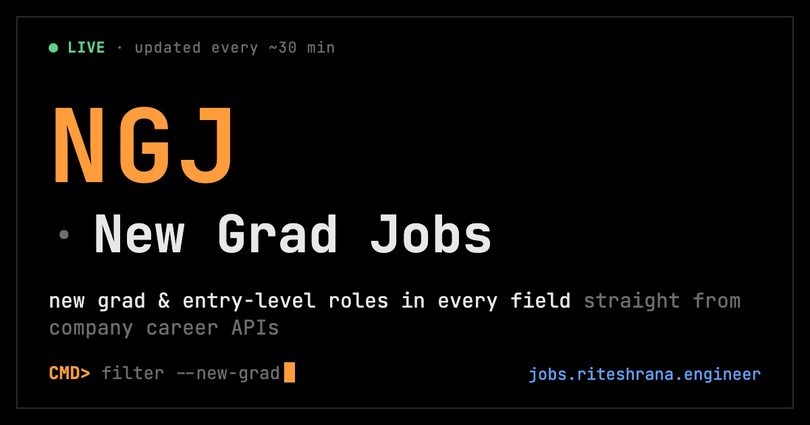

# 2026 New Grad Positions

**Fully automated** list of entry-level positions for 2025–2027 new graduates: software, data, engineering, finance, marketing, sales, healthcare and every other field, pulled straight from company career sites.

Unlike manually curated lists, this repository pulls directly from configured company APIs and refreshes **about every 30 minutes**, 24/7.

**[Open the live board →](https://jobs.riteshrana.engineer/)** · [Browse by role, company, city](https://jobs.riteshrana.engineer/jobs/) · [Guides](https://jobs.riteshrana.engineer/guides/) · [RSS alerts](https://jobs.riteshrana.engineer/feed.xml) · [How it works](https://jobs.riteshrana.engineer/about/)

**Contribute** by submitting an [issue](https://github.com/ambicuity/New-Grad-Jobs/issues/new/choose). See the [contribution guidelines](CONTRIBUTING.md) to get started.

> [!NOTE]
> **Solo-Maintained Project.** This repository is maintained by one person in spare time.
> PRs are reviewed within **1–2 weeks**. Bug fixes take priority over feature requests.
> Before opening an issue, read [SUPPORT.md](.github/SUPPORT.md).

---

## **Website & Autofill Extension**

Explore Zapply’s website and check out:
- Our Chrome extension, which autofills job applications in seconds.
- A dedicated job board featuring the latest openings across various roles.
- User accounts with multiple profiles for different resume types and roles.
- Job application tracking with streaks and commitment awards.

Experience an advanced career journey with us! 🚀

Sponsored by Zapply

---

## Sponsored by [Tailr](https://www.tailr.uk)

**[Tailr](https://www.tailr.uk) rewrites your résumé for each job posting and shows you the ATS match score** — so you stop getting auto-filtered by the same generic résumé. Free 10/day, no card required. This project is proudly sponsored by Tailr.

---

<!-- COUNTS:START - counts below are auto-synced from the scraper output jobs.json by scripts/sync_readme_counts.py -->
## Browse <!-- COUNT:total -->8338<!-- /COUNT --> Jobs by Category

| Category | Open Roles |
|----------|-----------:|
| [Software Engineering](#software-engineering) | <!-- COUNT:software_engineering -->1936<!-- /COUNT --> |
| [Frontend Engineering](#frontend-engineering) | <!-- COUNT:frontend -->28<!-- /COUNT --> |
| [Backend Engineering](#backend-engineering) | <!-- COUNT:backend -->41<!-- /COUNT --> |
| [Mobile Engineering](#mobile-engineering) | <!-- COUNT:mobile -->23<!-- /COUNT --> |
| [Security Engineering](#security-engineering) | <!-- COUNT:security -->212<!-- /COUNT --> |
| [Data Science & ML](#data-science--ml) | <!-- COUNT:data_ml -->304<!-- /COUNT --> |
| [Data Engineering](#data-engineering) | <!-- COUNT:data_engineering -->194<!-- /COUNT --> |
| [Data Analyst](#data-analyst) | <!-- COUNT:data_analyst -->36<!-- /COUNT --> |
| [Infrastructure & SRE](#infrastructure--sre) | <!-- COUNT:infrastructure_sre -->444<!-- /COUNT --> |
| [Product Management](#product-management) | <!-- COUNT:product_management -->19<!-- /COUNT --> |
| [Project Management](#project-management) | <!-- COUNT:project_management -->62<!-- /COUNT --> |
| [Quantitative Finance](#quantitative-finance) | <!-- COUNT:quant_finance -->21<!-- /COUNT --> |
| [Hardware Engineering](#hardware-engineering) | <!-- COUNT:hardware -->236<!-- /COUNT --> |
| [Engineering and Development](#engineering-and-development) | <!-- COUNT:engineering -->1128<!-- /COUNT --> |
| [Creatives and Design](#creatives-and-design) | <!-- COUNT:design -->47<!-- /COUNT --> |
| [Business Analyst](#business-analyst) | <!-- COUNT:business_analyst -->323<!-- /COUNT --> |
| [Marketing](#marketing) | <!-- COUNT:marketing -->74<!-- /COUNT --> |
| [Sales](#sales) | <!-- COUNT:sales -->723<!-- /COUNT --> |
| [Accounting and Finance](#accounting-and-finance) | <!-- COUNT:accounting_finance -->323<!-- /COUNT --> |
| [Consulting](#consulting) | <!-- COUNT:consulting -->144<!-- /COUNT --> |
| [Human Resources](#human-resources) | <!-- COUNT:human_resources -->132<!-- /COUNT --> |
| [Legal and Compliance](#legal-and-compliance) | <!-- COUNT:legal -->58<!-- /COUNT --> |
| [Customer Service and Support](#customer-service-and-support) | <!-- COUNT:customer_support -->176<!-- /COUNT --> |
| [Supply Chain](#supply-chain) | <!-- COUNT:supply_chain -->257<!-- /COUNT --> |
| [Healthcare](#healthcare) | <!-- COUNT:healthcare -->653<!-- /COUNT --> |
| [Education and Training](#education-and-training) | <!-- COUNT:education -->52<!-- /COUNT --> |
| [Public Sector and Government](#public-sector-and-government) | <!-- COUNT:public_sector -->26<!-- /COUNT --> |
| [Arts and Entertainment](#arts-and-entertainment) | <!-- COUNT:arts_entertainment -->2<!-- /COUNT --> |
| [Management and Executive](#management-and-executive) | <!-- COUNT:management -->124<!-- /COUNT --> |
| [Other](#other) | <!-- COUNT:other -->540<!-- /COUNT --> |
<!-- COUNTS:END -->

---

<!-- CATEGORY-LISTINGS:START - auto-generated from the scraper output jobs.json by scripts/sync_readme_jobs.py; do not edit by hand -->

> **Live listings** — the 10 most recently posted roles per category, refreshed about every 30 minutes. Browse and filter all **8,338** live roles on the **[live job board](https://jobs.riteshrana.engineer/)**.

## Software Engineering

[Back to top](#2026-new-grad-positions)

| Company | Role | Location | Posted | Apply |
|---------|------|----------|--------|-------|
| Eurofins | Manufacturing QA Associate \(2nd Shift\) | Sanford, NC, United States | Today | [Apply](<https://jobs.smartrecruiters.com/Eurofins/744000160071823>) |
| Rivian and Volkswagen Group Technologies | Software Engineer II, Vehicle Data Services | Vancouver, British Columbia, Canada | Today | [Apply](<https://jobs.ashbyhq.com/rivianvw.tech/840928b2-010b-413b-b614-edf7f01dbc4c>) |
| Trinzic | Job Posting Title Jr. Systems Engineer \(Digital Engineering Process Support\) | Chantilly, Virginia | Today | [Apply](<https://trinzic.wd115.myworkdayjobs.com/Trinzic_Careers/job/Chantilly-Virginia/Job-Posting-Title-Jr-Systems-Engineer--Digital-Engineering-Process-Support-_R3001288>) |
| Trinzic | Software Developer / Full Stack Engineer NSIC | Beavercreek Township, Ohio | Today | [Apply](<https://trinzic.wd115.myworkdayjobs.com/Trinzic_Careers/job/Beavercreek-Township-Ohio/Software-Developer---Full-Stack-Engineer-NSIC_R3001075>) |
| Raytheon | Software Engineer II, Secret Clearance | US-CA-EL SEGUNDO-R01 ~ 2000 E Imperial Hwy ~ BLDG R01 | Today | [Apply](<https://globalhr.wd5.myworkdayjobs.com/REC_RTX_Ext_Gateway/job/US-CA-EL-SEGUNDO-R01--2000-E-Imperial-Hwy--BLDG-R01/Software-Engineer-II--Secret-Clearance_01860188-1>) |
| KLA | Software Engineer II \(Distributed / Scalable Systems\) | Milpitas, CA | Today | [Apply](<https://kla.wd1.myworkdayjobs.com/Search/job/Milpitas-CA/Software-Engineer-II--Distributed---Scalable-Systems-_2636655-1>) |
| Cisco | Technical Systems Engineer II \(Full-Time\) - United States | RTP, North Carolina, US | Today | [Apply](<https://cisco.wd5.myworkdayjobs.com/Cisco_Careers/job/RTP-North-Carolina-US/Technical-Systems-Engineer-II--Full-Time----United-States_2026274>) |
| Leidos | Systems Engineer | Huntsville, AL | Today | [Apply](<https://leidos.wd5.myworkdayjobs.com/External/job/Huntsville-AL/Systems-Engineer_R-00193347>) |
| Raytheon | Software Engineer II, Onsite | US-CA-FULLERTON-675 ~ 1801 Hughes Dr ~ BLDG 675 | Today | [Apply](<https://globalhr.wd5.myworkdayjobs.com/REC_RTX_Ext_Gateway/job/US-CA-FULLERTON-675--1801-Hughes-Dr--BLDG-675/Software-Engineer-II--Onsite_01867647>) |
| American Express | Software Engineer I | Sunrise, FL, United States | Today | [Apply](<https://egug.fa.us2.oraclecloud.com/hcmUI/CandidateExperience/en/sites/CX_1/job/26016174>) |

**[View all 1,936 Software Engineering roles on the live board](https://jobs.riteshrana.engineer/)**

## Frontend Engineering

[Back to top](#2026-new-grad-positions)

| Company | Role | Location | Posted | Apply |
|---------|------|----------|--------|-------|
| CarGurus | Software Development Engineer II, Front End | Boston, Massachusetts, United States | Today | [Apply](<https://careers.cargurus.com/us/en/job/8204313?gh_jid=8204313>) |
| Ramp | Software Engineer, Frontend | New York City, NY, USA | 1 day ago | [Apply](<https://jobs.ashbyhq.com/ramp/6511d68f-b65d-4499-962f-7e2f75eabe3f>) |
| State of Illinois | Web Developer / Information Systems Analyst I, Option W | Springfield, IL, United States | 1 day ago | [Apply](<https://illinois.jobs2web.com/job/Springfield-Web-Developer-Information-Systems-Analyst-I%2C-Option-W-IL-62703/1437439100/>) |
| Relativity Space | Software Engineer II, Front-End Platforms | Long Beach, California, United States | 2 days ago | [Apply](<https://boards.greenhouse.io/relativity/jobs/8929521002?gh_jid=8929521002>) |
| General Dynamics | Front-End Software Engineer- TS/SCI with Polygraph | USA VA Chantilly | 3 days ago | [Apply](<https://gdit.wd5.myworkdayjobs.com/External_Career_Site/job/USA-VA-Chantilly/Front-End-Software-Engineer--TS-SCI-with-Polygraph_RQ230792-2>) |
| CACI | Front End Software Developer | Sterling, VA, US; Denver, CO, US | 2026-10-30 | [Apply](<https://caci.wd1.myworkdayjobs.com/External/job/Sterling-VA-US/Front-End-Software-Developer_334352>) |
| Mitel | Junior Full Stack Web Developer | Ottawa, ON, CA | 2026-10-30 | [Apply](<https://ca.indeed.com/viewjob?jk=478a0a405687a430>) |
| Amentum | Junior Web Developer | US-VA-Dahlgren | 2026-10-27 | [Apply](<https://pae.wd1.myworkdayjobs.com/Amentum_Careers/job/US-VA-Dahlgren/Junior-Web-Developer_R0172603>) |
| Roblox | Software Engineer, Frontend - Economy | San Mateo, CA, United States | 2026-10-26 | [Apply](<https://careers.roblox.com/jobs/8259453?gh_jid=8259453>) |
| Tenet3 | Junior Frontend Software Engineer- Hybrid | Dayton, Ohio | 2026-10-19 | [Apply](<https://job-boards.greenhouse.io/tenet3/jobs/8894846002>) |

**[View all 28 Frontend Engineering roles on the live board](https://jobs.riteshrana.engineer/)**

## Backend Engineering

[Back to top](#2026-new-grad-positions)

| Company | Role | Location | Posted | Apply |
|---------|------|----------|--------|-------|
| Cisco | Software Engineer Full Stack / Backend I \(Full Time\) - United States | Austin, Texas, US; Houston, Texas, US; Charleston, West Virginia, US; Denver, Colorado, US; Irvine, California, US; Knoxville, Tennessee, US; Nashville, Tennessee, US; Chicago, Illinois, US; Philadelphia, Pennsylvania, US; Phoenix, Arizona, US; Boise, Idaho, US; Carlsbad, California, US; San Diego, California, US; RTP, North Carolina, US; Dallas, Texas, US; Atlanta, Georgia, US; Costa Mesa, California, US; Boca Raton, Florida, US; Miami, Florida, US; Tampa, Florida, US; Plano, Texas, US; Coral Gables, Florida, US; Colorado Springs, Colorado, US | 1 day ago | [Apply](<https://cisco.wd5.myworkdayjobs.com/Cisco_Careers/job/Austin-Texas-US/Software-Engineer-Full-Stack---Backend-I--Full-Time----United-States_2028784>) |
| Vercel | Software Engineer, Backend | Hybrid - San Francisco, New York City | 1 day ago | [Apply](<https://job-boards.greenhouse.io/vercel/jobs/6195153004>) |
| Palantir | Backend Software Engineer - Data Connectors | New York, NY | 1 day ago | [Apply](<https://jobs.lever.co/palantir/9aadca04-df88-4b46-95d8-c3b2628b30b0>) |
| Lyft | Software Engineer, Backend | Toronto, Canada | 2 days ago | [Apply](<https://app.careerpuck.com/job-board/lyft/job/8927268002?gh_jid=8927268002>) |
| Toast | Software Engineer II, Backend | Remote US | 2 days ago | [Apply](<https://careers.toasttab.com/jobs?gh_jid=8334794>) |
| Verkada | Backend Software Engineer - University Graduate 2027 | San Mateo, CA United States | 3 days ago | [Apply](<https://job-boards.greenhouse.io/verkada/jobs/5280545007>) |
| Steampunk | Backend Software Engineer | McLean, VA, United States | 4 days ago | [Apply](<https://careers-steampunk.icims.com/jobs/7739/job>) |
| Steampunk | Backend Software Engineer | McLean, VA, United States | 4 days ago | [Apply](<https://careers-steampunk.icims.com/jobs/8237/job>) |
| Steampunk | Backend Software Engineer | McLean, VA, United States | 4 days ago | [Apply](<https://careers-steampunk.icims.com/jobs/7737/job>) |
| Mastercard | Software Engineer II \(Backend \_ Java\) | Vancouver, Canada | 2026-10-23 | [Apply](<https://mastercard.wd1.myworkdayjobs.com/CorporateCareers/job/Vancouver-Canada/Software-Engineer-II--Backend---Java-_R-291663>) |

**[View all 41 Backend Engineering roles on the live board](https://jobs.riteshrana.engineer/)**

## Mobile Engineering

[Back to top](#2026-new-grad-positions)

| Company | Role | Location | Posted | Apply |
|---------|------|----------|--------|-------|
| Uber | Software Engineer II, iOS- Maps Mobile Platform | San Francisco, CA, United States | Today | [Apply](<https://iaziqy.fa.ocs.oraclecloud.com/hcmUI/CandidateExperience/en/sites/UberCareers/job/303601>) |
| BJAK | iOS Software Engineer | India, India, India | 1 day ago | [Apply](<https://jobs.ashbyhq.com/bjakcareer/ac327c66-652f-402f-985a-43a2b576dc16>) |
| BJAK | Android Software Engineer | India, India, India | 1 day ago | [Apply](<https://jobs.ashbyhq.com/bjakcareer/22126fc1-876b-4486-a879-7f2b506aecca>) |
| Uber | Software Engineer II- Android | Hyderabad, Telangana, India | 1 day ago | [Apply](<https://iaziqy.fa.ocs.oraclecloud.com/hcmUI/CandidateExperience/en/sites/UberCareers/job/303371>) |
| BJAK | Android Software Engineer - AI Neobank App | India, India, India | 1 day ago | [Apply](<https://jobs.ashbyhq.com/bjakcareer/82349fdc-fc80-4da1-a39e-1f70dee09ba5>) |
| BJAK | Android Software Engineer - AI Neobank App | United States, United States, United States | 1 day ago | [Apply](<https://jobs.ashbyhq.com/bjakcareer/6cd46335-dae2-40e1-807a-b8f2dc18f618>) |
| Cisco | Software Engineer- Software Test Engineer – IOS XR / Python Automation / L0/L1 Optical Testing 8 - 10 years | Bangalore, India | 2 days ago | [Apply](<https://cisco.wd5.myworkdayjobs.com/Cisco_Careers/job/Bangalore-India/Software-Engineer--Software-Test-Engineer---IOS-XR---Python-Automation---L0-L1-Optical-Testing-8---10-years_2027016-1>) |
| Mozilla Corporation | iOS Software Engineer | Remote, CA | 2 days ago | [Apply](<https://ca.indeed.com/viewjob?jk=ebffc4c4a22c6544>) |
| Uber | Software Engineer II - Android | Seattle, WA, United States | 3 days ago | [Apply](<https://iaziqy.fa.ocs.oraclecloud.com/hcmUI/CandidateExperience/en/sites/UberCareers/job/302639>) |
| BJAK | iOS Software Engineer | United States, United States, United States | 2026-10-26 | [Apply](<https://jobs.ashbyhq.com/bjakcareer/b22150b6-5fa7-4842-b501-e5322f2f75b3>) |

**[View all 23 Mobile Engineering roles on the live board](https://jobs.riteshrana.engineer/)**

## Security Engineering

[Back to top](#2026-new-grad-positions)

| Company | Role | Location | Posted | Apply |
|---------|------|----------|--------|-------|
| Arcarithm | Cyber Engineer - Level 2 | Huntsville, AL, US | Today | [Apply](<https://workforcenow.adp.com/mascsr/default/mdf/recruitment/recruitment.html?cid=2ac19c2c-cd24-4fd1-8ab6-b1d93b864c78&jobId=544840>) |
| Lawrence Livermore National Laboratory | Center for Global Security Research \(CGSR\) Undergraduate Research Associate - Summer 2027 | Livermore, CA, United States | Today | [Apply](<https://jobs.smartrecruiters.com/LLNL/3743990016680716>) |
| Lawrence Livermore National Laboratory | Center for Global Security Research \(CGSR\) Graduate Research Associate - Summer 2027 | Livermore, CA, United States | Today | [Apply](<https://jobs.smartrecruiters.com/LLNL/3743990016680626>) |
| Booz Allen Hamilton | Cybersecurity Analyst, Junior | Rome, NY | Today | [Apply](<https://bah.wd1.myworkdayjobs.com/BAH_Jobs/job/Rome-NY/Cybersecurity-Analyst--Junior_R0253089>) |
| Agile Defense | Baseline Security Engineer | Remote | Today | [Apply](<https://jobs.lever.co/agile-defense/cbb72a7a-ad5d-42f7-a8ba-742f1a6df0ba>) |
| AMD | AI Platform Security Engineer | San Diego, California | Today | [Apply](<https://careers.amd.com/jobs/96095>) |
| Check Point Software Technologies | Security Engineer | Remote, Minneapolis, MN, United States | Today | [Apply](<https://jobs.smartrecruiters.com/CheckPointSoftwareTechnologies2/744000159880584>) |
| Check Point Software Technologies | Security Engineer | Remote, New York, NY, United States | Today | [Apply](<https://jobs.smartrecruiters.com/CheckPointSoftwareTechnologies2/744000159879933>) |
| Citi | Security and Derivatives Intermediate Associate Analyst | Tampa Florida United States | 1 day ago | [Apply](<https://citi.wd5.myworkdayjobs.com/2/job/Tampa-Florida-United-States/Security-and-Derivatives-Intermediate-Associate-Analyst_261000639>) |
| Strive Health | Application Security Engineer | United States | 1 day ago | [Apply](<https://job-boards.greenhouse.io/strivehealth/jobs/4726499006>) |

**[View all 212 Security Engineering roles on the live board](https://jobs.riteshrana.engineer/)**

## Data Science & ML

[Back to top](#2026-new-grad-positions)

| Company | Role | Location | Posted | Apply |
|---------|------|----------|--------|-------|
| The Wonderful Company | Data Scientist, Marketing &amp; eCommerce | Houston, TX, United States | Today | [Apply](<https://jobs.smartrecruiters.com/TheWonderfulCompany/744000160078019>) |
| The Wonderful Company | Data Scientist, Marketing &amp; eCommerce | Minneapolis, MN, United States | Today | [Apply](<https://jobs.smartrecruiters.com/TheWonderfulCompany/744000160077598>) |
| BMO | Data Scientist | Toronto, ON, CAN | Today | [Apply](<https://bmo.wd3.myworkdayjobs.com/External/job/Toronto-ON-CAN/Data-Scientist_R260030675-1>) |
| Reddit | Machine Learning Engineer | San Francisco, CA | Today | [Apply](<https://job-boards.greenhouse.io/reddit/jobs/8349916>) |
| ERG | Early-Career Research Scientist/Engineer- Aerosol &amp; Environmental | Morrisville, NC | Today | [Apply](<https://jobs.lever.co/erg/ffa7e5a8-5d49-4608-a3b0-9a5ff07a3f0a>) |
| SOSi | Machine Learning Engineer - Mid | Huntsville, AL, United States | Today | [Apply](<https://jobs.smartrecruiters.com/SOSi1/3743990016645886>) |
| Bunge | Data Scientist | Chesterfield, MO -, United States | 1 day ago | [Apply](<https://jobs.bunge.com/job/Chesterfield-Data-Scientist-MO-63017/1424973733/>) |
| USDA Food Safety and Inspection Service | Data Scientist | Fort Collins, CO, US | 1 day ago | [Apply](<https://www.indeed.com/viewjob?jk=e60449f01ccb21df>) |
| Michelin | Data Scientist | Pune | 1 day ago | [Apply](<https://michelinhr.wd3.myworkdayjobs.com/Michelin/job/Pune/Data-Scientist_R-2026039927-1>) |
| Bank of America | Data Scientist I | Charlotte, NC, US | 1 day ago | [Apply](<https://www.indeed.com/viewjob?jk=637b73cd2a327b69>) |

**[View all 304 Data Science & ML roles on the live board](https://jobs.riteshrana.engineer/)**

## Data Engineering

[Back to top](#2026-new-grad-positions)

| Company | Role | Location | Posted | Apply |
|---------|------|----------|--------|-------|
| Eli Lilly | LillyDirect Pharmacy Data Engineer | US, Indianapolis IN | Today | [Apply](<https://lilly.wd115.myworkdayjobs.com/lly/job/US-Indianapolis-IN/LillyDirect-Pharmacy-Data-Engineer_R-114363>) |
| Bristol Myers Squibb | Data Engineer, Clinical Operations | Princeton - NJ - US | Today | [Apply](<https://bristolmyerssquibb.wd5.myworkdayjobs.com/BMS/job/Princeton---NJ---US/Data-Engineer--Clinical-Operations_R1608237-1>) |
| SBT Global | Azure Cloud Data Engineer\(Korean Bilingual\) | Irvine, CA, United States | Today | [Apply](<https://jobs.smartrecruiters.com/SBTGlobalInc/3743990016678386>) |
| Eurofins | GMP Data Review Associate | Columbia, MO, United States | Today | [Apply](<https://jobs.smartrecruiters.com/Eurofins/744000159963919>) |
| City of Philadelphia | Data Engineer-Integration Specialist | Philadelphia, PA, United States | Today | [Apply](<https://jobs.smartrecruiters.com/CityofPhiladelphia/744000159941284>) |
| City of New York | Data Engineer, Bureau of Data Technology &amp; Strategy | Long Island City, NY, United States | Today | [Apply](<https://jobs.smartrecruiters.com/CityOfNewYork/3743990016644656>) |
| New York City Department of Health and Mental Hygiene | Data Engineer, Bureau of Data Technology &amp; Strategy | Queens, NY, US | 1 day ago | [Apply](<https://www.indeed.com/viewjob?jk=2d218e68a7514f33>) |
| Unknown | Data Applications Systems Analyst II | NC, US | 1 day ago | [Apply](<https://www.indeed.com/viewjob?jk=0e33f9f7d529b4d3>) |
| Meridian Systematics | Junior Data Engineer | Springfield, VA, US | 1 day ago | [Apply](<https://www.indeed.com/viewjob?jk=db7dbb24c273e28a>) |
| ICF | Data Engineer | Reston, VA | 1 day ago | [Apply](<https://icf.wd5.myworkdayjobs.com/ICFExternal_Career_Site/job/Reston-VA/Data-Engineer_R2603342>) |

**[View all 194 Data Engineering roles on the live board](https://jobs.riteshrana.engineer/)**

## Data Analyst

[Back to top](#2026-new-grad-positions)

| Company | Role | Location | Posted | Apply |
|---------|------|----------|--------|-------|
| Walmart | \(USA\) Data Analyst II | \(USA\) Upstream Building AR Bentonville Home Office | Today | [Apply](<https://walmart.wd504.myworkdayjobs.com/WalmartExternal/job/USA-Upstream-Building-AR-Bentonville-Home-Office/XMLNAME--USA--Data-Analyst-II_R-2676293>) |
| General Dynamics | Data Analyst Associate - TS/SCI with Polygraph | USA VA Chantilly | 1 day ago | [Apply](<https://gdit.wd5.myworkdayjobs.com/External_Career_Site/job/USA-VA-Chantilly/Systems-Engineer-Associate---TS-SCI-with-Polygraph_RQ231817>) |
| CORE Foodservice | Client Data Analyst II | Remote, Dallas, TX, United States | 1 day ago | [Apply](<https://eczy.fa.us2.oraclecloud.com/hcmUI/CandidateExperience/en/sites/CX_1/job/38906>) |
| Sony | Associate Data Analyst | San Diego | 1 day ago | [Apply](<https://sonyglobal.wd1.myworkdayjobs.com/SonyGlobalCareers/job/San-Diego/Associate-Data-Analyst_JR-119868>) |
| Precision Medicine Group | Sales Operations and Analytics Associate | Remote, United States | 1 day ago | [Apply](<https://job-boards.greenhouse.io/precisionmedicinegroup/jobs/6240955004>) |
| Health Net | Data Analyst II, Provider Analytics | Washington, DC, US | 2 days ago | [Apply](<https://www.indeed.com/viewjob?jk=0ae130dfa1bb96af>) |
| Ameresco | Data Analyst I | Calgary, AB, CA | 3 days ago | [Apply](<https://ca.indeed.com/viewjob?jk=5b20c7c908cee868>) |
| Smithfield Foods | Career Foundation Program \(CFP\) - Data Analytics - May/Spring 2027 Graduates | Smithfield, VA, US | 3 days ago | [Apply](<https://www.indeed.com/viewjob?jk=8b6940e704de2185>) |
| Snap-on | Business Intelligence Analyst I | Kenosha, WI, United States | 3 days ago | [Apply](<https://careers-snapon.icims.com/jobs/20919/job>) |
| MAPFRE | Business Intelligence Analyst II \(Hybrid - Webster or Boston\) | Webster, MA, United States | 4 days ago | [Apply](<https://jobs.mapfre.com/job/Webster-Business-Intelligence-Analyst-II-%28Hybrid-Webster-or-Boston%29-MA-01570/1413534533/>) |

**[View all 36 Data Analyst roles on the live board](https://jobs.riteshrana.engineer/)**

## Infrastructure & SRE

[Back to top](#2026-new-grad-positions)

| Company | Role | Location | Posted | Apply |
|---------|------|----------|--------|-------|
| SpaceX | Network Engineer \(Starlink Maritime\) | Redmond, WA | Today | [Apply](<https://boards.greenhouse.io/spacex/jobs/8927107002?gh_jid=8927107002>) |
| Samsung | Site Reliability Engineer \(SRE\) | 565 Great Northern Way, Vancouver, Canada | Today | [Apply](<https://sec.wd3.myworkdayjobs.com/Samsung_Careers/job/565-Great-Northern-Way-Vancouver-Canada/Site-Reliability-Engineer--SRE-_R116220>) |
| Boeing | Flight Test Lab Computing Support – Windows System Administrator \(Associate or Experienced\) | USA - Seattle, WA | Today | [Apply](<https://boeing.wd1.myworkdayjobs.com/external_careers/job/USA---Seattle-WA/Flight-Test-Lab-Computing-Support---Windows-System-Administrator--Associate-or-Experienced-_JR2026528883-1>) |
| Boeing | DevOps Developer \(Associate\) | USA - Seal Beach, CA | Today | [Apply](<https://boeing.wd1.myworkdayjobs.com/external_careers/job/USA---Seal-Beach-CA/DevOps-Developer--Associate-_JR2026528876-1>) |
| Accenture | Junior Data Analyst – Adobe Experience Platform &amp; CJA | — | Today | [Apply](<https://accenture.wd103.myworkdayjobs.com/AccentureCareers/job/Malaga-ID6---South-Building/Junior-Data-Analyst---Adobe-Experience-Platform---CJA_14274319>) |
| Mastercard | Site Reliability Engineer I | O'Fallon, Missouri | Today | [Apply](<https://mastercard.wd1.myworkdayjobs.com/CorporateCareers/job/OFallon-Missouri/Site-Reliability-Engineer-I_R-294460>) |
| Mastercard | Site Reliability Engineer I | O'Fallon, Missouri | Today | [Apply](<https://mastercard.wd1.myworkdayjobs.com/CorporateCareers/job/OFallon-Missouri/Site-Reliability-Engineer-I_R-292697-1>) |
| Raytheon | Platform Patch Integration Specialist II \(Onsite\) | US-TX-RICHARDSON-C17 ~ 1717 Cityline Dr ~ CITYLINE C17 | Today | [Apply](<https://globalhr.wd5.myworkdayjobs.com/REC_RTX_Ext_Gateway/job/US-TX-RICHARDSON-C17--1717-Cityline-Dr--CITYLINE-C17/Platform-Patch-Integration-Specialist-II--Onsite-_01882910>) |
| Raytheon | Platform Asset and Incident Strategist II \(Onsite\) | US-TX-RICHARDSON-C17 ~ 1717 Cityline Dr ~ CITYLINE C17 | Today | [Apply](<https://globalhr.wd5.myworkdayjobs.com/REC_RTX_Ext_Gateway/job/US-TX-RICHARDSON-C17--1717-Cityline-Dr--CITYLINE-C17/Platform-Asset-and-Incident-Strategist-II--Onsite-_01882912>) |
| CACI | Junior Network Engineer | Washington, DC, US; Reston, VA, US | Today | [Apply](<https://caci.wd1.myworkdayjobs.com/External/job/Washington-DC-US/Junior-Network-Engineer_334684>) |

**[View all 444 Infrastructure & SRE roles on the live board](https://jobs.riteshrana.engineer/)**

## Product Management

[Back to top](#2026-new-grad-positions)

| Company | Role | Location | Posted | Apply |
|---------|------|----------|--------|-------|
| American Express | Associate Product Manager - TLS | Phoenix, AZ, United States | 1 day ago | [Apply](<https://egug.fa.us2.oraclecloud.com/hcmUI/CandidateExperience/en/sites/CX_1/job/26015980>) |
| Wise | Graduate Analyst | Austin, TX, US | 1 day ago | [Apply](<https://www.indeed.com/viewjob?jk=1c6cf7729f70b491>) |
| Wise Australia Investments | Graduate Analyst | Austin, TX, US | 2026-10-30 | [Apply](<https://www.indeed.com/viewjob?jk=8c7c1cd3b41c7f79>) |
| Lear | Continuous Improvement Specialist I | Flint, MI, United States | 2026-10-29 | [Apply](<https://jobs.lear.com/job/Auburn-Hills-Continuous-Improvement-Specialist-I-MI-48326/1426304733/>) |
| T-Mobile | Associate Product Manager - App | Bellevue, Washington | 2026-10-29 | [Apply](<https://tmobile.wd1.myworkdayjobs.com/External/job/Bellevue-Washington/Associate-Product-Manager---App_REQ373263-1>) |
| Abbott | Associate Product Manager | United States &gt; Madison : 1 Exact Lane | 2026-10-28 | [Apply](<https://abbott.wd5.myworkdayjobs.com/abbottcareers2/job/United-States--Madison--1-Exact-Lane/Associate-Product-Manager_31165659-1>) |
| Abbott | Associate Product Manager | United States &gt; Madison : 1 Exact Lane | 2026-10-28 | [Apply](<https://abbott.wd5.myworkdayjobs.com/abbottcareers2/job/United-States--Madison--1-Exact-Lane/Associate-Product-Manager_31165697>) |
| Supermicro | Associate Product Manager - Key Components | San Jose, Cali, Un | 2026-10-27 | [Apply](<https://jobs.supermicro.com/job/San-Jose-Associate-Product-Manager-Key-Components-Cali/1443917000/>) |
| Copart | Associate Product Manager | San Francisco, CA | 2026-10-23 | [Apply](<https://copart.wd12.myworkdayjobs.com/Copart/job/San-Francisco-CA/Associate-Product-Manager_JR112367>) |
| Avery Dennison | Associate Product Manager, Media Solutions | Remote, Little Rock, AR, United States | 2026-10-21 | [Apply](<https://jobs.smartrecruiters.com/AveryDennison/744000156897969>) |

**[View all 19 Product Management roles on the live board](https://jobs.riteshrana.engineer/)**

## Project Management

[Back to top](#2026-new-grad-positions)

| Company | Role | Location | Posted | Apply |
|---------|------|----------|--------|-------|
| Texas A&amp;M University System | Program Coordinator I | College Station, TX | Today | [Apply](<https://tamus.wd1.myworkdayjobs.com/system-wide_external/job/College-Station-TX/Program-Coordinator-I_R-098063>) |
| State of Florida | PROGRAM ANALYST II - 42002559 | TALLAHASSEE, FL, United States | 1 day ago | [Apply](<https://jobs.myflorida.com/job/TALLAHASSEE-PROGRAM-ANALYST-II-42002559-FL-32301/1448189600/>) |
| Mount Sinai Health System | Project Coordinator I- Environmental Medicine | United States | 1 day ago | [Apply](<https://ejis.fa.us6.oraclecloud.com/hcmUI/CandidateExperience/en/sites/CX/job/3044352>) |
| US Farm Service Agency | County Program Analyst/Trainee | Hines, OR, US | 1 day ago | [Apply](<https://www.indeed.com/viewjob?jk=86ce90c471b4bf80>) |
| Guidehouse | Jr PMO Analyst | US - VA, Arlington | 1 day ago | [Apply](<https://guidehouse.wd1.myworkdayjobs.com/External/job/US---VA-Arlington/Jr-PMO-Analyst_45874>) |
| Mount Sinai Health System | Program Coordinator I - Surgery | United States | 1 day ago | [Apply](<https://ejis.fa.us6.oraclecloud.com/hcmUI/CandidateExperience/en/sites/CX/job/3043783>) |
| Texas A&amp;M University System | Program Coordinator II - Psychiatry Residency | Bryan, TX | 1 day ago | [Apply](<https://tamus.wd1.myworkdayjobs.com/system-wide_external/job/Bryan-TX/Program-Coordinator-II---Psychiatry-Residency_R-096342-1>) |
| Precision Medicine Group | Associate Project Manager, Market Access Marketing | Remote, United States | 1 day ago | [Apply](<https://job-boards.greenhouse.io/precisionmedicinegroup/jobs/6241887004>) |
| Texas A&amp;M University System | Program Coordinator I | College Station, TX | 2 days ago | [Apply](<https://tamus.wd1.myworkdayjobs.com/system-wide_external/job/College-Station-TX/Program-Coordinator-I_R-098496>) |
| Texas A&amp;M University System | Program Coordinator II | San Angelo, TX | 2 days ago | [Apply](<https://tamus.wd1.myworkdayjobs.com/system-wide_external/job/San-Angelo-TX/Program-Coordinator-II_R-097100-1>) |

**[View all 62 Project Management roles on the live board](https://jobs.riteshrana.engineer/)**

## Quantitative Finance

[Back to top](#2026-new-grad-positions)

| Company | Role | Location | Posted | Apply |
|---------|------|----------|--------|-------|
| Duke University | Quantitative Associate | Durham, NC, United States | 1 day ago | [Apply](<https://careers.duke.edu/job/Durham-Quantitative-Associate-NC-27710/1390904000/>) |
| Federal Reserve Bank of Richmond | Discover Program - Technical Analyst - January 2027 Cohort | Richmond, VA, US | 2 days ago | [Apply](<https://www.indeed.com/viewjob?jk=c29034ae0a0080cb>) |
| Havas Group | Strategy Fellowship, February 2027 | New York, NY, US | 2 days ago | [Apply](<https://www.indeed.com/viewjob?jk=f2e3eba0eacf2904>) |
| Harvard University | Research Associate \(Quantitative and/or Qualitative\), Division of Research and Faculty Development | Boston, MA, United States | 3 days ago | [Apply](<https://jobs.smartrecruiters.com/HarvardUniversity/3743990016565976>) |
| Mastercard | Creative Data Strategist \(Associate Managing Consultant\(-1 | Gurgaon, India | 6 days ago | [Apply](<https://mastercard.wd1.myworkdayjobs.com/CorporateCareers/job/Gurgaon-India/Creative-Data-Strategist--Associate-Managing-Consultant--1_R-294084>) |
| First Citizens Bank | Analyst I, Foreign Exchange Middle Office | New York, New York | 6 days ago | [Apply](<https://jobs.firstcitizens.com/jobs/36292>) |
| AQR Capital Management | Research - GSS Product Specialist - Associate | Bengaluru | 6 days ago | [Apply](<https://careers.aqr.com/jobs?gh_jid=8330516&gh_jid=8330516>) |
| Duke University | Laboratory Research Analyst II | Durham, NC, United States | 6 days ago | [Apply](<https://careers.duke.edu/job/Durham-Laboratory-Research-Analyst-II-NC-27710/1435925700/>) |
| NextEra Energy | Valuation Analyst II | Juno Beach, FL, United States | 2026-10-30 | [Apply](<https://jobs.nexteraenergy.com/job/Juno-Beach-Valuation-Analyst-II-FL-33408/1446403700/>) |
| Mastercard | Creative Data Strategist \(Associate Managing Consultant\(-2 | Gurgaon, India | 2026-10-29 | [Apply](<https://mastercard.wd1.myworkdayjobs.com/CorporateCareers/job/Gurgaon-India/Creative-Data-Strategist--Associate-Managing-Consultant--2_R-294085>) |

**[View all 21 Quantitative Finance roles on the live board](https://jobs.riteshrana.engineer/)**

## Hardware Engineering

[Back to top](#2026-new-grad-positions)

| Company | Role | Location | Posted | Apply |
|---------|------|----------|--------|-------|
| Raytheon | Electrical Engineer I, Test Equipment Maintenance Support - 2nd Shift | US-MA-ANDOVER-AN1 ~ 350 Lowell St ~ AN1 ESSEX BLDG | Today | [Apply](<https://globalhr.wd5.myworkdayjobs.com/REC_RTX_Ext_Gateway/job/US-MA-ANDOVER-AN1--350-Lowell-St--AN1-ESSEX-BLDG/Electrical-Engineer-I--Test-Equipment-Maintenance-Support---2nd-Shift_01887653>) |
| Boeing | Electronic and Electrical Design and Analysis Engineer \(Associate or Mid-Level\) | USA - Jackson, MS | Today | [Apply](<https://boeing.wd1.myworkdayjobs.com/external_careers/job/USA---Jackson-MS/Electronic-and-Electrical-Design-and-Analysis-Engineer--Associate-or-Mid-Level-_JR2026525959-1>) |
| Raytheon | FPGA/ Digital Design Engineer I - Onsite | US-MA-TEWKSBURY-TB4 ~ 836 North St ~ INNOVATION BLDG | Today | [Apply](<https://globalhr.wd5.myworkdayjobs.com/REC_RTX_Ext_Gateway/job/US-MA-TEWKSBURY-TB4--836-North-St--INNOVATION-BLDG/FPGA--Digital-Design-Engineer-I---Onsite_01879344>) |
| SpaceX | New Graduate Engineer, Electrical - Satellites \(Starlink\) | Redmond, WA | Today | [Apply](<https://boards.greenhouse.io/spacex/jobs/8931507002?gh_jid=8931507002>) |
| Advanced Energy | Electronic Engineer I | Fort Collins, CO, United States | Today | [Apply](<https://jobs.advanced-energy.com/job/Fort-Collins-Electronic-Engineer-I-CO-80525/1436796100/>) |
| Boeing | Electronic and Electrical Design and Analysis Engineer \(Associate or Mid-Level\) | USA - Dover, DE | 1 day ago | [Apply](<https://boeing.wd1.myworkdayjobs.com/external_careers/job/USA---Dover-DE/Electronic-and-Electrical-Design-and-Analysis-Engineer--Associate-or-Mid-Level-_JR2026522431-2>) |
| MCW Group of Companies | Electrical Designer \(May 2027\) | Toronto, ON, CA | 1 day ago | [Apply](<https://ca.indeed.com/viewjob?jk=546af03bccea225a>) |
| Northrop Grumman | 2027 Associate S/W Embedded Engineer – Sykesville MD | United States-Maryland-Sykesville | 1 day ago | [Apply](<https://ngc.wd1.myworkdayjobs.com/Northrop_Grumman_External_Site/job/United-States-Maryland-Sykesville/XMLNAME-2027-Associate-S-W-Embedded-Engineer---Sykesville-MD_R10258626>) |
| Northrop Grumman | 2027 Associate H/W Electronics Engineer – Sykesville MD | United States-Maryland-Sykesville | 1 day ago | [Apply](<https://ngc.wd1.myworkdayjobs.com/Northrop_Grumman_External_Site/job/United-States-Maryland-Sykesville/XMLNAME-2027-Associate-H-W-Electronics-Engineer---Sykesville-MD_R10258576>) |
| Micron Technology | New College Grad - FAB Engineer | Manassas, VA, US | 1 day ago | [Apply](<https://www.indeed.com/viewjob?jk=348a05cd926081ab>) |

**[View all 236 Hardware Engineering roles on the live board](https://jobs.riteshrana.engineer/)**

## Engineering and Development

[Back to top](#2026-new-grad-positions)

| Company | Role | Location | Posted | Apply |
|---------|------|----------|--------|-------|
| AbbVie | Manufacturing Technician I, MD Fill - B2 Shift | Waco, TX, United States | Today | [Apply](<https://jobs.smartrecruiters.com/AbbVie/3743990016682106>) |
| AVL | Project Engineer II - Design | Offsite in Michigan, MI, United States | Today | [Apply](<https://jobs.avl.com/job/Plymouth-Project-Engineer-II-Design-MI/1425388633/>) |
| The University of Texas at Austin | Research Engineering/ Scientist Associate I | AUSTIN, TX | Today | [Apply](<https://utaustin.wd1.myworkdayjobs.com/UTstaff/job/AUSTIN-TX/Research-Engineering--Scientist-Associate-I_R_00049793>) |
| Johnson &amp; Johnson | Manufacturing Technician II \(Night Shift\) | Jacksonville, Florida, United States of America | Today | [Apply](<https://jj.wd5.myworkdayjobs.com/JJ/job/Jacksonville-Florida-United-States-of-America/Manufacturing-Technician-II--Night-Shift-_R-108426>) |
| The University of Texas at Austin | Research Engineering/ Scientist Associate I | AUSTIN, TX | Today | [Apply](<https://utaustin.wd1.myworkdayjobs.com/UTstaff/job/AUSTIN-TX/Research-Engineering--Scientist-Associate-I_R_00049835>) |
| Northrop Grumman | 2027 Associate Engineer / Engineer Aeronautical - WAFB MO | United States-Missouri-Whiteman AFB | Today | [Apply](<https://ngc.wd1.myworkdayjobs.com/Northrop_Grumman_External_Site/job/United-States-Missouri-Whiteman-AFB/XMLNAME-2027-Associate-Engineer---Engineer-Aeronautical---WAFB-MO_R10259630>) |
| Northrop Grumman | Associate Manufacturing Engineer | United States-California-Palmdale | Today | [Apply](<https://ngc.wd1.myworkdayjobs.com/Northrop_Grumman_External_Site/job/United-States-California-Palmdale/Associate-Manufacturing-Engineer_R10259305>) |
| Raytheon | Software Systems Quality Engineer II - Huntsville, AL | US-AL-HUNTSVILLE-315 ~ 315 Bob Heath Dr ~ BOB HEATH | Today | [Apply](<https://globalhr.wd5.myworkdayjobs.com/REC_RTX_Ext_Gateway/job/US-AL-HUNTSVILLE-315--315-Bob-Heath-Dr--BOB-HEATH/Software-Systems-Quality-Engineer-II---Huntsville--AL_01887697>) |
| GE Aerospace | Junior Engineer- Quality | Pune | Today | [Apply](<https://geaerospace.wd5.myworkdayjobs.com/GE_ExternalSite/job/Pune/Junior-Engineer--Quality_R5041418-1>) |
| Raytheon | Mechanical Engineer I \(Onsite\) | US-CA-EL SEGUNDO-E01 ~ 2000 E El Segundo Blvd ~ BLDG E01 | Today | [Apply](<https://globalhr.wd5.myworkdayjobs.com/REC_RTX_Ext_Gateway/job/US-CA-EL-SEGUNDO-E01--2000-E-El-Segundo-Blvd--BLDG-E01/Mechanical-Engineer-I--Onsite-_01886494>) |

**[View all 1,128 Engineering and Development roles on the live board](https://jobs.riteshrana.engineer/)**

## Creatives and Design

[Back to top](#2026-new-grad-positions)

| Company | Role | Location | Posted | Apply |
|---------|------|----------|--------|-------|
| Fivetran | Product Designer II | Oakland, California, United States, AMER | Today | [Apply](<https://www.fivetran.com/careers/job?gh_jid=8040639003>) |
| Arcadis | Junior Interior Designer - Workplace Interiors | United States | 1 day ago | [Apply](<https://ebcs.fa.em2.oraclecloud.com/hcmUI/CandidateExperience/en/sites/CX_1/job/45426>) |
| Trinzic | Associate Instructional Systems Designer \(ISD\) / Learning &amp; Development Specialist | Chantilly, Virginia | 1 day ago | [Apply](<https://trinzic.wd115.myworkdayjobs.com/Trinzic_Careers/job/Chantilly-Virginia/Associate-Instructional-Systems-Designer--ISD----Learning---Development-Specialist_R3001279>) |
| WSP | Early Career Technician - Design Support | Baton Rouge, LA, United States | 1 day ago | [Apply](<https://emit.fa.ca3.oraclecloud.com/hcmUI/CandidateExperience/en/sites/CX_2001/job/98954>) |
| WSP | Junior Technical Graphic Designer | Pittsburgh, PA, United States | 2 days ago | [Apply](<https://emit.fa.ca3.oraclecloud.com/hcmUI/CandidateExperience/en/sites/CX_2001/job/98833>) |
| Electronic Arts | Associate Quality Designer - EA SPORTS FC | Vancouver, BC, CA | 2 days ago | [Apply](<https://ca.indeed.com/viewjob?jk=017e14b6d92f0ee3>) |
| Egis Group | Junior Highway Designer | Calgary, AB, CA | 2 days ago | [Apply](<https://ca.indeed.com/viewjob?jk=ec718e4a699b2b27>) |
| Two Six Technologies | Junior Product Designer | Arlington, VA, US | 2 days ago | [Apply](<https://www.indeed.com/viewjob?jk=220b25b25266e039>) |
| KD DISPLAYS | Junior Industrial Designer | Mississauga, ON, CA | 3 days ago | [Apply](<https://ca.indeed.com/viewjob?jk=a19a4023c971aa68>) |
| Vantor | Junior UI/UX Designer \(Secret\) | Herndon, VA, US | 3 days ago | [Apply](<https://www.indeed.com/viewjob?jk=d5799a6d7e8c48e7>) |

**[View all 47 Creatives and Design roles on the live board](https://jobs.riteshrana.engineer/)**

## Business Analyst

[Back to top](#2026-new-grad-positions)

| Company | Role | Location | Posted | Apply |
|---------|------|----------|--------|-------|
| Accenture Federal Services | ServiceNow Business Analyst | Washington, DC | Today | [Apply](<https://boards.greenhouse.io/accenturefederalservices/jobs/4727787006?gh_jid=4727787006>) |
| Capital One | Associate, Strategy Analyst - New Grad 2027 | Toronto, ON | Today | [Apply](<https://capitalone.wd12.myworkdayjobs.com/Capital_One/job/Toronto-ON/Associate--Strategy-Analyst---New-Grad-2027_R242577-1>) |
| Mastercard | Associate Analyst, Customer Operational Excellence | Gurgaon, India | Today | [Apply](<https://mastercard.wd1.myworkdayjobs.com/CorporateCareers/job/Gurgaon-India/Associate-Analyst--Insights---Enablement_R-293097>) |
| London Stock Exchange Group | Business Analyst | IND-Bangalore-A, RMZ Infinity | Today | [Apply](<https://lseg.wd3.myworkdayjobs.com/Careers/job/IND-Bangalore-A-RMZ-Infinity/Business-Analyst_R0121107-1>) |
| Amentum | Junior All Source Analyst | US-FL-Tampa | Today | [Apply](<https://pae.wd1.myworkdayjobs.com/Amentum_Careers/job/US-FL-Tampa/Junior-All-Source-Analyst_R0174832>) |
| London Stock Exchange Group | Associate Content Analyst | IND-Bangalore-TowerE,RMZ Infin | Today | [Apply](<https://lseg.wd3.myworkdayjobs.com/Careers/job/IND-Bangalore-TowerERMZ-Infin/Associate-Content-Analyst_R0124692>) |
| Raytheon | ServiceNow Business Analyst | US-OR-REMOTE | Today | [Apply](<https://globalhr.wd5.myworkdayjobs.com/REC_RTX_Ext_Gateway/job/US-OR-REMOTE/ServiceNow-Business-Analyst_01886259>) |
| Raytheon | Junior Network Administrator, Analyst, Tucson, AZ – Onsite \(3 openings\) | US-AZ-TUCSON-801 ~ 1151 E Hermans Rd ~ BLDG 801 \(External Site\) | Today | [Apply](<https://globalhr.wd5.myworkdayjobs.com/REC_RTX_Ext_Gateway/job/US-AZ-TUCSON-801--1151-E-Hermans-Rd--BLDG-801-External-Site/Junior-Network-Administrator--Analyst--Tucson--AZ---Onsite--3-openings-_01868078>) |
| Invesco | Junior Analyst \(Financials\) – US Core &amp; Dividend | New York, New York | Today | [Apply](<https://invesco.wd1.myworkdayjobs.com/IVZ/job/New-York-New-York/Junior-Analyst--Financials----US-Core---Dividend_R-15899>) |
| CU\*Answers | Business Analyst | Grand Rapids, MI, USA | Today | [Apply](<https://recruiting.paylocity.com/Recruiting/Jobs/Details/4551568>) |

**[View all 323 Business Analyst roles on the live board](https://jobs.riteshrana.engineer/)**

## Marketing

[Back to top](#2026-new-grad-positions)

| Company | Role | Location | Posted | Apply |
|---------|------|----------|--------|-------|
| Pfizer | Pfizer CentreOne Commercial Development &amp; Marketing Associate | United States - New York - New York City, United States of America; Global Any Pfizer Site | Today | [Apply](<https://pfizer.wd1.myworkdayjobs.com/PfizerCareers/job/United-States---New-York---New-York-City/Pfizer-CentreOne-Commercial-Development---Marketing-Associate_4966454-1>) |
| Cisco | Amplify Marketing Specialist I \(Full-Time\) - United States | RTP, North Carolina, US; Austin, Texas, US | Today | [Apply](<https://cisco.wd5.myworkdayjobs.com/Cisco_Careers/job/RTP-North-Carolina-US/Amplify-Marketing-Specialist-I--Full-Time----United-States_2028440>) |
| Verkada | Channel Marketing Associate | Denver, CO United States | Today | [Apply](<https://job-boards.greenhouse.io/verkada/jobs/5280624007>) |
| M3 USA | Digital Marketing Associate \(Remote\) | Remote, Fort Washington, PA, United States | Today | [Apply](<https://jobs.smartrecruiters.com/M3USA/744000159908724>) |
| EY | CBS-BMC-Communications and Engagement - Communications Support - Supervising Associate | KL, IN | 1 day ago | [Apply](<https://in.indeed.com/viewjob?jk=90a4bb344fcc1c55>) |
| Phillips 66 | Advisor II, Volumetric Accounting - Marketing | Houston, TX, United States | 1 day ago | [Apply](<https://careers.phillips66.com/job/Bartlesville-Advisor-II%2C-Volumetric-Accounting-Marketing-OK-74004/1448374300/>) |
| GuidePoint Security | Associate Marketing Coordinator \(San Jose\) | San Jose, CA | 1 day ago | [Apply](<https://boards.greenhouse.io/guidepointsecurity/jobs/6242631004?gh_jid=6242631004>) |
| Triple J | Marketing Associate | Tamuning, GU, US | 2 days ago | [Apply](<https://www.indeed.com/viewjob?jk=086f83a7f5a9c155>) |
| Wildlife Conservation Society | Marketing Associate | Remote, US | 2 days ago | [Apply](<https://www.indeed.com/viewjob?jk=04619288ace98c06>) |
| Kirtilal Kalidas Jewellers Pvt. Ltd. | Digital Marketing Trainee | TN, IN | 2 days ago | [Apply](<https://in.indeed.com/viewjob?jk=08467a69cc034891>) |

**[View all 74 Marketing roles on the live board](https://jobs.riteshrana.engineer/)**

## Sales

[Back to top](#2026-new-grad-positions)

| Company | Role | Location | Posted | Apply |
|---------|------|----------|--------|-------|
| Verizon | Retail Sales Associate | 2000 Gunbarrel RD, Chattanooga, Tennessee | Today | [Apply](<https://verizon.wd12.myworkdayjobs.com/verizon-careers/job/2000-Gunbarrel-RD-Chattanooga-Tennessee/Retail-Sales-Associate_R-1103473>) |
| Verizon | Retail Sales Associate | 13534 Beach BLVD, Jacksonville, Florida | Today | [Apply](<https://verizon.wd12.myworkdayjobs.com/verizon-careers/job/13534-Beach-BLVD-Jacksonville-Florida/Retail-Sales-Associate_R-1101288>) |
| Verizon | Retail Sales Associate Spanish Bilingual | 16401 Beach BLVD, Huntington Beach, California | Today | [Apply](<https://verizon.wd12.myworkdayjobs.com/verizon-careers/job/16401-Beach-BLVD-Huntington-Beach-California/Retail-Sales-Associate_R-1098350>) |
| Verizon | Retail Sales Associate | 2476 Solomons Island RD, Annapolis, Maryland | Today | [Apply](<https://verizon.wd12.myworkdayjobs.com/verizon-careers/job/2476-Solomons-Island-RD-Annapolis-Maryland/Retail-Sales-Associate_R-1103495-1>) |
| Verizon | Retail Sales Associate | 6925 W 135th ST, Overland Park, Kansas | Today | [Apply](<https://verizon.wd12.myworkdayjobs.com/verizon-careers/job/6925-W-135th-ST-Overland-Park-Kansas/Retail-Sales-Associate_R-1099931-1>) |
| CoStar Group | Bilingual Sales Associate, Apartments.com/ Associé\(e\) aux ventes bilingue, Apartments.com - Montréal, Québec | Montreal \(Canada\) | Today | [Apply](<https://costar.wd1.myworkdayjobs.com/CoStarCareers/job/Montreal-Canada/Bilingual-Sales-Associate--Apartmentscom---Montral--Qubec_R40243>) |
| Abbott | Associate Sales Executive - South Florida | United States - Florida - Orlando, United States of America; United States - Florida - Fort Lauderdale; United States - Florida - Miami | Today | [Apply](<https://abbott.wd5.myworkdayjobs.com/abbottcareers2/job/United-States---Florida---Orlando/Associate-Sales-Executive---South-Florida_31166691-1>) |
| Verizon | Retail Sales Associate - Spanish Bilingual | 844 Fourth ST, Santa Rosa, California | Today | [Apply](<https://verizon.wd12.myworkdayjobs.com/verizon-careers/job/844-Fourth-ST-Santa-Rosa-California/Retail-Sales-Associate---Spanish-Bilingual_R-1103521>) |
| Johnson &amp; Johnson | Account Executive I - Advanced Surgical Instruments – Augusta, GA – Johnson &amp; Johnson MedTech - Surgery | Augusta, Georgia, United States | Today | [Apply](<https://jj.wd5.myworkdayjobs.com/JJ/job/Augusta-Georgia-United-States/Account-Executive-I---Advanced-Surgical-Instruments---Augusta--GA---Johnson---Johnson-MedTech---Surgery_R-106226-1>) |
| T-Mobile | Mobile Associate, Store-in-Store - Retail Sales, Bilingual | Vernon Hills, Illinois | Today | [Apply](<https://tmobile.wd1.myworkdayjobs.com/External/job/Vernon-Hills-Illinois/Mobile-Associate--Store-in-Store---Retail-Sales--Bilingual_REQ381658-1>) |

**[View all 723 Sales roles on the live board](https://jobs.riteshrana.engineer/)**

## Accounting and Finance

[Back to top](#2026-new-grad-positions)

| Company | Role | Location | Posted | Apply |
|---------|------|----------|--------|-------|
| Travelers | Underwriting Associate Operations Account Specialist - Small Commercial - Agency Solutions Center | GA - Alpharetta | Today | [Apply](<https://travelers.wd5.myworkdayjobs.com/External/job/GA---Alpharetta/Underwriting-Associate-Operations-Account-Specialist---Small-Commercial---Agency-Solutions-Center_R-53610>) |
| Travelers | Underwriting Associate Operations Account Specialist - Middle Market Business Center - Commercial Accounts | CT - Hartford | Today | [Apply](<https://travelers.wd5.myworkdayjobs.com/External/job/CT---Hartford/Underwriting-Associate-Operations-Account-Specialist---Middle-Market-Business-Center---Commercial-Accounts_R-53659>) |
| The Cigna Group | Accounting Associate Analyst - Cigna Healthcare | Bengaluru, India | Today | [Apply](<https://cigna.wd5.myworkdayjobs.com/cignacareers/job/Bengaluru-India/Accounting-Associate-Analyst---Cigna-Healthcare_26012965>) |
| BMO | Commercial Credit Analyst/Associate | Tampa, FL, USA; Boca Raton, FL, USA; Miami, FL, USA; Winter Park, FL, USA | Today | [Apply](<https://bmo.wd3.myworkdayjobs.com/External/job/Tampa-FL-USA/Commercial-Credit-Analyst-Associate_R260027351>) |
| Bank of America | Merrill Wealth Management Client Associate – Advisor Development Program: San Francisco Market | San Francisco | Today | [Apply](<https://ghr.wd1.myworkdayjobs.com/Lateral-US/job/San-Francisco/Merrill-Wealth-Management-Client-Associate---Advisor-Development-Program--San-Francisco-Market_26037032>) |
| Citi | Corporate Banking Associate - Global Network Banking | New York New York United States | Today | [Apply](<https://citi.wd5.myworkdayjobs.com/2/job/New-York-New-York-United-States/Corporate-Banking-Associate---Global-Network-Banking_261006858>) |
| State Street | Fund Accounting and Administration, Associate 2 | Kansas City, Missouri | Today | [Apply](<https://statestreet.wd1.myworkdayjobs.com/Global/job/Kansas-City-Missouri/Fund-Accounting-and-Administration--Associate-2_R-799671>) |
| PwC | Audit and Assurance - Internal Audit - Associate - CS - G | Mumbai Shivaji Park | Today | [Apply](<https://pwc.wd3.myworkdayjobs.com/Global_Experienced_Careers/job/Mumbai-Shivaji-Park/Audit-and-Assurance---Internal-Audit---Associate---CS---G_DB_009193>) |
| University of Southern California | Financial Aid Counselor II | Los Angeles, CA - University Park Campus | Today | [Apply](<https://usc.wd5.myworkdayjobs.com/ExternalUSCCareers/job/Los-Angeles-CA---University-Park-Campus/Sr-Assistant-Director_REQ20179081>) |
| Travelers | Underwriting Associate Operations Account Specialist - Small Commercial - Agency Solutions Center | WA - Spokane Valley | Today | [Apply](<https://travelers.wd5.myworkdayjobs.com/External/job/WA---Spokane-Valley/Underwriting-Associate-Operations-Account-Specialist---Small-Commercial---Agency-Solutions-Center_R-53608>) |

**[View all 323 Accounting and Finance roles on the live board](https://jobs.riteshrana.engineer/)**

## Consulting

[Back to top](#2026-new-grad-positions)

| Company | Role | Location | Posted | Apply |
|---------|------|----------|--------|-------|
| The Cigna Group | Software Engineering Associate Advisor - HIH - Evernorth | Hyderabad, India | Today | [Apply](<https://cigna.wd5.myworkdayjobs.com/cignacareers/job/Hyderabad-India/Software-Engineering-Associate-Advisor---HIH---Evernorth_26011465>) |
| Accenture | Junior Strategy Consultant Chemicals &amp; Natural Resources \( all genders\) | — | Today | [Apply](<https://accenture.wd103.myworkdayjobs.com/AccentureCareers/job/Kronberg/Junior-Strategy-Consultant-Chemicals---Natural-Resources---all-genders-_R00329842-1>) |
| Accenture | Consultant junior Aéronautique et Défense – F/H - Marseille | — | Today | [Apply](<https://accenture.wd103.myworkdayjobs.com/AccentureCareers/job/Vitrolles/Consultant-junior-Aronautique-et-Dfense---F-H---Marseille_R00347342-1>) |
| Accenture | Stage Consultant Junior Customer Experience &amp; Service Transformation - F/H Paris | — | Today | [Apply](<https://accenture.wd103.myworkdayjobs.com/AccentureCareers/job/Paris/Stage-Consultant-Junior-Customer-Experience---Service-Transformation---F-H-Paris_R00364395>) |
| Ramboll | Associate Consultant, Air Quality | Los Angeles, California, , United States | Today | [Apply](<https://jobs.smartrecruiters.com/Ramboll3/744000159949859>) |
| C5MI Insight | SAP Basis Consultant I | Remote - United States | Today | [Apply](<https://job-boards.greenhouse.io/c5miinsightllc/jobs/4476392009>) |
| Exponent | Construction Consulting Associate | Oakland, CA, United States | Today | [Apply](<https://careers-exponent.icims.com/jobs/2669/job>) |
| State of Florida | CRIMINAL JUSTICE INFO CONSULTANT I - 71002560 | TALLAHASSEE, FL, United States | 1 day ago | [Apply](<https://jobs.myflorida.com/job/TALLAHASSEE-CRIMINAL-JUSTICE-INFO-CONSULTANT-I-71002560-FL-32301/1448086800/>) |
| State of Florida | OPERATIONS &amp; MGMT CONSULTANT I - SES - 64083677 | MIAMI, FL, United States | 1 day ago | [Apply](<https://jobs.myflorida.com/job/MIAMI-OPERATIONS-&-MGMT-CONSULTANT-I-SES-64083677-FL-33157/1448132700/>) |
| Lennar | New Home Consultant Trainee | Rochester, MN \(Job Posting Location\) | 1 day ago | [Apply](<https://lennar.wd1.myworkdayjobs.com/Lennar_Jobs/job/Rochester-MN-Job-Posting-Location/New-Home-Consultant-Trainee_R26_0000004784-1>) |

**[View all 144 Consulting roles on the live board](https://jobs.riteshrana.engineer/)**

## Human Resources

[Back to top](#2026-new-grad-positions)

| Company | Role | Location | Posted | Apply |
|---------|------|----------|--------|-------|
| Amgen | Associate Human Resources | India - Hyderabad | Today | [Apply](<https://amgen.wd1.myworkdayjobs.com/Careers/job/India---Hyderabad/Associate-Human-Resources_R-260586-1>) |
| Salesforce | Systems Engineering Associate, Early Talent | Texas - Dallas | Today | [Apply](<https://salesforce.wd12.myworkdayjobs.com/External_Career_Site/job/Texas---Dallas/Systems-Engineering-Associate--Early-Talent_JR367534-2>) |
| Medtronic | HR Shared Services Specialist - Benefits Operations \(Tier II\) | Minneapolis, Minnesota, United States of America | Today | [Apply](<https://medtronic.wd1.myworkdayjobs.com/MedtronicCareers/job/Minneapolis-Minnesota-United-States-of-America/HR-Shared-Services-Specialist_R71925-1>) |
| Emory University | Recruiter II | Atlanta, Georgia | Today | [Apply](<https://careers.emory.edu/jobs/184807>) |
| Milliman | HR Service Associate | Brookfield, WI, United States | Today | [Apply](<https://recruiting2.ultipro.com/MIL1017/JobBoard/f54234e9-dfde-b183-fd20-4fbdb19cba7a/OpportunityDetail?opportunityId=292b30bc-dde2-4432-84bb-557fd9763d51>) |
| Gartner | Associate HR Partner | Stamford, CT; Irving, TX | 1 day ago | [Apply](<https://gartner.wd5.myworkdayjobs.com/EXT/job/Stamford-CT/Associate-HR-Partner_115780>) |
| Texas A&amp;M University System | Human Resources Generalist II | College Station, TX | 1 day ago | [Apply](<https://tamus.wd1.myworkdayjobs.com/system-wide_external/job/College-Station-TX/Human-Resources-Generalist-II_R-098304>) |
| Vertiv | Human Resources Business Partner II | Ambernath, India | 1 day ago | [Apply](<https://egup.fa.us2.oraclecloud.com/hcmUI/CandidateExperience/en/sites/CX/job/20276231>) |
| Abbott | Coordinator II, Human Resources | United States - California - Santa Clara | 1 day ago | [Apply](<https://abbott.wd5.myworkdayjobs.com/abbottcareers2/job/United-States---California---Santa-Clara/Coordinator-II--Human-Resources_31165537>) |
| MEL Systems &amp; Services \(MELSS\) | Campus Recruitment - Sathyabama University | TN, IN | 1 day ago | [Apply](<https://in.indeed.com/viewjob?jk=51cca23306badf0e>) |

**[View all 132 Human Resources roles on the live board](https://jobs.riteshrana.engineer/)**

## Legal and Compliance

[Back to top](#2026-new-grad-positions)

| Company | Role | Location | Posted | Apply |
|---------|------|----------|--------|-------|
| CU\*Answers | Entry-Level Compliance Support Associate | Grand Rapids, MI, USA | Today | [Apply](<https://recruiting.paylocity.com/Recruiting/Jobs/Details/4356954>) |
| Dropbox | Legal Operations Associate | Remote - Canada: Select locations | Today | [Apply](<https://jobs.dropbox.com/listing/8328470?gh_jid=8328470>) |
| Perlin Bal Figol LLP | Junior Paralegal - Residential Tenancies Practice Group | Toronto, ON, CA | 1 day ago | [Apply](<https://ca.indeed.com/viewjob?jk=ab5b650995cb92fd>) |
| State of Florida | REGULATORY SPECIALIST II \(Legal Assistant\) - 64085522 | TALLAHASSEE, FL, United States | 1 day ago | [Apply](<https://jobs.myflorida.com/job/TALLAHASSEE-REGULATORY-SPECIALIST-II-%28Legal-Assistant%29-64085522-FL-32399/1448290800/>) |
| Jerry.ai | Legal Operations Associate \(Remote\) | Toronto, Ontario, Canada | 1 day ago | [Apply](<https://jobs.ashbyhq.com/jerry.ai/fb1c0c5d-72a7-4543-824b-69c80492d8f0>) |
| MATEVOSYAN LAW GROUP | Legal Assistant/Junior Paralegal | Riverside, CA, US | 2 days ago | [Apply](<https://www.indeed.com/viewjob?jk=b878fb294aedbf78>) |
| Lennar | Technical Analyst I, Legal &amp; Compliance Technology | Miami FL \(Waterford\), United States of America; Austin TX - Virtual; Irving TX \(Greenway\); Sacramento CA - Virtual; Irvine CA \(FivePoint\) | 2 days ago | [Apply](<https://lennar.wd1.myworkdayjobs.com/Lennar_Jobs/job/Miami-FL-Waterford/Technical-Analyst-I--Legal---Compliance-Technology_R26_0000004738>) |
| State of Florida | REGULATORY SPECIALIST II - 42005595 | TALLAHASSEE, FL, United States | 2 days ago | [Apply](<https://jobs.myflorida.com/job/TALLAHASSEE-REGULATORY-SPECIALIST-II-42005595-FL-32399/1447884200/>) |
| Dropbox | Legal Operations Associate | Remote - US: Select locations | 2 days ago | [Apply](<https://jobs.dropbox.com/listing/8328469?gh_jid=8328469>) |
| City of New York | Paralegal Aide, Level II | New York City, NY, United States | 2 days ago | [Apply](<https://jobs.smartrecruiters.com/CityOfNewYork/3743990016578816>) |

**[View all 58 Legal and Compliance roles on the live board](https://jobs.riteshrana.engineer/)**

## Customer Service and Support

[Back to top](#2026-new-grad-positions)

| Company | Role | Location | Posted | Apply |
|---------|------|----------|--------|-------|
| Domino's | Customer Service Rep\(08816\) - 987-I East St. | Pittsboro, NC, United States | Today | [Apply](<https://jobs.smartrecruiters.com/Dominos/744000160078662>) |
| True Anomaly | Help Desk Analyst II | Long Beach, CA | Today | [Apply](<https://job-boards.greenhouse.io/trueanomalyinc/jobs/5283875007>) |
| Boeing | Associate Business Support Specialist | IND - Bangalore, India | Today | [Apply](<https://boeing.wd1.myworkdayjobs.com/external_careers/job/IND---Bangalore-India/Associate-Business-Support-Specialist_JR2026520990-1>) |
| TJX Companies | Retail Loss Prevention Customer Service Associate II | La Jolla, CA 92037 | Today | [Apply](<https://tjx.wd1.myworkdayjobs.com/TJX_EXTERNAL/job/La-Jolla-CA-92037/Retail-Loss-Prevention-Customer-Service-Associate-II_REQ174704>) |
| Robinhood | Customer Experience Associate, Prediction Markets | Westlake, TX | Today | [Apply](<https://boards.greenhouse.io/robinhood/jobs/8356278?t=gh_src=&gh_jid=8356278>) |
| Third Bridge | Associate, Client Services - April 2027 Start | New York | Today | [Apply](<https://job-boards.eu.greenhouse.io/thirdbridge/jobs/5029140101?gh_jid=5029140101>) |
| Smartsheet | Technical Support Specialist II \(Remote Eligible - Costa Rica\) | San Jose, CR | Today | [Apply](<https://job-boards.greenhouse.io/smartsheet/jobs/8349496>) |
| AbbVie | Customer Service Representative I | Austin, TX, United States | Today | [Apply](<https://jobs.smartrecruiters.com/AbbVie/3743990016656426>) |
| MSX International | Technical Support Engineer Associate | Navi Mumbai, , India | Today | [Apply](<https://jobs.smartrecruiters.com/MSXInternational/3743990016645166>) |
| Applied Materials | 2027 Process Support Engineer, New College Grad - Bachelor's \(Multiple Locations\)\) | Boise, ID, US | 1 day ago | [Apply](<https://www.indeed.com/viewjob?jk=465bce1ee1cf71c4>) |

**[View all 176 Customer Service and Support roles on the live board](https://jobs.riteshrana.engineer/)**

## Supply Chain

[Back to top](#2026-new-grad-positions)

| Company | Role | Location | Posted | Apply |
|---------|------|----------|--------|-------|
| Northrop Grumman | Associate Supply Chain Planning Specialist/Supply Chain Planning Specialist | United States-California-Palmdale | Today | [Apply](<https://ngc.wd1.myworkdayjobs.com/Northrop_Grumman_External_Site/job/United-States-California-Palmdale/Associate-Supply-Chain-Planning-Specialist-Supply-Chain-Planning-Specialist_R10259497>) |
| Boeing | Entry Level or Associate Supply Chain Specialist \(Supply Chain Management\) | USA - Ridley Park, PA | Today | [Apply](<https://boeing.wd1.myworkdayjobs.com/external_careers/job/USA---Ridley-Park-PA/Entry-Level-or-Associate-Supply-Chain-Specialist--Supply-Chain-Management-_JR2026525389-1>) |
| Boeing | Entry-Level Supply Chain Specialist | USA - Hazelwood, MO | Today | [Apply](<https://boeing.wd1.myworkdayjobs.com/external_careers/job/USA---Hazelwood-MO/Entry-Level-Supply-Chain-Specialist_JR2026524512-1>) |
| Boeing | Associate Procurement Agent | USA - Hazelwood, MO | Today | [Apply](<https://boeing.wd1.myworkdayjobs.com/external_careers/job/USA---Hazelwood-MO/Associate-Procurement-Agent_JR2026525407-1>) |
| Amgen | Associate Strategic Planning &amp; Operations | United States - Remote | Today | [Apply](<https://amgen.wd1.myworkdayjobs.com/Careers/job/United-States---Remote/Associate-Strategic-Planning---Operations_R-260201>) |
| Boeing | Associate Supply Chain Specialist | USA - Dallas, TX | Today | [Apply](<https://boeing.wd1.myworkdayjobs.com/external_careers/job/USA---Dallas-TX/Associate-Supply-Chain-Specialist_JR2026526008-1>) |
| DoorDash | Associate, Dasher &amp; Logistics Rotational Leadership Program | San Francisco, CA | Today | [Apply](<https://job-boards.greenhouse.io/doordashusa/jobs/8356727>) |
| Rocket Lab | Sourcing Specialist I | Long Beach, CA | Today | [Apply](<https://job-boards.greenhouse.io/rocketlab/jobs/8165875003>) |
| ATOMS | Procurement Associate | Austin, TX | Today | [Apply](<https://job-boards.greenhouse.io/cssmerge/jobs/8931965002>) |
| Rocket Lab | Sourcing Specialist II | Long Beach, CA | 1 day ago | [Apply](<https://job-boards.greenhouse.io/rocketlab/jobs/8165861003>) |

**[View all 257 Supply Chain roles on the live board](https://jobs.riteshrana.engineer/)**

## Healthcare

[Back to top](#2026-new-grad-positions)

| Company | Role | Location | Posted | Apply |
|---------|------|----------|--------|-------|
| Sutter Health | Medical Assistant II, Cardiology | Sacramento, United States of America; Jackson; Elk Grove; Roseville; Folsom | Today | [Apply](<https://sutterhealth.wd1.myworkdayjobs.com/SH/job/Sacramento/Medical-Assistant-II--Cardiology_R-145834>) |
| Fortrea | In House Clinical Research Associate II - FSP | Durham, United States of America; Remote United States | Today | [Apply](<https://fortrea.wd1.myworkdayjobs.com/Fortrea/job/Durham/In-House-Clinical-Research-Associate-II----FSP_266611>) |
| Texas A&amp;M University System | Bilingual Clinical Research Vocational Nurse II | Dallas, TX | Today | [Apply](<https://tamus.wd1.myworkdayjobs.com/system-wide_external/job/Dallas-TX/Bilingual-Clinical-Research-Vocational-Nurse-II_R-098478>) |
| Jefferson Health | Full-Time Cardiac CRNA – Jefferson Health Northeast - Torresdale Campus | Montgomery County, PA | Today | [Apply](<https://jeffersonhealth.wd5.myworkdayjobs.com/ThomasJeffersonExternal/job/Montgomery-County-PA/Full-Time-Cardiac-CRNA---Jefferson-Health-Northeast---Torresdale-Campus_REQ-0040378-1>) |
| Sutter Health | Medical Assistant II, Pediatrics | Modesto, United States of America; Turlock | Today | [Apply](<https://sutterhealth.wd1.myworkdayjobs.com/SH/job/Modesto/Medical-Assistant-II--Pediatrics_R-143600>) |
| Providence | Associate CNA - Skilled Nursing Care - Full Time Day | Healdsburg, CA, United States | Today | [Apply](<https://evac.fa.us2.oraclecloud.com/hcmUI/CandidateExperience/en/sites/CX_1/job/466963>) |
| Advocate Aurora Health | Graduate Respiratory Therapist \(RT\) | Advocate Condell Medical Center - 801 S Milwaukee Ave | Today | [Apply](<https://aah.wd5.myworkdayjobs.com/External/job/Advocate-Condell-Medical-Center---801-S-Milwaukee-Ave/Graduate-Respiratory-Therapist--RT-_R286381>) |
| Abbott | Clinical Laboratory Scientist I | United States - Wisconsin - Marshfield | Today | [Apply](<https://abbott.wd5.myworkdayjobs.com/abbottcareers2/job/United-States---Wisconsin---Marshfield/Clinical-Laboratory-Scientist-I_31166819-2>) |
| Sutter Health | Medical Assistant II, Cardiology | Sacramento, United States of America; Jackson; Elk Grove; Roseville; Folsom | Today | [Apply](<https://sutterhealth.wd1.myworkdayjobs.com/SH/job/Sacramento/Medical-Assistant-II--Cardio-Invasive_R-145827>) |
| Sutter Health | Medical Assistant II, Pediatrics | Modesto, United States of America; Turlock | Today | [Apply](<https://sutterhealth.wd1.myworkdayjobs.com/SH/job/Modesto/Medical-Assistant-II--Pediatrics_R-143598>) |

**[View all 653 Healthcare roles on the live board](https://jobs.riteshrana.engineer/)**

## Education and Training

[Back to top](#2026-new-grad-positions)

| Company | Role | Location | Posted | Apply |
|---------|------|----------|--------|-------|
| Texas A&amp;M University System | Early Childhood Teacher I | College Station, TX | Today | [Apply](<https://tamus.wd1.myworkdayjobs.com/system-wide_external/job/College-Station-TX/Early-Childhood-Teacher-I---NEW-GRADUATES-WELCOME_R-090110>) |
| Texas A&amp;M University System | Instructional Designer I or II | College Station, TX | Today | [Apply](<https://tamus.wd1.myworkdayjobs.com/system-wide_external/job/College-Station-TX/Instructional-Designer-I-or-II_R-098658>) |
| Texas A&amp;M University System | Associate Teacher \(Early Childhood Teacher II\) | San Antonio, TX | 1 day ago | [Apply](<https://tamus.wd1.myworkdayjobs.com/system-wide_external/job/San-Antonio-TX/Associate-Teacher--Early-Chidlhood-Teacher-II-_R-098552>) |
| Texas A&amp;M University System | Early Childhood Teacher Aide II | San Antonio, TX | 1 day ago | [Apply](<https://tamus.wd1.myworkdayjobs.com/system-wide_external/job/San-Antonio-TX/Early-Childhood-Teacher-Aide-II_R-098503>) |
| Texas A&amp;M University System | Assistant Teacher \(Early Childhood Teacher I\) | San Antonio, TX | 1 day ago | [Apply](<https://tamus.wd1.myworkdayjobs.com/system-wide_external/job/San-Antonio-TX/Assistant-Teacher--Early-Childhood-Teacher-I-_R-098541>) |
| Texas A&amp;M University System | Early Childhood Teacher I \(Substitute Teacher\) | San Antonio, TX | 1 day ago | [Apply](<https://tamus.wd1.myworkdayjobs.com/system-wide_external/job/San-Antonio-TX/Early-Childhood-Teacher-I--Substitute-Teacher-_R-098574>) |
| Gwinnett County Public Schools | Teacher Elementary - Grades K-5 - 2026-2027 | Suwanee, GA, US | 2 days ago | [Apply](<https://www.indeed.com/viewjob?jk=1af5e00e7d1c68da>) |
| Gwinnett County Public Schools | Teacher Middle Grades - Grades 6-8 - 2026-2027 | Suwanee, GA, US | 2 days ago | [Apply](<https://www.indeed.com/viewjob?jk=422bc988c9510ba3>) |
| Quiver Full | ECE Teacher Level 1/2 \(Casual\) | Calgary, AB, CA | 2 days ago | [Apply](<https://ca.indeed.com/viewjob?jk=bc5896e4bdbee12b>) |
| Gwinnett County Public Schools | Teacher High - Grades 9-12 - 2026-2027 | Suwanee, GA, US | 2 days ago | [Apply](<https://www.indeed.com/viewjob?jk=f6f2a306853cb14f>) |

**[View all 52 Education and Training roles on the live board](https://jobs.riteshrana.engineer/)**

## Public Sector and Government

[Back to top](#2026-new-grad-positions)

| Company | Role | Location | Posted | Apply |
|---------|------|----------|--------|-------|
| State of Florida | 68065058 - GOVERNMENT ANALYST I | TALLAHASSEE, FL, United States | Today | [Apply](<https://jobs.myflorida.com/job/TALLAHASSEE-68065058-GOVERNMENT-ANALYST-I-FL-32308/1423411400/>) |
| University of Tennessee | Post-Doctoral Research Associate - Baker School of Public Policy and Public Affairs - UTK | Knoxville, TN, United States | 1 day ago | [Apply](<https://fa-ewlq-saasfaprod1.fa.ocs.oraclecloud.com/hcmUI/CandidateExperience/en/sites/CX_1/job/10626>) |
| State of Florida | 887082 - GOVERNMENT ANALYST II | TALLAHASSEE, FL, United States | 1 day ago | [Apply](<https://jobs.myflorida.com/job/TALLAHASSEE-887082-GOVERNMENT-ANALYST-II-FL-32399/1448216700/>) |
| State of Florida | OPS Government Analyst I | TALLAHASSEE, FL, United States | 2 days ago | [Apply](<https://jobs.myflorida.com/job/TALLAHASSEE-OPS-Government-Analyst-I-FL-32303/1431407700/>) |
| State of Florida | GOVERNMENT ANALYST II - 43004866 | TALLAHASSEE, FL, United States | 2 days ago | [Apply](<https://jobs.myflorida.com/job/TALLAHASSEE-GOVERNMENT-ANALYST-II-43004866-FL-32399/1430656200/>) |
| Frontier Group \(part of The Public Interest Network\) | Policy Associate | Boston, MA, US | 3 days ago | [Apply](<https://www.indeed.com/viewjob?jk=1fd2810e7d860199>) |
| State of Florida | OPS GOVERNMENT ANALYST I - 37960070 | TALLAHASSEE, FL, United States | 4 days ago | [Apply](<https://jobs.myflorida.com/job/TALLAHASSEE-OPS-GOVERNMENT-ANALYST-I-37960070-FL-32399/1447038700/>) |
| State of Florida | OPS GOVERNMENT OPERATIONS CONS II - 37970060 | TALLAHASSEE, FL, United States | 4 days ago | [Apply](<https://jobs.myflorida.com/job/TALLAHASSEE-OPS-GOVERNMENT-OPERATIONS-CONS-II-37970060-FL-32399/1446874500/>) |
| State of Florida | 68064785 - GOVERNMENT ANALYST II | TALLAHASSEE, FL, United States | 4 days ago | [Apply](<https://jobs.myflorida.com/job/TALLAHASSEE-68064785-GOVERNMENT-ANALYST-II-FL-32308/1446795100/>) |
| State of Florida | OPS GOVERNMENT ANALYST I - 37960032 | TALLAHASSEE, FL, United States | 4 days ago | [Apply](<https://jobs.myflorida.com/job/TALLAHASSEE-OPS-GOVERNMENT-ANALYST-I-37960032-FL-32399/1447022600/>) |

**[View all 26 Public Sector and Government roles on the live board](https://jobs.riteshrana.engineer/)**

## Arts and Entertainment

[Back to top](#2026-new-grad-positions)

| Company | Role | Location | Posted | Apply |
|---------|------|----------|--------|-------|
| Northrop Grumman | 2027 Associate Technical Editor and Writer/Technical Editor and Writer | United States-Florida-Melbourne | 1 day ago | [Apply](<https://ngc.wd1.myworkdayjobs.com/Northrop_Grumman_External_Site/job/United-States-Florida-Melbourne/XMLNAME-2027-Associate-Technical-Editor-and-Writer-Technical-Editor-and-Writer_R10259375>) |
| Teradyne | Technical Writer, New College Graduate, \(Teradyne, North Reading, MA\) | North Reading, MA, United States | 2026-10-28 | [Apply](<https://jobs.teradyne.com/Teradyne/job/North-Reading-Technical-Writer%2C-New-College-Graduate%2C-%28Teradyne%2C-North-Reading%2C-MA%29-MA/1444529800/>) |

## Management and Executive

[Back to top](#2026-new-grad-positions)

| Company | Role | Location | Posted | Apply |
|---------|------|----------|--------|-------|
| CVS Health | Care Management Associate, Service Operations | — | Today | [Apply](<https://cvshealth.wd1.myworkdayjobs.com/CVS_Health_Careers/job/Care-Management-Associate--Service-Operations_R1066539>) |
| Flex | Junior Executive - Program Management | India, Chennai | Today | [Apply](<https://flextronics.wd1.myworkdayjobs.com/Careers/job/India-Chennai/Junior-Executive---Program-Management_WD231743>) |
| Esri | Operations Associate | Redlands, CA | Today | [Apply](<https://www.esri.com/careers/5280905007?gh_jid=5280905007>) |
| Bamboo Health | Delivery Operations Associate | Remote \(United States\) | Today | [Apply](<https://ats.rippling.com/bamboo-health-careers/jobs/2d7ba6e9-3785-43b1-8adf-5fddbafd06bc>) |
| Bamboo Health | Delivery Operations Associate | Remote \(United States\) | Today | [Apply](<https://ats.rippling.com/bamboo-health-careers/jobs/c2170ced-4183-40d5-813d-251e6bc746e5>) |
| Bombardier | Program Management New Graduate - Program office Career Accelerated Program \(PCAP\) - Montréal | Dorval, QC, CA | 1 day ago | [Apply](<https://ca.indeed.com/viewjob?jk=104c8a55c55db834>) |
| Uber | Strategic Operations Associate - Global Member Engagement | New York City, NY, United States | 1 day ago | [Apply](<https://iaziqy.fa.ocs.oraclecloud.com/hcmUI/CandidateExperience/en/sites/UberCareers/job/304045>) |
| Westinghouse | IT Specialist I - Early Career Leadership Development Program | Cranberry Township, NC, United States | 1 day ago | [Apply](<https://careers.westinghousenuclear.com/job/Cranberry-Township-IT-Specialist-I-Early-Career-Leadership-Development-Program-NC/1448366200/>) |
| Westinghouse | IT Specialist I - Early Career Leadership Development Program | Cranberry Township, NC, United States | 1 day ago | [Apply](<https://careers.westinghousenuclear.com/job/Cranberry-Township-IT-Specialist-I-Early-Career-Leadership-Development-Program-NC/1448364400/>) |
| Texas A&amp;M University System | Flight Operations Associate | Corpus Christi, TX | 1 day ago | [Apply](<https://tamus.wd1.myworkdayjobs.com/system-wide_external/job/Corpus-Christi-TX/Flight-Operations-Associate_R-098604>) |

**[View all 124 Management and Executive roles on the live board](https://jobs.riteshrana.engineer/)**

## Other

[Back to top](#2026-new-grad-positions)

| Company | Role | Location | Posted | Apply |
|---------|------|----------|--------|-------|
| University of Toronto | Assistant, Associate or Full Professor -General Hematology Specialist | Toronto, ON, Canada | Today | [Apply](<https://jobs.utoronto.ca/job/Toronto-Assistant%2C-Associate-or-Full-Professor-General-Hematology-Specialist-ON/602645117/>) |
| ICF | Energy and Climate Researcher \(Entry Level, Summer 2027, Hybrid\) | Arlington, VA \(VA31\), United States of America; Reston, VA \(VA30\) | Today | [Apply](<https://icf.wd5.myworkdayjobs.com/ICFExternal_Career_Site/job/Arlington-VA-VA31/Energy-and-Climate-Researcher--Entry-Level--Summer-2027--Hybrid-_R2603617>) |
| State Street | Technology Early Career Entry Program | Bangalore, India; Hyderabad, India | Today | [Apply](<https://statestreet.wd1.myworkdayjobs.com/Global/job/Bangalore-India/Technology-Early-Career-Entry-Program_R-800791>) |
| TJX Companies | Early Morning Backroom Merchandise Processing Associate | Bonita Springs, FL 34135 | Today | [Apply](<https://tjx.wd1.myworkdayjobs.com/TJX_EXTERNAL/job/Bonita-Springs-FL-34135/Early-Morning-Backroom-Merchandise-Processing-Associate_REQ169068>) |
| University of Southern California | Associate Research Administrator | Los Angeles, CA | Today | [Apply](<https://usc.wd5.myworkdayjobs.com/ExternalUSCCareers/job/Los-Angeles-CA/Associate-Research-Administrator_REQ20168480>) |
| Conagra Brands | General Production - Specialist I - 1st shift | Fayetteville, Arkansas | Today | [Apply](<https://conagrabrands.wd1.myworkdayjobs.com/Careers_US/job/Fayetteville-Arkansas/General-Production---Specialist-I---1st-shift_Req-040967>) |
| Texas A&amp;M University System | Program Specialist I | Dallas, TX | Today | [Apply](<https://tamus.wd1.myworkdayjobs.com/system-wide_external/job/Dallas-TX/Program-Specialist-I_R-098652>) |
| BMO | Associate, Interest Rate Derivatives Trade Desk Support, GMO | New York, NY, USA | Today | [Apply](<https://bmo.wd3.myworkdayjobs.com/External/job/New-York-NY-USA/Associate--Interest-Rate-Derivatives-Trade-Desk-Support--GMO_R260031008-1>) |
| Symbotic | New Grad- BIM Modeler | USA Wilmington, MA - HQ | Today | [Apply](<https://symbotic.wd504.myworkdayjobs.com/Symbotic/job/USA-Wilmington--MA---HQ/New-Grad--BIM-Modeler_R8435>) |
| University of Southern California | Sterile Processing Technician II - Sterile Processing - Full Time 8 Hour Nights \(Non-Exempt\) \(Union\) | Los Angeles, CA - Health Sciences Campus | Today | [Apply](<https://usc.wd5.myworkdayjobs.com/ExternalUSCCareers/job/Los-Angeles-CA---Health-Sciences-Campus/Sterile-Processing-Technician-II---Sterile-Processing---Full-Time-8-Hour-Nights--Non-Exempt---Union-_REQ20182585-1>) |

**[View all 540 Other roles on the live board](https://jobs.riteshrana.engineer/)**

<!-- CATEGORY-LISTINGS:END -->
---

## About This Repository

This repository automatically scrapes new graduate job opportunities from various company job boards **about every 30 minutes** using multiple data sources and APIs.

### Data Sources

- **Greenhouse**: <!-- COUNT:boards_greenhouse -->289<!-- /COUNT --> configured boards (e.g. Stripe, Affirm, Lyft, Anduril, xAI, Block, Jane Street, Point72).
- **Ashby**: <!-- COUNT:boards_ashby -->126<!-- /COUNT --> configured boards covering AI labs and modern devtools (OpenAI, Notion, Cursor, Mistral AI, Cohere, Perplexity, Linear, Snowflake, Plaid, ElevenLabs, …). Returns structured compensation when companies opt in.
- **Workday**: <!-- COUNT:boards_workday -->214<!-- /COUNT --> configured boards (Boeing, Lockheed, Citi, The Home Depot, GE Aerospace, etc.). A cohort of enterprise tenants rejects the public jobs API (HTTP 422/400); per-company errors are reported in [`health.json`](https://jobs.riteshrana.engineer/health.json) — see [`docs/operations.md`](docs/operations.md#a-source-returns-far-fewer-jobs).
- **Lever**: <!-- COUNT:boards_lever -->56<!-- /COUNT --> active boards (Palantir, Spotify, Layup Parts, …) — most legacy Lever boards have migrated to other ATSes; see [`docs/removed-companies.md`](docs/removed-companies.md).
- **SmartRecruiters**: <!-- COUNT:boards_smartrecruiters -->43<!-- /COUNT --> configured companies (AbbVie, Bosch, ServiceNow, Western Digital, LinkedIn, …), queried once per target country (US, Canada, India).
- **Oracle HCM**: <!-- COUNT:boards_oracle_hcm -->36<!-- /COUNT --> configured careers sites (Texas Instruments, American Express, Uber, Nokia, Mayo Clinic, …), queried once per target country (US, Canada, India).
- **Rippling**: <!-- COUNT:boards_rippling -->16<!-- /COUNT --> configured boards (Rippling, Webull, Lyte, Eridu, …); postings that can pass the filter get their date, description and pay from the detail endpoint.
- **UKG Pro Recruiting**: <!-- COUNT:boards_ukg -->22<!-- /COUNT --> configured job boards (AFL, Gray Media, Brown and Caldwell, Scripps Research, Toshiba America, …), searched newest first.
- **ADP Workforce Now**: <!-- COUNT:boards_adp -->3<!-- /COUNT --> configured career centers (Moran Environmental Recovery, Arcarithm, nou Systems).
- **Workable**: <!-- COUNT:boards_workable -->6<!-- /COUNT --> configured direct employers (Credence, TP-Link Systems, Zifo, …); recruiters posting for unnamed clients are not included.
- **Paylocity**: <!-- COUNT:boards_paylocity -->11<!-- /COUNT --> configured direct employers (Interclypse, Concept Solutions, Trean, …), read from each public board page.
- **SuccessFactors**: <!-- COUNT:boards_successfactors -->32<!-- /COUNT --> configured careers sites (Duke University, Boston Scientific, Leonardo DRS, …), read from each SAP SuccessFactors Career Site Builder search page.
- **iCIMS**: <!-- COUNT:boards_icims -->28<!-- /COUNT --> configured career sites and portals (AMD, PepsiCo, RoviSys, Kimley-Horn, …), read from each career site's public job search API or each classic portal's search pages.
- **JobSpy**: aggregation layer over Indeed (LinkedIn is disabled because of rate limits), searched in the US, Canada and India.
- **Community Submissions**: User-submitted jobs via GitHub Issues.

The complete authoritative source list lives in [`config.yml`](config.yml); the snapshot in [`docs/removed-companies.md`](docs/removed-companies.md) documents why entries were pruned or added.

### Key Features

- **Terminal-aesthetic frontend (NGJ)** at [jobs.riteshrana.engineer](https://jobs.riteshrana.engineer/) — dense tabular layout rendered with JetBrains Mono, sortable by posted date / compensation / company, filterable by role (30 categories, from Software Engineering, Data Science & ML and Hardware to Finance, Marketing, Sales, Healthcare, Legal and Supply Chain), remote / hybrid / onsite, stated visa or citizenship restrictions, and company tier. A contributors view shares the same chrome, every open job has its own shareable page (`/job/<job_id>/`), and [`/jobs/`](https://jobs.riteshrana.engineer/jobs/) has static landing pages by role, company, city, country, remote, visa status and "new this week", all with live counts.
- **Real compensation ranges** extracted from each posting where US pay-transparency laws make them available. Ashby's structured `compensationTiers` is preferred when present; otherwise regex-parses CA/NY/CO/WA disclosure text from the description body.
- **Real "About the role"** copy from each posting (Greenhouse / Ashby / Lever) is published in `descriptions/*.json` (lazy-loaded) and rendered in the detail panel.
- **Real-time Updates**: Automatic refresh about every 30 minutes via `.github/workflows/update-jobs.yml`.
- **Smart Filtering**: new-grad signal detection + US / Canada / India locations + 60-day recency.
- **Company Badges**: FAANG+ and unicorn companies highlighted.

### Filtering Criteria

- **New Grad Signals**: new grad, entry-level, junior, associate, campus, early career, graduate programs, entry levels ("Engineer I/II", L3/L4); titles at level III and above, senior, staff, lead, manager, intern, co-op, student and summer-analyst roles are excluded
- **Track Focus**: every profession, from software, data and engineering to finance, marketing, sales, HR, legal, healthcare, education and the public sector. A title needs both a new-grad signal and a recognisable role word, so a bare "Associate" never passes
- **Recency**: Jobs posted within the last 60 days
- **Location**: United States, Canada and India (including remote roles there)

### `jobs.json` schema

The full dataset is published at [`https://jobs.riteshrana.engineer/jobs.json`](https://jobs.riteshrana.engineer/jobs.json) (also as an RSS feed with per-category, remote and no-visa-restriction slices under [`feeds/`](https://jobs.riteshrana.engineer/feeds/software-engineering.xml), [`feed.xml`](https://jobs.riteshrana.engineer/feed.xml), and run telemetry in [`health.json`](https://jobs.riteshrana.engineer/health.json)). Each entry is consumed by the [NGJ frontend](site/) and is also stable for third-party use.
`meta` carries `schema_version` (currently `"1.1"`), `generated_at`, `total_jobs` and `categories`
(every category with its `count`, zero counts included). Jobs are ordered by `posted_at` (newest first), ties by `job_id`.

| Field | Type | Notes |
|---|---|---|
| `job_id` | string | stable, unique `job_<20 hex>` hash of `source` + canonical posting URL (tracking params stripped; company/title/location when there is no URL); keys the description shards and the RSS guid |
| `id` | string | same value as `job_id` (kept for backward compatibility; was a `company-title-location` slug before schema 1.1) |
| `company` | string | |
| `title` | string | |
| `location` | string | |
| `url` | string | direct link to the posting on the source ATS |
| `posted_at` | ISO 8601 | when the employer posted the role |
| `first_seen` | ISO 8601 | when this board first saw the job (carried forward across runs; orders `feed.xml`) |
| `source` | string | one of `Greenhouse`, `Ashby`, `Workday`, `Lever`, `SmartRecruiters`, `Oracle HCM`, `Rippling`, `UKG`, `ADP`, `Workable`, `Paylocity`, `SuccessFactors`, `iCIMS`, `JobSpy (Indeed)` (`GraphQL` when enabled) |
| `category` | object | `{id, name, emoji}` — one of the 30 categories (`CATEGORY_PATTERNS` in `scripts/ngj/taxonomy.py`) |
| `company_tier` | object | `{tier, emoji, label, sectors}` — FAANG+ / unicorn / other |
| `flags` | object | `{no_sponsorship, us_citizenship_required}` |
| `is_closed` | bool | |
| `comp` | object\|null | `{min, max, currency: "USD", source: "ashby"\|"posting"}` when extractable; null otherwise |
| `description` | string | clean-text snippet (≤ 3000 chars) of the posting body, "" for Workday |

The site itself loads two lighter artifacts generated alongside it:

- [`jobs-index.json`](https://jobs.riteshrana.engineer/jobs-index.json): the same `meta` and jobs, minus `description`, minified. This is what the terminal UI fetches on page load.
- `descriptions/<0-f>.json`: `{job_id: full "About the role" text}`, sharded by the first hex digit of `job_id`. The UI fetches one shard the first time a job's detail pane opens.
- [`jobs-extended.json`](https://jobs.riteshrana.engineer/jobs-extended.json): the **near-miss tier**. Postings that pass every hard rule but fail a soft one (internship or co-op, level III+, outside US/CA/IN, posted 60–120 days ago) with `near_miss.reasons` attached, newest first, capped, without descriptions. The board fetches it only when a WIDEN SCOPE toggle is on and shows a row only when every one of its reasons is toggled on; every count elsewhere is the curated set.
- [`corpus-index.json`](https://jobs.riteshrana.engineer/corpus-index.json): every unique posting the run saw (about 54k), titles only, as compact rows tagged with the tier they landed in (curated / near miss / out). Research and "bring your own signal" material; nothing on the site loads it by default.
- Each of the three data files also has a Brotli sibling (`<file>.br`) that the site prefers when the browser can decode it natively; GitHub Pages itself only gzips.

### Companies Monitored

Click to expand the configured list (<!-- COUNT:boards_total -->882<!-- /COUNT --> boards)

<!-- COMPANY-LISTINGS:START - auto-generated from config.yml by scripts/sync_readme_companies.py; do not edit by hand -->

**Greenhouse (289)**: 10Beauty, Abnormal Security, Accenture Federal Services, Advanced Space, Adyen, Affirm, Airbnb, Airtable, Akuna Capital, Alarm.com, AlayaCare, Algolia, Allen Control Systems, Alo Yoga, ALTEN Technology USA, Anduril Industries, Anthropic, AppDirect, AppLovin, AQR Capital Management, Archer Aviation, ARCO, Astranis, ATOMS, Axon, Baselayer, BathWorks of Michigan, Betterment, Beyond Finance, Bitwarden, Black Canyon Consulting, Blend, Block, Bot Auto, Braze, Brex, BridgeBio, C5MI Insight, Cadwell, Calm, Captivation Software, CareDx, CarGurus, Carta, CentralReach, Chainguard, CHAOS Industries, ChargePoint, CharterUP, Checkr, Chime, CircleCI, Civic Nation, Clarity Innovations, ClinChoice, Cloudflare, Coalition, Cockroach Labs, Cognite, Coinbase, Contentful, CoreWeave, Cottingham &amp; Butler, Coursera, Cribl, Crunchyroll, Culture Amp, D2 Consulting, Dark Wolf Solutions, Databento, Databricks, Datadog, DHI Group, Dialpad, DigiCert, DigitalOcean, Discord, Domino Data Lab, DoorDash, Dropbox, DRW, Duolingo, DV Trading, Elastic, ELEVI Associates, Epic Games, Esri, Extend, ExtraHop, Faire, FanDuel, Fastly, Figma, Fireblocks, Fivetran, Flatiron Health, Flexport, Flow Traders, Foxhole Technology, Freedom Technology Solutions Group, Gemini, General Matter, GenScript, GitLab, Glean, Grafana Labs, Greenhouse, Gruve, GuidePoint Security, Gusto, Hanwha Energy USA, Harbinger Motors, HeartFlow, HexArmor, Honeycomb, HP IQ, Huntress, iCapital, ID.me, IMC Trading, Imply, Instacart, Instawork, Integrated Specialty Coverages, Intercom, Inversion Space, IonQ, Iterable, IXL Learning, Jamf, Jane Street, Justworks, K2 Space, Khan Academy, Klaviyo, Klaviyo Campus, Koalafi, Kodiak Robotics, Konrad, Lattice, Launch Potato, LaunchDarkly, LG Electronics, Lila Sciences, Locus Robotics, Lucid, Lyft, Maven Clinic, May Mobility, Melio, Mercari, Mercury, Mesh, MetTel, Mixpanel, Mobiik, Modern Health, MongoDB, Monster Energy, Motional, Motive, Natera, National Information Solutions Cooperative (NISC), Neros Technologies, NetSage, Neuralink, New Relic, NewsBreak, Nexla, Nextdoor, NICE, North Point Technology, Nuro, Okta, Old Mission Capital, OneTrust, OpenTeams, OppFi, Orca Security, Orion Innovation, Oscar Health, Otterbein SeniorLife, Outrider, PagerDuty, Paperless Parts, PathAI, Peloton, Perpay, PhysicsX, Pindrop, Pinterest, Planet Labs, PlanetScale, Point72, Precision Medicine Group, Proconex, Prolific, Pulley, Pure Storage, Qualtrics, QuEra Computing, Inc., Radix Trading (University), Rampant Technologies, Recidiviz, Recursion, Red Ventures, Reddit, Redwood Materials, Relativity Space, Remote, Resource Environmental Solutions, Revolution Medicines, Rhombus Power, Riot Games, Ripple, Robinhood, Roblox, Rocket Lab, Roku, RZR Global, Salesloft, Samsara, Scale AI, Schrödinger, Scopely, Scout AI, SeatGeek, SentinelOne, Sezzle, Showpad, Sigma Computing, SimpliSafe, SingleStore, SIXGEN, Smartsheet, SMX, SoFi, SpaceX, Sparksoft, Specialty1 Partners, Squarespace, Stability AI, Starburst, StockX, Stoke Space, Stratolaunch, Striim, Stripe, Strive Health, Striveworks, StubHub, Sumo Logic, SupplyHouse.com, Sweetgreen, Tailscale, Tanium, tastytrade, Teads, Tenet3, The New York Times, Third Bridge, Toast, Together AI, Toloka, TrellisWare Technologies, Triumvirate Environmental, True Anomaly, Truveta, Tubi, Twilio, Twitch, Upstart, Ursa Major, Varda Space Industries, Vectara, Vercel, Verkada, Virtu Financial, Voyager Technologies, Waymo, Webflow, Wildlife Studios, Wiz, xAI, Yext, Yugabyte, Zipline, Zocdoc, ZoomInfo

**Ashby (126)**: Abridge, Aescape, Airbyte, Alchemy, Amplitude, Anyscale, Ashby, Astronomer, Attio, Aurelian, Authorium, Axiom, Base Power, Baseten, Benchling, BJAK, Blissway, Browserbase, Campfire, Cerebras, Clay, ClickHouse, Cogent Security, Cognition, Cohere, Commure, Confluent, Cradle Bio, Crusoe, Cursor, David AI, Decagon, Deel, Docker, Dryft, ElevenLabs, EliseAI, Etched, Fluidstack, Focused Energy, Forward Financing, Fuse, Handshake, Harvey, Helion, Hippocratic AI, Hiya, Jerry.ai, Lambda, LangChain, Legora, Lightfield, Linear, Lovable, LPA Design Studios, Luma AI, Materialize, MatX, Mercor, Midjourney, Mind Robotics, Mintlify, Miro, Miter, Modal, N1, Neon, NETGEAR, Netic, Niantic, Notion, OffDeal, OpenAI, PAR Technology, Perplexity, Pinecone, Pivotal Health, Plaid, Poolside, Poshmark, Prefect, Promise, Qualified, Quicknode, Radiant Industries, Railway, Ramp, Realm, REGENT, Reka, Reliable Robotics, Replit, Rivian and Volkswagen Group Technologies, Rox Data Corp, Runway, Saronic, Scan.com, Scientech Research LLC, SentiLink, Sentry, Sierra, Snowflake, Stytch, Sunday Robotics, Suno, Supabase, Swarm Aero, Tamarind Bio, Temporal, Tennr, Top Hat, Tradeify, Truelogic, Turbopuffer, TypeSafe, Valon, Vanta, Vapi, Vercel, Vola Dynamics, Vorticity, Vultr, Warp, Weaviate, Zello, Zip

**Workday (214)**: 7-Eleven, A-dec, Abbott, Academy District 20, Accenture, Adobe, Advocate Aurora Health, AeroVironment, Alkami, alliantgroup, ALS, Amentum, Amgen, Ares Management, Arrowstreet Capital, Astound, Asurion, Auto-Owners Insurance, Autodesk, Axos Bank, Bank of America, Barry-Wehmiller, BDO Canada, BlackBerry, Blue Origin, BMO, BMO Campus, Boeing, Booz Allen Hamilton, bp, Bristol Myers Squibb, Broadcom, Broadridge, CACI, Cambium Learning, Canadian Tire, Capital One, Cars Commerce, Caterpillar, Cboe Global Markets, Centric Software, Cisco, Citi, Clark Construction, Cleveland Clinic, Clio, Conagra Brands, ConocoPhillips, Copart, Copeland, CoStar Group, Crane Company, Cushman &amp; Wakefield, CVS Health, Daimler Truck North America, DataRobot, DELO, Dematic, Dow Jones, DPR Construction, Duck Creek Technologies, Eli Lilly, Eos Energy Enterprises, Equifax, ERCOT, Esko, Fannie Mae, Ferrovial, Fidelity, Flex, Fortrea, Freddie Mac, GAF, Gartner, GE Aerospace, GE Vernova, GEA Group, General Dynamics, General Motors, Genworth, Great American Insurance Group, Guidehouse, Hach, Harris Computer, Hewlett Packard Enterprise, Highmark Health, HNTB, HP, Humana (CenterWell), ICF, IFF, Intel, Invesco, Itron, Jefferson Health, JLL, Johnson &amp; Johnson, KBR, Inc., KION Group, KLA, KONE, Kyndryl, Leidos, Lennar, Light &amp; Wonder, Little Caesars, Logitech, London Stock Exchange Group, Lowe's, Luma Energy, Maritz, Markel, Mastercard, McKesson, Medtronic, Meijer, Merck, Michelin, Microchip Technology, Mimecast, Mohegan, Mosaic, Motorola Solutions, Nationwide, NCR Voyix, Nebraska Medicine, Nelnet, Netsmart, Nextracker, Nordstrom, Northrop Grumman, NVIDIA, Pacific Life, PayPal, Penn State University, Pfizer, Philips, Pima County, Plante Moran, Point32Health, PPG, Prime Therapeutics, Primient, Procter &amp; Gamble, Protiviti, PwC, Radiance Technologies, Raymond James, Raytheon, RBC, Regal Rexnord, Republic Services, Restaurant Brands International, Revvity, Rio Tinto, Rockwell Automation, Ryan Specialty, Ryder, S&amp;P Global, Salesforce, Samsung, Simons Foundation, Simpson Thacher &amp; Bartlett LLP, Snap Finance, Sony, Southwest Airlines, State Street, Sutter Health, Symbotic, T-Mobile, T. Rowe Price, Target, TaskUs, Texas A&amp;M University System, Texas Rangers, The Campbell's Company, The Cigna Group, The Home Depot, The Kendall Group, The University of Texas at Austin, The Walt Disney Company, TJX Companies, TKO Group (WWE), Tokio Marine HCC, TopBloc, Torch Technologies, Toyota, TransUnion, Travelers, TreeHouse Foods, Trellix, Trinzic, TSC, TTI, Tyson Foods, U.S. Bank, Unisys, Universities of Wisconsin, University of Chicago, University of Miami, University of Southern California, UPM, Vanguard, Verizon, VIAVI Solutions, Viridien, Walmart, Washington University in St. Louis, Waystar, Western Governors University, Whataburger, Workday, Worldwide Clinical Trials, Xylem

**Lever (56)**: Agile Defense, Alloy.ai, ARSIEM Corporation, Beghou Consulting, Belvedere Trading, Centuria, CGS Federal, Commonwealth Fusion Systems, Computer World Services, DEUNA, Dexterity, Dutch, Dynamic Catholic, Electric Mind, Eleos Technologies, ERG, Fehr &amp; Peers, Field AI, Finch, Global Lending Services, Grant Street Group, Hermeus, Hevo Data, Hive, Institute of Foundation Models, Intenseye, K Group Companies, Kitware, Kraken, Laminar, Layup Parts, Life.Church, Lightcast, Loft Orbital, Match Group, Mendix, Palantir, Pivotal, Prosper, Protective Life, Redhorse, Safe Security, Shield AI, Skyward IT Solutions, Spotify, Spry Methods, SteerBridge, Telligen, Thea Energy, True Zero Technologies, TrueML, Waabi, Welo Global, Wyetech, zaimler, Zoox

**SmartRecruiters (43)**: AbbVie, Afficiency, Avery Dennison, Bertelsmann, Bosch, Check Point Software Technologies, City of New York, City of Philadelphia, Domino's, ELITEBRAIN, Eurofins, EVERSANA, Expeditors, Flywire, Grantek, Harvard University, Intelerad, Interco, Intuitive, IPT Global, Kioxia, Lawrence Livermore National Laboratory, LGC Group, LinkedIn, M3 USA, Mattel, MAXISIQ, MSX International, PA Consulting, Proximate Technologies, Ramboll, SBT Global, ServiceNow, SGS, Sika, SOSi, Stäubli, The Wonderful Company, Versant, Wabtec, Western Digital, Winsupply, Wynn Resorts

**Oracle HCM (36)**: American Express, Arcadis, Berkshire Hathaway Energy, Caesars Entertainment, Citco, CORE Foodservice, CSX, Dallas County, Diebold Nixdorf, Emerson, Estes, First Solar, GCI, GM Financial, Hearst, Howmet Aerospace, International Paper, Mayo Clinic, Mount Sinai Health System, Nokia, Northeastern Nevada Regional Hospital, Oceaneering, Providence, Sherwin-Williams, Southern Company, Texas Instruments, Trail King, Tulane University, Uber, UC San Francisco, University of Tennessee, Verisk, Vertiv, VITAS Healthcare, Wesco, WSP

**Rippling (16)**: Albers Aerospace, Bamboo Health, Cintal, Concept Plus, Decision Technologies, Eridu, Flourish and Thrive Labs, Kreate, Lyte, Reserv, Rippling, Sight Machine, Swoop, ThreatDown, Veracity Insurance, Webull

**UKG (22)**: Aeroflow Health, AFL, Alliance Technical Group, Alpha Omega, Amada, ARA, arrivia, Brown and Caldwell, Cleveland Guardians, Community Health Center of Snohomish County, Gen II, Gray Media, HOPCo, Hotwire Communications, John Knox Village, Milliman, Modern Woodmen of America, PowerSecure, Rocky Brands, RubinBrown LLP, Scripps Research, Toshiba America

**ADP (3)**: Arcarithm, Moran Environmental Recovery, nou Systems

**Workable (6)**: Credence, Delaware Nation Industries, InterImage, Texas Sports Academy, TP-Link Systems, Zifo

**Paylocity (11)**: Concept Solutions, CU\*Answers, E&amp;M Technologies, Five Star Bank, Forgent Power Solutions, Heartland Business Systems, Inadev, Interclypse, Oneida Professional Services, Trean, UNICO Group

**SuccessFactors (32)**: Advanced Energy, ANDRITZ, AVL, Bank of Canada, Boston Scientific, Bunge, BWX Technologies, Compass Group USA, Doosan, Duke University, FlightSafety International, Hatch, Hubbell, IDEMIA, J.R. Simplot, JetBlue, Lear, Leonardo DRS, Lincoln Electric, MAPFRE, MIT Lincoln Laboratory, NextEra Energy, Oak Ridge National Laboratory, Phillips 66, Schaeffler, State of Florida, State of Illinois, Supermicro, Swiss Re, Teradyne, University of Toronto, Westinghouse

**iCIMS (28)**: AMD, Berkley, Beyond New Horizons, Bowhead, Cotiviti, Daifuku, Emory University, Everwatch, Exponent, First Citizens Bank, ISYS Technologies, Kimley-Horn, Markon, Medpace, New York University, Noblis, PeopleTec, PepsiCo, Persistent Systems, PowerSchool, RoviSys, RoviSys Building Technologies, SimVentions, Snap-on, Soft Tech Consulting, Steampunk, TekSynap, The Tatitlek Corporation

<!-- COMPANY-LISTINGS:END -->

**JobSpy**: Indeed (US, Canada, India)

See [`docs/removed-companies.md`](docs/removed-companies.md) for the audit trail of pruned / re-routed entries.

---

### Test Coverage

Click to view Codecov Sunburst Graph

 

---

## Support This Project

This project is **free and solo-maintained**. If it helps your job search, here's how to keep it running:

- **[GitHub Sponsors](https://github.com/sponsors/ambicuity)** — recurring support
- **[Buy Me a Coffee](https://buymeacoffee.com/ritesh.rana)** — one-off support
- **Star this repository** and share it with other new grads
- **[Contribute](CONTRIBUTING.md)** a missing job or a fix

Our sponsors **[Tailr](https://www.tailr.uk)** and **[Zapply](https://app.zapply.jobs/onboarding/?ref=github-cta-ambicuity)** help cover the running costs.

Want your product in front of new grads? Open a [sponsorship / CTA placement proposal](https://github.com/ambicuity/New-Grad-Jobs/issues/new?template=sponsor_placement.yml) — we publish what we do and don't accept up front.

---

## Contributing

Found a job we're missing? Want to report a closed position?

1. [Submit a new job](https://github.com/ambicuity/New-Grad-Jobs/issues/new?template=new_role.yml)
2. [Report a closed job](https://github.com/ambicuity/New-Grad-Jobs/issues/new?template=edit_role.yml)
3. [Report a bug](https://github.com/ambicuity/New-Grad-Jobs/issues/new?template=bug_report.yml)

---

## License and Policies

The code, guides and documentation in this repository are [MIT licensed](LICENSE). The licence covers this project's own work only. Job postings, descriptions and employer names belong to the employers and platforms that published them, and the MIT licence does not cover them. Third-party software keeps its own licence ([THIRD_PARTY_NOTICES.md](THIRD_PARTY_NOTICES.md)).

The site's [Terms of Service](https://jobs.riteshrana.engineer/terms/), [Privacy Policy](https://jobs.riteshrana.engineer/privacy/), [Copyright and Attribution Policy](https://jobs.riteshrana.engineer/copyright/) and [Data Sources](https://jobs.riteshrana.engineer/data-sources/) pages are built from [`site/content/legal/`](site/content/legal/). To ask for a correction, a removal or a copyright review, email contact@riteshrana.engineer.

---

**Star this repository** to stay updated with the latest new grad opportunities.

*Last updated: 2026-11-06 03:41:33 UTC*
