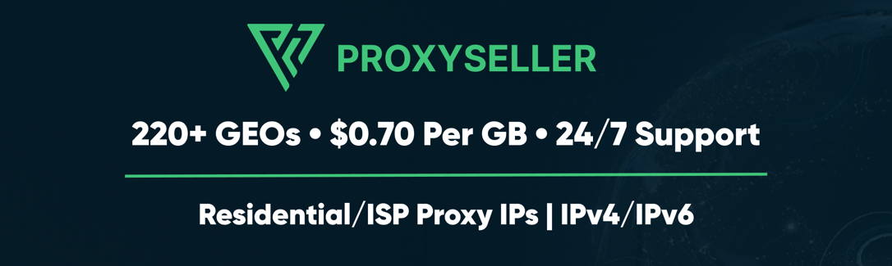

# 2026 New Grad Positions

**Fully automated** list of entry-level positions for 2025–2027 new graduates: software, data, engineering, finance, marketing, sales, healthcare and every other field, pulled straight from company career sites.

Unlike manually curated lists, this repository pulls directly from configured company APIs and refreshes **about every 30 minutes**, 24/7.

**[Open the live board →](https://jobs.riteshrana.engineer/)** · [Browse by role, company, city](https://jobs.riteshrana.engineer/jobs/) · [Guides](https://jobs.riteshrana.engineer/guides/) · [RSS alerts](https://jobs.riteshrana.engineer/feed.xml) · [How it works](https://jobs.riteshrana.engineer/about/)

**Contribute** by submitting an [issue](https://github.com/ambicuity/New-Grad-Jobs/issues/new/choose). See the [contribution guidelines](CONTRIBUTING.md) to get started.

> [!NOTE]
> **Solo-Maintained Project.** This repository is maintained by one person in spare time.
> PRs are reviewed within **1–2 weeks**. Bug fixes take priority over feature requests.
> Before opening an issue, read [SUPPORT.md](.github/SUPPORT.md).

---

## Proxy-Seller

Proxy-Seller gives you reliable proxy infrastructure for any workflow: private residential, mobile (4G/5G/LTE), ISP, and datacenter IPv4/IPv6 proxies, all with HTTP(S) and SOCKS5 support. Tap into 47M+ residential IPs across 220+ locations, target exactly the country, city, or ISP you need, and count on 99.7% uptime backed by 24/7 support. Get 15% off with promo code **NEWJOBS**.

Sponsored by Proxy-Seller

---

## Sponsored by [Tailr](https://www.tailr.uk)

**[Tailr](https://www.tailr.uk) rewrites your résumé for each job posting and shows you the ATS match score** — so you stop getting auto-filtered by the same generic résumé. Free 10/day, no card required. This project is proudly sponsored by Tailr.

---

<!-- COUNTS:START - counts below are auto-synced from the scraper output jobs.json by scripts/sync_readme_counts.py -->
## Browse <!-- COUNT:total -->7894<!-- /COUNT --> Jobs by Category

| Category | Open Roles |
|----------|-----------:|
| [Software Engineering](#software-engineering) | <!-- COUNT:software_engineering -->1809<!-- /COUNT --> |
| [Frontend Engineering](#frontend-engineering) | <!-- COUNT:frontend -->34<!-- /COUNT --> |
| [Backend Engineering](#backend-engineering) | <!-- COUNT:backend -->56<!-- /COUNT --> |
| [Mobile Engineering](#mobile-engineering) | <!-- COUNT:mobile -->19<!-- /COUNT --> |
| [Security Engineering](#security-engineering) | <!-- COUNT:security -->213<!-- /COUNT --> |
| [Data Science & ML](#data-science--ml) | <!-- COUNT:data_ml -->307<!-- /COUNT --> |
| [Data Engineering](#data-engineering) | <!-- COUNT:data_engineering -->195<!-- /COUNT --> |
| [Data Analyst](#data-analyst) | <!-- COUNT:data_analyst -->31<!-- /COUNT --> |
| [Infrastructure & SRE](#infrastructure--sre) | <!-- COUNT:infrastructure_sre -->409<!-- /COUNT --> |
| [Product Management](#product-management) | <!-- COUNT:product_management -->22<!-- /COUNT --> |
| [Project Management](#project-management) | <!-- COUNT:project_management -->77<!-- /COUNT --> |
| [Quantitative Finance](#quantitative-finance) | <!-- COUNT:quant_finance -->23<!-- /COUNT --> |
| [Hardware Engineering](#hardware-engineering) | <!-- COUNT:hardware -->182<!-- /COUNT --> |
| [Engineering and Development](#engineering-and-development) | <!-- COUNT:engineering -->1036<!-- /COUNT --> |
| [Creatives and Design](#creatives-and-design) | <!-- COUNT:design -->49<!-- /COUNT --> |
| [Business Analyst](#business-analyst) | <!-- COUNT:business_analyst -->302<!-- /COUNT --> |
| [Marketing](#marketing) | <!-- COUNT:marketing -->93<!-- /COUNT --> |
| [Sales](#sales) | <!-- COUNT:sales -->664<!-- /COUNT --> |
| [Accounting and Finance](#accounting-and-finance) | <!-- COUNT:accounting_finance -->342<!-- /COUNT --> |
| [Consulting](#consulting) | <!-- COUNT:consulting -->113<!-- /COUNT --> |
| [Human Resources](#human-resources) | <!-- COUNT:human_resources -->132<!-- /COUNT --> |
| [Legal and Compliance](#legal-and-compliance) | <!-- COUNT:legal -->75<!-- /COUNT --> |
| [Customer Service and Support](#customer-service-and-support) | <!-- COUNT:customer_support -->163<!-- /COUNT --> |
| [Supply Chain](#supply-chain) | <!-- COUNT:supply_chain -->237<!-- /COUNT --> |
| [Healthcare](#healthcare) | <!-- COUNT:healthcare -->575<!-- /COUNT --> |
| [Education and Training](#education-and-training) | <!-- COUNT:education -->46<!-- /COUNT --> |
| [Public Sector and Government](#public-sector-and-government) | <!-- COUNT:public_sector -->24<!-- /COUNT --> |
| [Arts and Entertainment](#arts-and-entertainment) | <!-- COUNT:arts_entertainment -->3<!-- /COUNT --> |
| [Management and Executive](#management-and-executive) | <!-- COUNT:management -->119<!-- /COUNT --> |
| [Other](#other) | <!-- COUNT:other -->544<!-- /COUNT --> |
<!-- COUNTS:END -->

---

<!-- CATEGORY-LISTINGS:START - auto-generated from the scraper output jobs.json by scripts/sync_readme_jobs.py; do not edit by hand -->

> **Live listings** — the 10 most recently posted roles per category, refreshed about every 30 minutes. Browse and filter all **7,894** live roles on the **[live job board](https://jobs.riteshrana.engineer/)**.

## Software Engineering

[Back to top](#2026-new-grad-positions)

| Company | Role | Location | Posted | Apply |
|---------|------|----------|--------|-------|
| CarGurus | Software Development Engineer II | Boston, Massachusetts, United States | Today | [Apply](<https://careers.cargurus.com/us/en/job/8417873?gh_jid=8417873>) |
| Anduril Industries | Systems Engineer, Quality | Irvine, California, United States | Today | [Apply](<https://boards.greenhouse.io/andurilindustries/jobs/5291271007?gh_jid=5291271007>) |
| Reddit | Software Engineer, Ads | San Francisco, CA | Today | [Apply](<https://job-boards.greenhouse.io/reddit/jobs/8415553>) |
| Anduril Industries | Flight Software Engineer | Atlanta, Georgia, United States | Today | [Apply](<https://boards.greenhouse.io/andurilindustries/jobs/5309020007?gh_jid=5309020007>) |
| LinkedIn | Software Engineer - Applications | Bengaluru, KA, India | Today | [Apply](<https://jobs.smartrecruiters.com/LinkedIn3/744000163694854>) |
| Bosch | Generative AI &amp; Agent Systems Engineer | bangalore, , India | Today | [Apply](<https://jobs.smartrecruiters.com/BoschGroup/744000163675569>) |
| Leonardo DRS | Software Engineer II | Dallas, TX, United States | Today | [Apply](<https://careers.leonardodrs.com/job/Dallas-Software-Engineer-II-TX-75243/1444356400/>) |
| Oak Ridge National Laboratory | HPC Software Engineer | Oak Ridge, TN, United States | Today | [Apply](<https://jobs.ornl.gov/job/Oak-Ridge-HPC-Software-Engineer-TN-37830/1396765700/>) |
| NICE | Software Engineer - AI &amp; Angular or React | India - Pune | Today | [Apply](<https://boards.eu.greenhouse.io/nice/jobs/5044602101?gh_jid=5044602101>) |
| NICE | Software Engineer - Core Java, AI | India - Pune | Today | [Apply](<https://boards.eu.greenhouse.io/nice/jobs/5044592101?gh_jid=5044592101>) |

**[View all 1,809 Software Engineering roles on the live board](https://jobs.riteshrana.engineer/)**

## Frontend Engineering

[Back to top](#2026-new-grad-positions)

| Company | Role | Location | Posted | Apply |
|---------|------|----------|--------|-------|
| CACI | Front End Software Developer | 2 Locations | 1 day ago | [Apply](<https://caci.wd1.myworkdayjobs.com/External/job/Sterling-VA-US/Front-End-Software-Developer_329623>) |
| CACI | Front-end Software Developer | Denver, CO, US | 2 days ago | [Apply](<https://caci.wd1.myworkdayjobs.com/External/job/Denver-CO-US/Front-end-Software-Developer_335430>) |
| HeartFlow | Software Engineer – Frontend | San Francisco, California | 2026-11-16 | [Apply](<https://job-boards.greenhouse.io/heartflowinc/jobs/6262467004>) |
| StockX | Software Engineer \(Front End\) | Detroit, MI | 2026-11-16 | [Apply](<https://job-boards.greenhouse.io/stockx/jobs/8942720002>) |
| CACI | Front-end Software Developer | Denver, CO, US | 2026-11-16 | [Apply](<https://caci.wd1.myworkdayjobs.com/External/job/Denver-CO-US/Front-end-Software-Developer_335093>) |
| nou Systems | Software Developer \(Frontend/ Backend/ Full-stack\) | Colorado Springs CO, Colorado Springs, CO, US; Huntsville AL, Huntsville, AL, US | 2026-11-13 | [Apply](<https://workforcenow.adp.com/mascsr/default/mdf/recruitment/recruitment.html?cid=9e26f425-d064-4c19-9e7b-cc8236837a7c&jobId=522023>) |
| Brex | Software Engineer II, Frontend \(Banking\) | Seattle, Washington, United States | 2026-11-12 | [Apply](<https://www.brex.com/careers/8939939002?gh_jid=8939939002>) |
| Brex | Software Engineer II, Frontend \(Banking\) | San Francisco, California, United States | 2026-11-12 | [Apply](<https://www.brex.com/careers/8939938002?gh_jid=8939938002>) |
| Brex | Software Engineer II, Frontend \(Banking\) | New York, New York, United States | 2026-11-12 | [Apply](<https://www.brex.com/careers/8928935002?gh_jid=8928935002>) |
| Booz Allen Hamilton | Front-End Software Engineer | Chantilly, VA | 2026-11-12 | [Apply](<https://bah.wd1.myworkdayjobs.com/BAH_Jobs/job/Chantilly-VA/Front-End-Software-Engineer_R0245772>) |

**[View all 34 Frontend Engineering roles on the live board](https://jobs.riteshrana.engineer/)**

## Backend Engineering

[Back to top](#2026-new-grad-positions)

| Company | Role | Location | Posted | Apply |
|---------|------|----------|--------|-------|
| Base Power | Software Engineer, Backend - Base Power Platform | Austin, Texas, United States | Today | [Apply](<https://jobs.ashbyhq.com/base-power/f1faeca1-0545-44d2-87e3-aa74dc88b083>) |
| Base Power | Software Engineer, Backend | Austin, Texas, United States | Today | [Apply](<https://jobs.ashbyhq.com/base-power/23bc4e94-d63c-4933-926b-edcb69138410>) |
| Base Power | Software Engineer, Backend - Distributed Compute | Austin, Texas, United States | Today | [Apply](<https://jobs.ashbyhq.com/base-power/5ea771cb-099f-40e7-a73f-a813494dc037>) |
| Base Power | Software Engineer, Backend - Core Experience | Austin, Texas, United States | Today | [Apply](<https://jobs.ashbyhq.com/base-power/02ca6e34-9827-4183-b05c-b73d06038640>) |
| OpenAI | Software Engineer, Backend — ChatGPT Voice | San Francisco, California, United States | Today | [Apply](<https://jobs.ashbyhq.com/openai/d22b6934-3bdc-459f-b801-87195d79be8a>) |
| Base Power | Software Engineer, Backend - Device Analytics | Austin, Texas, United States | 2 days ago | [Apply](<https://jobs.ashbyhq.com/base-power/578a5f17-ce99-4897-ae6c-9491163e759f>) |
| Supabase | Software Engineer - Interfaces Backend | Remote, Global | 2 days ago | [Apply](<https://jobs.ashbyhq.com/supabase/30cc053e-33dc-4924-a870-2cf41c296b01>) |
| BJAK | Backend Software Engineer - AI Finance Agent | India, India, India | 2 days ago | [Apply](<https://jobs.ashbyhq.com/bjakcareer/7f6692fb-eed1-4134-9baa-76cb68850037>) |
| BJAK | Backend Software Engineer - AI Finance Agent | United States, United States, United States | 2 days ago | [Apply](<https://jobs.ashbyhq.com/bjakcareer/b40a76d9-d71e-47f1-a44e-1638d20990de>) |
| Steampunk | Backend Software Engineer | McLean, VA, United States | 2 days ago | [Apply](<https://careers-steampunk.icims.com/jobs/9310/job>) |

**[View all 56 Backend Engineering roles on the live board](https://jobs.riteshrana.engineer/)**

## Mobile Engineering

[Back to top](#2026-new-grad-positions)

| Company | Role | Location | Posted | Apply |
|---------|------|----------|--------|-------|
| Copeland | Developer I iOS | Pune, India | Today | [Apply](<https://copeland.wd5.myworkdayjobs.com/Copeland_External_Careers_Page/job/Pune-India/Developer-I-iOS_JR119133>) |
| Copeland | Developer I iOS | Pune, India | Today | [Apply](<https://copeland.wd5.myworkdayjobs.com/Copeland_External_Careers_Page/job/Pune-India/Developer-I-iOS_JR119134>) |
| Uber | Software Engineer II - Android | Bengaluru, Karnataka, India | 1 day ago | [Apply](<https://iaziqy.fa.ocs.oraclecloud.com/hcmUI/CandidateExperience/en/sites/UberCareers/job/304920>) |
| BJAK | Android Software Engineer | United States, United States, United States | 2 days ago | [Apply](<https://jobs.ashbyhq.com/bjakcareer/07e640e0-eb45-4a1b-98b8-1bcc12065cd1>) |
| BJAK | Android Software Engineer | India, India, India | 2 days ago | [Apply](<https://jobs.ashbyhq.com/bjakcareer/763c619d-c688-41e0-bf11-155220e86c03>) |
| BJAK | Android Software Engineer - AI Finance Agent | United States, United States, United States | 2 days ago | [Apply](<https://jobs.ashbyhq.com/bjakcareer/eb04a770-467b-4923-a719-efa24c3c6536>) |
| BJAK | Android Software Engineer - AI Finance Agent | India, India, India | 2 days ago | [Apply](<https://jobs.ashbyhq.com/bjakcareer/7e1b725f-c1a3-43e3-87a0-ebdc62eab301>) |
| BJAK | Android Software Engineer - AI Finance Agent | India, India, India | 2 days ago | [Apply](<https://jobs.ashbyhq.com/bjakcareer/8ae8267f-b14a-4762-af95-0a933eea9fcf>) |
| Showpad | Mobile Software Engineer, Android | Pune | 5 days ago | [Apply](<https://job-boards.greenhouse.io/showpad/jobs/8405767>) |
| Lyft | Android Software Developer, Lyft Urban Solutions | Montreal, Canada | 2026-11-18 | [Apply](<https://app.careerpuck.com/job-board/lyft/job/8950102002?gh_jid=8950102002>) |

**[View all 19 Mobile Engineering roles on the live board](https://jobs.riteshrana.engineer/)**

## Security Engineering

[Back to top](#2026-new-grad-positions)

| Company | Role | Location | Posted | Apply |
|---------|------|----------|--------|-------|
| True Zero Technologies | Cyber Defense Analyst - Jr \(R-00264\) | Washington DC | Today | [Apply](<https://jobs.lever.co/truezerotech/f0a00ce0-a16d-42f1-b5da-f4df16820f0c>) |
| Supabase | Product Security Engineer | Remote, Global | Today | [Apply](<https://jobs.ashbyhq.com/supabase/62ad3b86-3a18-435a-ab29-dc62b77154e5>) |
| Supermicro | Information Security Engineer | San Jose, Cali, Un | Today | [Apply](<https://jobs.supermicro.com/job/San-Jose-Information-Security-Engineer-Cali/1443918100/>) |
| Base Power | Product Security Engineer | Austin, Texas, United States | Today | [Apply](<https://jobs.ashbyhq.com/base-power/095df108-3edd-44d5-818e-86283d98705f>) |
| Boeing | Associate Product Security Engineer | USA - Berkeley, MO | Today | [Apply](<https://boeing.wd1.myworkdayjobs.com/external_careers/job/USA---Berkeley-MO/Associate-Product-Security-Engineer_JR2026527678-1>) |
| Radiance Technologies | Junior DevSecOps Administrator | Huntsville, AL | Today | [Apply](<https://radiancetech.wd12.myworkdayjobs.com/Radiance_External/job/Huntsville-AL/Junior-DevSecOps-Administrator_HR102598>) |
| Credence | Systems Security Engineer CROWS 7.55 | Wright-Patterson Air Force Base, Ohio, United States | Today | [Apply](<https://apply.workable.com/j/CF80E81401>) |
| Vanguard | Cloud Security Engineer, Specialist - AWS Cloud Engineer- ES&amp;F | Hyderabad, India | Today | [Apply](<https://vanguard.wd5.myworkdayjobs.com/vanguard_external/job/Hyderabad-India/Cloud-Security-Engineer--Specialist---AWS-Cloud-Engineer--ES-F_183804>) |
| Duke University | Security Engineer | Durham, NC, United States | Today | [Apply](<https://careers.duke.edu/job/Durham-Security-Engineer-NC-27710/1453893900/>) |
| Trinzic | Associate Identity Security Engineer | Houston, Texas | Today | [Apply](<https://trinzic.wd115.myworkdayjobs.com/Trinzic_Careers/job/Houston-Texas/Associate-Security-Engineer--Identity-Security_R2126761>) |

**[View all 213 Security Engineering roles on the live board](https://jobs.riteshrana.engineer/)**

## Data Science & ML

[Back to top](#2026-new-grad-positions)

| Company | Role | Location | Posted | Apply |
|---------|------|----------|--------|-------|
| AbbVie | Associate AI Applications Engineer II | North Chicago, IL, United States | Today | [Apply](<https://jobs.smartrecruiters.com/AbbVie/3743990017096576>) |
| Rox Data Corp | Data Scientist, Finance | San Francisco, California, United States | Today | [Apply](<https://jobs.ashbyhq.com/Rox-Data-Corp/63bbf645-0265-4fc9-87b5-82ecc014bf38>) |
| Rox Data Corp | Data Scientist, Growth | San Francisco, California, United States | Today | [Apply](<https://jobs.ashbyhq.com/Rox-Data-Corp/49a62752-3d88-46d1-8c43-48a4a0840d91>) |
| Intuitive | Machine Learning Engineer | Sunnyvale, CA, United States | Today | [Apply](<https://jobs.smartrecruiters.com/Intuitive/744000163734433>) |
| Harvard University | Research Associate - Data Science and AI for Leaders | Boston, MA, United States | Today | [Apply](<https://jobs.smartrecruiters.com/HarvardUniversity/3743990017088856>) |
| Cognite | Machine Learning Engineer | India \(Bengaluru\) | Today | [Apply](<https://job-boards.eu.greenhouse.io/cognite/jobs/5047952101>) |
| Twitch | Data Scientist, Discovery &amp; Recommendations | San Francisco, CA | Today | [Apply](<https://job-boards.greenhouse.io/twitch/jobs/8953490002>) |
| NVIDIA | Research Scientist, AI and Systems Security - PhD New College Grad 2026 | 2 Locations | Today | [Apply](<https://nvidia.wd5.myworkdayjobs.com/NVIDIAExternalCareerSite/job/US-MA-Westford/Research-Scientist--AI-and-Systems-Security---PhD-New-College-Grad-2026_JR2025894>) |
| BMO | Associate, Data Scientist | Toronto, ON, CAN | Today | [Apply](<https://bmo.wd3.myworkdayjobs.com/External/job/Toronto-ON-CAN/Associate--Data-Scientist_R260032620-1>) |
| BMO Financial Group | Associate, AI Engineer | Toronto, ON, CA | Today | [Apply](<https://ca.indeed.com/viewjob?jk=91c5ee85df2f8a2a>) |

**[View all 307 Data Science & ML roles on the live board](https://jobs.riteshrana.engineer/)**

## Data Engineering

[Back to top](#2026-new-grad-positions)

| Company | Role | Location | Posted | Apply |
|---------|------|----------|--------|-------|
| SpaceX | Data Engineer, Application Software | Bastrop, TX | Today | [Apply](<https://boards.greenhouse.io/spacex/jobs/8957969002?gh_jid=8957969002>) |
| TaskUs | Associate Data Engineer | Navi Mumbai, India | Today | [Apply](<https://taskus.wd1.myworkdayjobs.com/careers/job/Navi-Mumbai-India/Associate-Data-Engineer_R_2609_11729>) |
| Copeland | Data Engineer | Pune, India | Today | [Apply](<https://copeland.wd5.myworkdayjobs.com/Copeland_External_Careers_Page/job/Pune-India/Data-Engineer_JR119893>) |
| Visa | Associate Data Engineer, AI Studio | Austin, TX, US | Today | [Apply](<https://www.indeed.com/viewjob?jk=2976e0458e7e7522>) |
| Adobe | Data Engineer | Bangalore, India; Noida | Today | [Apply](<https://adobe.wd5.myworkdayjobs.com/external_experienced/job/Bangalore/Data-Engineer_R173786-1>) |
| MAPFRE | Data Engineer II | Webster, MA, United States | Today | [Apply](<https://jobs.mapfre.com/job/Webster-Data-Engineer-II-MA-01570/1460788933/>) |
| Intuitive | Data Engineer | Sunnyvale, CA, United States | 1 day ago | [Apply](<https://jobs.smartrecruiters.com/Intuitive/744000163503569>) |
| Collectors | Associate Analytics Engineer | Remote, US | 1 day ago | [Apply](<https://www.indeed.com/viewjob?jk=73cd49abc11afc07>) |
| Western Governors University | Associate Data Governance Engineer | Salt Lake City, UT, US | 1 day ago | [Apply](<https://www.indeed.com/viewjob?jk=6b269b36025ada04>) |
| PwC | Data Engineer | Toronto | 1 day ago | [Apply](<https://pwc.wd3.myworkdayjobs.com/Global_Experienced_Careers/job/Toronto/Data-Engineer_773574WD>) |

**[View all 195 Data Engineering roles on the live board](https://jobs.riteshrana.engineer/)**

## Data Analyst

[Back to top](#2026-new-grad-positions)

| Company | Role | Location | Posted | Apply |
|---------|------|----------|--------|-------|
| Department of Conservation | RESEARCH DATA ANALYST II | CA, US | Today | [Apply](<https://www.indeed.com/viewjob?jk=05c375f05f3b0dd6>) |
| The University of Texas at Austin | Data Analyst II | AUSTIN, TX | Today | [Apply](<https://utaustin.wd1.myworkdayjobs.com/UTstaff/job/AUSTIN-TX/Data-Analyst-II_R_00050187-1>) |
| Libro Credit Union | Data Analyst L3 - London Administration | London, ON, CA | Today | [Apply](<https://ca.indeed.com/viewjob?jk=18d633570e813a0b>) |
| Department Of Public Health | RESEARCH DATA ANALYST II | CA, US | Today | [Apply](<https://www.indeed.com/viewjob?jk=936e39e670bf1ecb>) |
| Trinzic | Associate Data Analyst | Arlington, Virginia | Today | [Apply](<https://trinzic.wd115.myworkdayjobs.com/Trinzic_Careers/job/Arlington-Virginia/Associate-Data-Analyst_R3001837>) |
| Intact | Security &amp; Data Analyst I - Identity and Access Management | Ajax, ON, CA | Today | [Apply](<https://ca.indeed.com/viewjob?jk=259dc4a54d207512>) |
| Mass General Brigham | Data Analyst I | Boston, MA, US | Today | [Apply](<https://www.indeed.com/viewjob?jk=9ce335e9478911ff>) |
| Walmart | Data Analyst II - Fraud Prevention | Bentonville, AR | 1 day ago | [Apply](<https://walmart.wd504.myworkdayjobs.com/WalmartExternal/job/Bentonville-AR/Data-Analyst-II_R-2721046>) |
| University of Utah | Salesforce Administrator / Data Analyst, Graduate &amp; Executive Education Programs | Salt Lake City, UT, US | 1 day ago | [Apply](<https://www.indeed.com/viewjob?jk=6849fb781a4b4232>) |
| Philips | Full Time- Graduate Development Program-AI &amp; Analytics Associate-Nashville, TN or Cambridge, MA-2027 | Nashville, Tennessee, United States | 2 days ago | [Apply](<https://philips.wd3.myworkdayjobs.com/jobs-and-careers/job/Nashville-Tennessee-United-States/Full-Time--Graduate-Development-Program-AI---Analytics-Associate-Nashville--TN-or-Cambridge--MA-2026_587083>) |

**[View all 31 Data Analyst roles on the live board](https://jobs.riteshrana.engineer/)**

## Infrastructure & SRE

[Back to top](#2026-new-grad-positions)

| Company | Role | Location | Posted | Apply |
|---------|------|----------|--------|-------|
| MetTel | Wireless Network Engineer - Device Certification Technician | Salt Lake City, Utah, United States | Today | [Apply](<https://job-boards.greenhouse.io/mettel/jobs/4732262006>) |
| Rocket Lab | Test and Launch Operations Engineer I | Wallops Island, VA | Today | [Apply](<https://job-boards.greenhouse.io/rocketlab/jobs/8197832003>) |
| Cloudflare | Network Engineer | Hybrid | Today | [Apply](<https://boards.greenhouse.io/cloudflare/jobs/8407666?gh_jid=8407666>) |
| Hatch | Junior Operational Readiness Specialist 1 | Houston, TX, United States | Today | [Apply](<https://jobs.hatch.com/job/Houston-Junior-Operational-Readiness-Specialist-1-TX-77001/1434309700/>) |
| Westinghouse | Project Estimator-Level 1 | OTHER, MA, United States | Today | [Apply](<https://careers.westinghousenuclear.com/WECTEC_Staffing/job/OTHER-Project-Estimator-Level-1-MA-0/1355163700/>) |
| AWA Teknik PVT. LTD. | MEP Design Trainee | KL, IN | Today | [Apply](<https://in.indeed.com/viewjob?jk=7fdda821d0313481>) |
| Leidos | Access Management Infrastructure Engineer-Junior | 6314 Remote/Teleworker US | Today | [Apply](<https://leidos.wd5.myworkdayjobs.com/External/job/6314-RemoteTeleworker-US/Access-Management-Infrastructure-Engineer-Junior_R-00197515>) |
| NVIDIA | Network Site Reliability Engineer | US, CA, Santa Clara | Today | [Apply](<https://nvidia.wd5.myworkdayjobs.com/NVIDIAExternalCareerSite/job/US-CA-Santa-Clara/Network-Site-Reliability-Engineer_JR2029104>) |
| Leidos | Linux Network Infrastructure Vulnerability Remediation Engineer-Junior | 6314 Remote/Teleworker US | Today | [Apply](<https://leidos.wd5.myworkdayjobs.com/External/job/6314-RemoteTeleworker-US/Linux-Network-Infrastructure-Vulnerability-Remediation-Engineer-Junior_R-00197514>) |
| Mondelēz International | SG10 - CSIRT Junior Analyst | Remote, US | Today | [Apply](<https://www.indeed.com/viewjob?jk=472437367cc90b50>) |

**[View all 409 Infrastructure & SRE roles on the live board](https://jobs.riteshrana.engineer/)**

## Product Management

[Back to top](#2026-new-grad-positions)

| Company | Role | Location | Posted | Apply |
|---------|------|----------|--------|-------|
| Clarivate | Associate Content Analyst | TN, IN | Today | [Apply](<https://in.indeed.com/viewjob?jk=8a63d7652a9fd06a>) |
| Sanofi | 2027 Digital Graduate Program, Product Analyst | Toronto, ON, CA | 5 days ago | [Apply](<https://ca.indeed.com/viewjob?jk=a8dd9d87519cb900>) |
| Lennar | Associate Product Manager, Closings | Miami, FL \(Job Posting Location\) | 5 days ago | [Apply](<https://lennar.wd1.myworkdayjobs.com/Lennar_Jobs/job/Miami-FL-Job-Posting-Location/Associate-Product-Manager--Closings_R26_0000004865>) |
| London Stock Exchange Group | Associate Product Manager, Enterprise AI | 2 Locations | 6 days ago | [Apply](<https://lseg.wd3.myworkdayjobs.com/Careers/job/London-United-Kingdom/Associate-Product-Manager--Enterprise-AI_R0124430-1>) |
| Copart | Associate Product Manager | Dallas, TX - Headquarters | 2026-11-12 | [Apply](<https://copart.wd12.myworkdayjobs.com/Copart/job/Dallas-TX---Headquarters/Associate-Product-Manager_JR112795>) |
| IXL Learning | IXL Associate Product Manager | San Mateo, CA | 2026-11-11 | [Apply](<https://www.ixl.com/company/jobs?gh_jid=8936808002>) |
| Westinghouse | Configuration Management Engineer \(early career\) | Cranberry Township, NC, United States | 2026-11-09 | [Apply](<https://careers.westinghousenuclear.com/job/Cranberry-Township-Configuration-Management-Engineer-%28early-career%29-NC/1449116300/>) |
| Medpace | Business Analyst / Product Owner | Cincinnati, Ohio | 2026-11-06 | [Apply](<https://careers.medpace.com/jobs/13124>) |
| Lear | Continuous Improvement Specialist I | Flint, MI, United States | 2026-10-29 | [Apply](<https://jobs.lear.com/job/Auburn-Hills-Continuous-Improvement-Specialist-I-MI-48326/1426304733/>) |
| Abbott | Associate Product Manager | United States &gt; Madison : 1 Exact Lane | 2026-10-27 | [Apply](<https://abbott.wd5.myworkdayjobs.com/abbottcareers2/job/United-States--Madison--1-Exact-Lane/Associate-Product-Manager_31165659-1>) |

**[View all 22 Product Management roles on the live board](https://jobs.riteshrana.engineer/)**

## Project Management

[Back to top](#2026-new-grad-positions)

| Company | Role | Location | Posted | Apply |
|---------|------|----------|--------|-------|
| Leonardo DRS | Program Analyst II | Bridgeton, MO, United States | Today | [Apply](<https://careers.leonardodrs.com/job/Bridgeton-Program-Analyst-II-MO-63044/1444041800/>) |
| Harvard University | Coordinator I \(Research and Program Coordinator\) | Boston, MA, United States | Today | [Apply](<https://jobs.smartrecruiters.com/HarvardUniversity/3743990017079496>) |
| JLL | Engineering Program Coordinator | Bengaluru, KA | Today | [Apply](<https://jll.wd1.myworkdayjobs.com/jllcareers/job/Bengaluru-KA/Engineering-Program-Coordinator_REQ546741>) |
| Mount Sinai Health System | Project Coordinator I - Cardiology | United States | Today | [Apply](<https://ejis.fa.us6.oraclecloud.com/hcmUI/CandidateExperience/en/sites/CX/job/3044865>) |
| YORK REGIONAL POLICE | Business Analyst, Enterprise Project Management Office | Aurora, ON, CA | 1 day ago | [Apply](<https://ca.indeed.com/viewjob?jk=7f55608b418d63cd>) |
| Texas A&amp;M University System | Program Coordinator I | College Station, TX | 1 day ago | [Apply](<https://tamus.wd1.myworkdayjobs.com/system-wide_external/job/College-Station-TX/Program-Coordinator-I_R-099107-2>) |
| WSP | Associate Project Manager - Power Delivery | New Orleans, LA, United States | 1 day ago | [Apply](<https://emit.fa.ca3.oraclecloud.com/hcmUI/CandidateExperience/en/sites/CX_2001/job/99437>) |
| Network Connex | Project Coordinator I | San Antonio, TX, US | 1 day ago | [Apply](<https://www.indeed.com/viewjob?jk=be39ed359390578a>) |
| POWERGROUP Resources | Junior Project Coordinator | Hamilton, ON, CA | 1 day ago | [Apply](<https://ca.indeed.com/viewjob?jk=806a678efcc8985e>) |
| GE Vernova | Project Management Associate – Project Controls | Remote, United States of America; Findlay Township | 1 day ago | [Apply](<https://gevernova.wd5.myworkdayjobs.com/Vernova_ExternalSite/job/Remote/Project-Management-Associate---Project-Controls_R5059555>) |

**[View all 77 Project Management roles on the live board](https://jobs.riteshrana.engineer/)**

## Quantitative Finance

[Back to top](#2026-new-grad-positions)

| Company | Role | Location | Posted | Apply |
|---------|------|----------|--------|-------|
| First Citizens Bank | Process Coordinator II | Raleigh, North Carolina | Today | [Apply](<https://jobs.firstcitizens.com/jobs/36472>) |
| DV Trading | Junior Trading Operations Analyst | Chicago | 1 day ago | [Apply](<https://job-boards.greenhouse.io/dvtrading/jobs/4758258005>) |
| Hatch | Stagiaire en ingénierie des barrages et de l'hydroélectricité - Hiver 2027 | St. John's, NL, Canada | 1 day ago | [Apply](<https://jobs.hatch.com/job/St_-John&apos;s-Stagiaire-en-ing%C3%A9nierie-des-barrages-et-de-l&apos;hydro%C3%A9lectricit%C3%A9-Hiver-2027-NL/1443586000/>) |
| BNY | 2027 BNY Analyst Program – Credit and Trading - \(New York, NY\) | New York, NY, US | 1 day ago | [Apply](<https://www.indeed.com/viewjob?jk=5dce6dea854d7bd4>) |
| Harvard University | Research Associate \(Quantitative and/or Qualitative\), Division of Research and Faculty Development | Boston, MA, United States | 1 day ago | [Apply](<https://jobs.smartrecruiters.com/HarvardUniversity/3743990017045896>) |
| EliseAI | Associate Deployment Strategist, Future Platforms / Housing | New York , NY , United States | 2 days ago | [Apply](<https://jobs.ashbyhq.com/EliseAI/97c0cc28-b7f7-4416-a907-1ce7fcf5ff39>) |
| Bunge | Analyst I Trading DDGs \(Omaha, NE\) | Omaha, NE -, United States | 2 days ago | [Apply](<https://jobs.bunge.com/job/Omaha-Analyst-I-Trading-DDGs-%28Omaha%2C-NE%29-NE-68102/1459899933/>) |
| Berkshire Hathaway Energy | Portfolio Analyst I/II \(Gas Trader I/II\) | Urbandale, IA, United States | 5 days ago | [Apply](<https://fa-essf-saasfaprod1.fa.ocs.oraclecloud.com/hcmUI/CandidateExperience/en/sites/CX_1/job/10005680>) |
| Akuna Capital | Trading Sneak Peek Program: May 2027 \(Reaching Women+\) | Chicago | 6 days ago | [Apply](<https://www.akunacapital.com/careers/job/8011686/?gh_jid=8011686>) |
| Akuna Capital | Trading Sneak Peek Program: August 2027 | Chicago | 6 days ago | [Apply](<https://www.akunacapital.com/careers/job/8011610/?gh_jid=8011610>) |

**[View all 23 Quantitative Finance roles on the live board](https://jobs.riteshrana.engineer/)**

## Hardware Engineering

[Back to top](#2026-new-grad-positions)

| Company | Role | Location | Posted | Apply |
|---------|------|----------|--------|-------|
| Westinghouse | Electrical Engineer II | Cranberry Township, NC, United States | Today | [Apply](<https://careers.westinghousenuclear.com/job/Cranberry-Township-Electrical-Engineer-II-NC/1326340800/>) |
| NVIDIA | ASIC Clocks Verification Engineer - New College Grad 2026 | US, CA, Santa Clara | Today | [Apply](<https://nvidia.wd5.myworkdayjobs.com/NVIDIAExternalCareerSite/job/US-CA-Santa-Clara/ASIC-Clocks-Verification-Engineer---New-College-Grad-2026_JR2027579>) |
| Raytheon | Electrical Assembler I - 1st Shift \(Onsite\) | US-IA-MANCHESTER-185 ~ 901 S 10th St ~ S 10TH | Today | [Apply](<https://globalhr.wd5.myworkdayjobs.com/REC_RTX_Ext_Gateway/job/US-IA-MANCHESTER-185--901-S-10th-St--S-10TH/Electrical-Assembler-I---1st-Shift--Onsite-_01891737-1>) |
| NVIDIA | Silicon Co-Design Engineer - New College Grad 2026 | US, CA, Santa Clara | Today | [Apply](<https://nvidia.wd5.myworkdayjobs.com/NVIDIAExternalCareerSite/job/US-CA-Santa-Clara/Silicon-Co-Design-Engineer---New-College-Grad-2026_JR2027335>) |
| NVIDIA | ASIC Design Engineer - New College Grad 2027 | US, CA, Santa Clara | Today | [Apply](<https://nvidia.wd5.myworkdayjobs.com/NVIDIAExternalCareerSite/job/US-CA-Santa-Clara/ASIC-Design-Engineer---New-College-Grad-2027_JR2026277>) |
| NVIDIA | ASIC Floorplan Design Engineer - New College Grad 2026 | US, CA, Santa Clara | Today | [Apply](<https://nvidia.wd5.myworkdayjobs.com/NVIDIAExternalCareerSite/job/US-CA-Santa-Clara/ASIC-Floorplan-Design-Engineer---New-College-Grad-2026_JR2024651>) |
| NVIDIA | PCIe Post-Silicon Validation Engineer - New College Grad 2027 | US, CA, Santa Clara | Today | [Apply](<https://nvidia.wd5.myworkdayjobs.com/NVIDIAExternalCareerSite/job/US-CA-Santa-Clara/PCIe-Post-Silicon-Validation-Engineer---New-College-Grad-2027_JR2029108>) |
| NVIDIA | ASIC Design Engineer - New College Grad 2026 | US, CA, Santa Clara | Today | [Apply](<https://nvidia.wd5.myworkdayjobs.com/NVIDIAExternalCareerSite/job/US-CA-Santa-Clara/ASIC-Design-Engineer---New-College-Grad-2026_JR2020309>) |
| NVIDIA | ASIC Physical Design and Timing Engineer - New College Grad 2026 | US, CA, Santa Clara | Today | [Apply](<https://nvidia.wd5.myworkdayjobs.com/NVIDIAExternalCareerSite/job/US-CA-Santa-Clara/ASIC-Timing-Engineer---New-College-Grad-2026_JR2013177>) |
| NVIDIA | ASIC Physical Design Engineer, Netlisting - New College Grad 2026 | US, CA, Santa Clara, United States of America; US, TX, Austin | Today | [Apply](<https://nvidia.wd5.myworkdayjobs.com/NVIDIAExternalCareerSite/job/US-CA-Santa-Clara/ASIC-Physical-Design-Engineer--Netlisting---New-College-Grad-2026_JR2017681>) |

**[View all 182 Hardware Engineering roles on the live board](https://jobs.riteshrana.engineer/)**

## Engineering and Development

[Back to top](#2026-new-grad-positions)

| Company | Role | Location | Posted | Apply |
|---------|------|----------|--------|-------|
| Axon | Mechanical Design Engineer II \(Hybrid\) | Sterling, Virginia, United States | Today | [Apply](<https://job-boards.greenhouse.io/axon/jobs/8196947003>) |
| Axon | Mechanical Design Engineer I \(Hybrid\) | Sterling, Virginia, United States | Today | [Apply](<https://job-boards.greenhouse.io/axon/jobs/8196965003>) |
| Rocket Lab | Spacecraft Propulsion Components Engineer I | Long Beach, CA | Today | [Apply](<https://job-boards.greenhouse.io/rocketlab/jobs/8058075003>) |
| Esri | Product Engineer II – ArcGIS Enterprise Patch | Ottawa, CA | Today | [Apply](<https://www.esri.com/careers/5304476007?gh_jid=5304476007>) |
| Relativity Space | Vehicle Structures Engineer II \(Stage 2 Structures\) | Long Beach, California, United States | Today | [Apply](<https://boards.greenhouse.io/relativity/jobs/8943519002?gh_jid=8943519002>) |
| Voyager Technologies | Propulsion Engineer II | Mojave, CA | Today | [Apply](<https://job-boards.greenhouse.io/voyagertechnologiesinc/jobs/4520802009>) |
| Wabtec | Trainee Junior Engineer-Production | Marhowra, BR, India | Today | [Apply](<https://jobs.smartrecruiters.com/Wabtec/3743990017085716>) |
| City of New York | Associate IAM Engineer | Brooklyn, NY, United States | Today | [Apply](<https://jobs.smartrecruiters.com/CityOfNewYork/3743990017083666>) |
| Teradyne | Applications Engineer - Rotational Development Program, New College Graduate, \(North Reading, MA\) | North Reading, MA, United States | Today | [Apply](<https://jobs.teradyne.com/Teradyne/job/North-Reading-Applications-Engineer-Rotational-Development-Program%2C-New-College-Graduate%2C-%28North-Reading%2C-MA%29-MA/1444242500/>) |
| Westinghouse | Delivery Stream Engineer II | Cranberry Township, NC, United States | Today | [Apply](<https://careers.westinghousenuclear.com/job/Cranberry-Township-Delivery-Stream-Engineer-II-NC/1422679500/>) |

**[View all 1,036 Engineering and Development roles on the live board](https://jobs.riteshrana.engineer/)**

## Creatives and Design

[Back to top](#2026-new-grad-positions)

| Company | Role | Location | Posted | Apply |
|---------|------|----------|--------|-------|
| American Express | Associate - Digital Product Solution Design | Phoenix, AZ, United States | Today | [Apply](<https://egug.fa.us2.oraclecloud.com/hcmUI/CandidateExperience/en/sites/CX_1/job/26016852>) |
| Right Resources | Junior Graphic Designer | GJ, IN | Today | [Apply](<https://in.indeed.com/viewjob?jk=aefc2b608bd8f491>) |
| Electronic Arts | Associate Experience Designer | Vancouver, BC, CA | Today | [Apply](<https://ca.indeed.com/viewjob?jk=cdec492d01df7ac9>) |
| Texas A&amp;M University System | CEHD - Graphic Designer I | College Station, TX | Today | [Apply](<https://tamus.wd1.myworkdayjobs.com/system-wide_external/job/College-Station-TX/CEHD---Graphic-Designer-I_R-099151>) |
| mike@arohinc.com | Junior Wayfinding Designer | Simcoe, ON, CA | 1 day ago | [Apply](<https://ca.indeed.com/viewjob?jk=45f32eed60182728>) |
| Passionworkx | Junior Interior Designer / Design Assistant \(Fresher\) | DL, IN | 1 day ago | [Apply](<https://in.indeed.com/viewjob?jk=1b55f00a50623926>) |
| Amazon.com | Product Designer II, Design Systems, People Engagement eXperience | Seattle, WA, US | 1 day ago | [Apply](<https://www.indeed.com/viewjob?jk=8f6ae6ab6c5ea126>) |
| Konrad | Associate UI/UX Designer | New York | 2 days ago | [Apply](<https://www.konrad.com/careers/job/8214177003?gh_jid=8214177003>) |
| AV GLOBAL APPAREL | junior Graphic design faculty | TN, IN | 2 days ago | [Apply](<https://in.indeed.com/viewjob?jk=872b3fe94679547c>) |
| TP-LINK | Early Career UX/ UI Designer | Irvine, CA, US | 2 days ago | [Apply](<https://www.indeed.com/viewjob?jk=d61d920f28b69448>) |

**[View all 49 Creatives and Design roles on the live board](https://jobs.riteshrana.engineer/)**

## Business Analyst

[Back to top](#2026-new-grad-positions)

| Company | Role | Location | Posted | Apply |
|---------|------|----------|--------|-------|
| ALTEN Technology USA | SAP Material Management Business Analyst | Grand Prairie, Texas, United States | Today | [Apply](<https://job-boards.greenhouse.io/altentechnologyusa/jobs/5309480007>) |
| AFL | Business Operations Analyst II | Dallas, TX, United States | Today | [Apply](<https://recruiting.ultipro.com/AFL1002/JobBoard/d535bad2-e3ea-c8c8-2fb2-63621892e293/OpportunityDetail?opportunityId=c4edc0de-14a5-47b8-96ab-3965bc1f5759>) |
| SGS | Quality Control Analyst, Level 1 - Finished Products | Markham, ON, Canada | Today | [Apply](<https://jobs.smartrecruiters.com/SGS/744000163716680>) |
| CU\*Answers | Business Analyst | Grand Rapids, MI, USA | Today | [Apply](<https://recruiting.paylocity.com/Recruiting/Jobs/Details/4551568>) |
| Duke University | Application Analyst - Level 2 - Maestro Care Solutions Analyst | Other, NC, United States | Today | [Apply](<https://careers.duke.edu/job/Other-Application-Analyst-Level-2-Maestro-Care-Solutions-Analyst-NC-27710/1444086900/>) |
| State of Florida | GIS MAPPING ANALYST I - 55003655 | TALLAHASSEE, FL, United States | Today | [Apply](<https://jobs.myflorida.com/job/TALLAHASSEE-GIS-MAPPING-ANALYST-I-55003655-FL-32399/1419331400/>) |
| BJAK | Business Operations Associate | United States, United States, United States | Today | [Apply](<https://jobs.ashbyhq.com/bjakcareer/591e0e27-2ade-46f1-896e-d199b6564040>) |
| Gruve | Threat Hunting Analyst I | Pune, Maharashtra, India | Today | [Apply](<https://gruve.ai/careers/?gh_jid=5490426008>) |
| Soft Tech Consulting | Business Analyst/Tester | DC, United States | Today | [Apply](<https://careers-softtechconsulting.icims.com/jobs/3685/job>) |
| Soft Tech Consulting | Business Analyst/Tester | DC, United States | Today | [Apply](<https://careers-softtechconsulting.icims.com/jobs/3472/job>) |

**[View all 302 Business Analyst roles on the live board](https://jobs.riteshrana.engineer/)**

## Marketing

[Back to top](#2026-new-grad-positions)

| Company | Role | Location | Posted | Apply |
|---------|------|----------|--------|-------|
| HeartFlow | Marketing Associate Contractor | Rohnert Park, California; San Francisco, California | Today | [Apply](<https://job-boards.greenhouse.io/heartflowinc/jobs/6271440004>) |
| Crowd4Test | GTM Associate – Founder’s Office \(Marketing &amp; Sales\) | KA, IN | Today | [Apply](<https://in.indeed.com/viewjob?jk=b7cf7cd311dc260f>) |
| Unknown | Communications and Development Associate | Boston, MA, US | Today | [Apply](<https://www.indeed.com/viewjob?jk=31eee7dde17695e1>) |
| Amplyfy, Inc. | Junior Marketing Associate - Entry Level | Edison, NJ, US | Today | [Apply](<https://www.indeed.com/viewjob?jk=0780f5d0dc6c9a5a>) |
| Cisco | Technical Marketing Engineer I \(Full Time\) - United States | San Jose, California, US; Milpitas, California, US | Today | [Apply](<https://cisco.wd5.myworkdayjobs.com/Cisco_Careers/job/San-Jose-California-US/Technical-Marketing-Engineer-I--Full-Time----United-States_2026465>) |
| Maximus Law | Marketing Associate | Lawndale, CA, US | Today | [Apply](<https://www.indeed.com/viewjob?jk=38b9549edead0d01>) |
| Unknown | Junior Marketing Associate | Jacksonville, FL, US | Today | [Apply](<https://www.indeed.com/viewjob?jk=7175c8ce8e3aa0d4>) |
| State of Illinois | TRANSPORTATION OPERATIONS COMMUNICATIONS SPECIALIST II | Collinsville, IL, United States | 1 day ago | [Apply](<https://illinois.jobs2web.com/job/Collinsville-TRANSPORTATION-OPERATIONS-COMMUNICATIONS-SPECIALIST-II-IL-62234/1453610800/>) |
| Concentrix | Automotive Marketing Sales Associate \(Remote\) | Remote, US | 1 day ago | [Apply](<https://www.indeed.com/viewjob?jk=96b0cf3b10748c3c>) |
| NM Group | Entry Level Sales and Marketing Representative | Manhattan, NY, US | 1 day ago | [Apply](<https://www.indeed.com/viewjob?jk=31d850fad1c13ee0>) |

**[View all 93 Marketing roles on the live board](https://jobs.riteshrana.engineer/)**

## Sales

[Back to top](#2026-new-grad-positions)

| Company | Role | Location | Posted | Apply |
|---------|------|----------|--------|-------|
| Intuitive | Territory Sales Associate | Remote, Boston, MA, United States | Today | [Apply](<https://jobs.smartrecruiters.com/Intuitive/744000163723987>) |
| Air Charter Service | Entry-Level Commercial Jet Charter Sales Consultant \(Long Island\) | Uniondale, NY, US | Today | [Apply](<https://www.indeed.com/viewjob?jk=3152fcb9785e00b9>) |
| BMO | Sales Associate, TPS | Toronto, ON, CAN | Today | [Apply](<https://bmo.wd3.myworkdayjobs.com/External/job/Toronto-ON-CAN/Sales-Associate--TPS_R260032181-1>) |
| Verizon | Retail Sales Associate Spanish Bilingual | 12190 Biscayne Blvd, North Miami, Florida | Today | [Apply](<https://verizon.wd12.myworkdayjobs.com/verizon-careers/job/12190-Biscayne-Blvd-North-Miami-Florida/Retail-Sales-Associate-Spanish-Bilingual_R-1104372>) |
| Verizon | Retail Sales Associate | 2375 S 9th St, Salina, Kansas | Today | [Apply](<https://verizon.wd12.myworkdayjobs.com/verizon-careers/job/2375-S-9th-St-Salina-Kansas/Retail-Sales-Associate_R-1104351-1>) |
| Lowe's | Full Time - Sales Associate - Inside Lawn &amp; Garden - Closing | Reidsville, NC 1210 | Today | [Apply](<https://lowes.wd5.myworkdayjobs.com/LWS_External_CS/job/Reidsville-NC-1210/Full-Time---Sales-Associate---Inside-Lawn---Garden---Closing_JR-02712358>) |
| Verizon | Retail Sales Associate | 5207 Brodie LN, Sunset Valley, Texas | Today | [Apply](<https://verizon.wd12.myworkdayjobs.com/verizon-careers/job/5207-Brodie-LN-Sunset-Valley-Texas/Retail-Sales-Associate_R-1104383-1>) |
| Verizon | Retail Sales Associate | 262 Andover St, Peabody, Massachusetts | Today | [Apply](<https://verizon.wd12.myworkdayjobs.com/verizon-careers/job/262-Andover-St-Peabody-Massachusetts/Retail-Sales-Associate_R-1102622>) |
| Lowe's | Full Time - Sales Associate - Outside Lawn &amp; Garden - Closing | Lebanon, MO 2565 | Today | [Apply](<https://lowes.wd5.myworkdayjobs.com/LWS_External_CS/job/Lebanon-MO-2565/Full-Time---Sales-Associate---Outside-Lawn---Garden---Closing_JR-02712379>) |
| Bell Fuels Service | Sales Coordinator \(Entry-Level\) | Bridgeview, IL, US | Today | [Apply](<https://www.indeed.com/viewjob?jk=29fb8cd46b157160>) |

**[View all 664 Sales roles on the live board](https://jobs.riteshrana.engineer/)**

## Accounting and Finance

[Back to top](#2026-new-grad-positions)

| Company | Role | Location | Posted | Apply |
|---------|------|----------|--------|-------|
| NextEra Energy | Financial Analyst I | Juno Beach, FL, United States | Today | [Apply](<https://jobs.nexteraenergy.com/job/Juno-Beach-Financial-Analyst-I-FL-33408/1444241800/>) |
| NextEra Energy | Financial Controller I | Juno Beach, FL, United States | Today | [Apply](<https://jobs.nexteraenergy.com/job/Juno-Beach-Financial-Controller-I-FL-33408/1444295000/>) |
| NextEra Energy | Financial Analyst I | Juno Beach, FL, United States | Today | [Apply](<https://jobs.nexteraenergy.com/job/Juno-Beach-Financial-Analyst-I-FL-33408/1453774300/>) |
| Ecolab | General Ledger Accounting Analyst I | MH, IN | Today | [Apply](<https://in.indeed.com/viewjob?jk=10e622f89743d77b>) |
| BDO Canada | Junior Accountant, Assurance \(Fall 2027\) | Montréal - 1000 Rue De La Gauchetière Ouest | Today | [Apply](<https://bdo.wd3.myworkdayjobs.com/bdo/job/Montral---1000-Rue-De-La-Gauchetire-Ouest/Junior-Accountant--Assurance--Fall-2027-_JR7428>) |
| RBC | Private Banking Associate | VICTORIA, British Columbia, Canada | Today | [Apply](<https://rbc.wd3.myworkdayjobs.com/RBCGLOBAL1/job/VICTORIA-British-Columbia-Canada/Private-Banking-Associate_R-0000182850>) |
| Texas A&amp;M University System | Financial Aid Advisor II | Fort Worth, TX | Today | [Apply](<https://tamus.wd1.myworkdayjobs.com/system-wide_external/job/Fort-Worth-TX/Financial-Aid-Advisor-II_R-098990>) |
| Universities of Wisconsin | Associate Accountant | University of Wisconsin Parkside | Today | [Apply](<https://wisconsin.wd1.myworkdayjobs.com/UW_Comprehensives/job/Kenosha-WI/Associate-Accountant_JR10016930>) |
| Raymond James | Client Relationship Associate \(Gentian Financial\) | Mequon Wisconsin, United States | Today | [Apply](<https://raymondjames.wd1.myworkdayjobs.com/RaymondJamesCareers/job/Mequon-Wisconsin---United-States/Client-Relationship-Associate_R-0013878>) |
| RBC | Private Banking Associate | RICHMOND HILL, Ontario, Canada | Today | [Apply](<https://rbc.wd3.myworkdayjobs.com/RBCGLOBAL1/job/RICHMOND-HILL-Ontario-Canada/Private-Banking-Associate_R-0000193369>) |

**[View all 342 Accounting and Finance roles on the live board](https://jobs.riteshrana.engineer/)**

## Consulting

[Back to top](#2026-new-grad-positions)

| Company | Role | Location | Posted | Apply |
|---------|------|----------|--------|-------|
| IQVIA | Associate / Associate Consultant, EMEA Strategy Consulting | HR, IN | Today | [Apply](<https://in.indeed.com/viewjob?jk=a596ac4f807fd700>) |
| Protiviti | Denver Technology Consulting Consultant - 2027 | DENVER | Today | [Apply](<https://roberthalf.wd1.myworkdayjobs.com/ProtivitiNA/job/DENVER/Denver-Technology-Consulting-Consultant---2027_JR-260518-1>) |
| Equifax | Associate Consultant - Data &amp; Analytics | 3 Locations | Today | [Apply](<https://equifax.wd5.myworkdayjobs.com/External/job/GBR---London/Associate-Consultant---Data---Analytics_J00178623>) |
| Silva and Associates | Entry-Level Investment Advisor, Insurance Consultant and Mortgage Loan originator | Remote, US | Today | [Apply](<https://www.indeed.com/viewjob?jk=00156a08a93b44a5>) |
| Cority | Consultant I - Safety | Remote, US | Today | [Apply](<https://www.indeed.com/viewjob?jk=e17dac1506a007aa>) |
| Cority | Consultant I - Safety | Remote, CA | Today | [Apply](<https://ca.indeed.com/viewjob?jk=2e1b756718218ea1>) |
| State Street | Associate Consultant | Burlington Massachusetts | Today | [Apply](<https://statestreet.wd1.myworkdayjobs.com/Global/job/Burlington-Massachusetts/Associate-Consultant_R-795220-1>) |
| Independent Contractor/Consultant | Entry-Level Investment Advisor, Insurance Consultant &amp; Mortgage Loan Originator | Remote, US | Today | [Apply](<https://www.indeed.com/viewjob?jk=1f8abba4b7736743>) |
| State of Florida | REGULATORY CONSULTANT \(WT: MS COMPLIANCE OFFICER I\) - 76002145 | TALLAHASSEE, FL, United States | 1 day ago | [Apply](<https://jobs.myflorida.com/job/TALLAHASSEE-REGULATORY-CONSULTANT-%28WT-MS-COMPLIANCE-OFFICER-I%29-76002145-FL-32399/1430259700/>) |
| State of Florida | GOVERNMENT OPERATIONS CONSULTANT II - 64000566 | WEST PALM BEACH, FL, United States | 1 day ago | [Apply](<https://jobs.myflorida.com/job/WEST-PALM-BEACH-GOVERNMENT-OPERATIONS-CONSULTANT-II-64000566-FL-33401/1453581800/>) |

**[View all 113 Consulting roles on the live board](https://jobs.riteshrana.engineer/)**

## Human Resources

[Back to top](#2026-new-grad-positions)

| Company | Role | Location | Posted | Apply |
|---------|------|----------|--------|-------|
| Clay | Early Career Recruiter | New York, NY, United States | Today | [Apply](<https://jobs.ashbyhq.com/claylabs/49be9f38-09e2-4b89-8d06-eeac07c30f55>) |
| City of New York | Human Resources Associate, Workforce Operations | New York, NY, United States | Today | [Apply](<https://jobs.smartrecruiters.com/CityOfNewYork/3743990017084376>) |
| Accenture | HR Service Delivery New Associate | Bengaluru BDC9A | Today | [Apply](<https://accenture.wd103.myworkdayjobs.com/AccentureCareers/job/Bengaluru-BDC9A/Talent-Connector-Associate_AIOC-S01672017-1>) |
| Accenture | HR Service Delivery New Associate | Bengaluru BDC9A | Today | [Apply](<https://accenture.wd103.myworkdayjobs.com/AccentureCareers/job/Bengaluru-BDC9A/Talent-Connector-Associate_AIOC-S01673100-1>) |
| Citi | Citi - Human Resources, Full Time Analyst, India – APAC, 2027 | Mumbai Maharashtra India | Today | [Apply](<https://citi.wd5.myworkdayjobs.com/2/job/Mumbai-Maharashtra-India/Citi---Human-Resources--Full-Time-Analyst--India---APAC--2027_261009640>) |
| Texas A&amp;M University System | Coordinator of Transfer and Graduate Recruitment | Corpus Christi, TX | Today | [Apply](<https://tamus.wd1.myworkdayjobs.com/system-wide_external/job/Corpus-Christi-TX/Coordinator-of-Transfer-and-Graduate-Recruitment_R-099207>) |
| Orlando Utilities Commission | Associate Talent Acquisition Partner – Early Careers &amp; Recruitment | Orlando, FL, US | Today | [Apply](<https://www.indeed.com/viewjob?jk=432cc901ff117896>) |
| Accenture Federal Services | Recruiting Research Analyst \(Entry Level\) | Baltimore, MD; San Antonio, TX | Today | [Apply](<https://boards.greenhouse.io/accenturefederalservices/jobs/4732103006?gh_jid=4732103006>) |
| Affirm | Compensation Analyst I | Remote US | 1 day ago | [Apply](<https://job-boards.greenhouse.io/affirm/jobs/8200669003>) |
| Netic | Technical Recruiter - New Grad | San Francisco, California, United States | 1 day ago | [Apply](<https://jobs.ashbyhq.com/netic/12588fb6-77c3-41fe-b1bf-56f05e00bd8c>) |

**[View all 132 Human Resources roles on the live board](https://jobs.riteshrana.engineer/)**

## Legal and Compliance

[Back to top](#2026-new-grad-positions)

| Company | Role | Location | Posted | Apply |
|---------|------|----------|--------|-------|
| Oscar Health | Associate, Authorization Services Regulatory Program Operations | Tempe, Arizona, United States | Today | [Apply](<https://oscarhealth.com/careers/jobs?gh_jid=8415921>) |
| Oscar Health | Associate, Authorization Services Regulatory Program Operations | New York, New York, United States | Today | [Apply](<https://oscarhealth.com/careers/jobs?gh_jid=8414717>) |
| Boeing | Associate Contracts Procurement Agent | USA - Seattle, WA | Today | [Apply](<https://boeing.wd1.myworkdayjobs.com/external_careers/job/USA---Seattle-WA/Associate-Contracts-Procurement-Agent_JR2026525124-1>) |
| KONE | KBS Junior Process Associate – Contracts Administration | Chennai ITEC/KBS | Today | [Apply](<https://kone.wd3.myworkdayjobs.com/Careers/job/Chennai-ITECKBS/KBS-Junior-Process-Associate---Contracts-Administration_R0666748-1>) |
| KONE | KBS Junior Process Associate – Contracts Administration | Chennai ITEC/KBS | Today | [Apply](<https://kone.wd3.myworkdayjobs.com/Careers/job/Chennai-ITECKBS/KBS-Junior-Process-Associate---Contracts-Administration_R0666747>) |
| KONE | KBS Junior Process Associate – Contracts Administration | Chennai ITEC/KBS | Today | [Apply](<https://kone.wd3.myworkdayjobs.com/Careers/job/Chennai-ITECKBS/KBS-Junior-Process-Associate---Contracts-Administration_R0666749-2>) |
| LIDDELL LAW OFFICE | Receptionist/Junior Legal Assistant | Edmonton, AB, CA | 1 day ago | [Apply](<https://ca.indeed.com/viewjob?jk=e23c6d35f6970b27>) |
| Friedman Vartolo LLP | Entry Level Paralegal - Philadelphia | Philadelphia, PA, US | 1 day ago | [Apply](<https://www.indeed.com/viewjob?jk=5ba2bde1df7c2012>) |
| Northrop Grumman | Contracts Administrator - Level 2 | United States-Colorado-Aurora | 1 day ago | [Apply](<https://ngc.wd1.myworkdayjobs.com/Northrop_Grumman_External_Site/job/United-States-Colorado-Aurora/Contracts-Administrator---Level-2_R10261998>) |
| Unknown | Remote Paralegal I | Remote, US | 2 days ago | [Apply](<https://www.indeed.com/viewjob?jk=9093d02b59c9d808>) |

**[View all 75 Legal and Compliance roles on the live board](https://jobs.riteshrana.engineer/)**

## Customer Service and Support

[Back to top](#2026-new-grad-positions)

| Company | Role | Location | Posted | Apply |
|---------|------|----------|--------|-------|
| Point72 | Macro And Alternatives Trade Support Associate | Stamford, CT | Today | [Apply](<https://boards.greenhouse.io/point72/jobs/8959743002?gh_jid=8959743002>) |
| Domino's | Customer Service Rep\(03659\) - 2025-2027 Westchester Ave | Bronx, NY, United States | Today | [Apply](<https://jobs.smartrecruiters.com/Dominos/744000163602769>) |
| Jefferson Health | Supply Chain Customer Service Associate \(Full-Time/Day\) Center City | Philadelphia, PA | Today | [Apply](<https://jeffersonhealth.wd5.myworkdayjobs.com/ThomasJeffersonExternal/job/Philadelphia-PA/Supply-Chain-Customer-Service-Associate--Full-Time-Day--Center-City_REQ-0039201-2>) |
| Lowe's | Full Time - Outlet Customer Service Associate - Flexible Open Availability Needed | Meriden, CT \(Lowe's Outlet\) 3567 | Today | [Apply](<https://lowes.wd5.myworkdayjobs.com/LWS_External_CS/job/Meriden-CT-Lowes-Outlet-3567/Full-Time---Outlet-Customer-Service-Associate---Day_JR-02698855>) |
| American Express | Customer Service Associate | Gurugram, HR, India | Today | [Apply](<https://egug.fa.us2.oraclecloud.com/hcmUI/CandidateExperience/en/sites/CX_1/job/26016017>) |
| Castles Technology | Customer Success Agent Entry Level | Salisbury, NY, US | Today | [Apply](<https://www.indeed.com/viewjob?jk=71e1607396fc2da3>) |
| City of New York | COMPUTER ASSOCIATE \(TECHNICAL SUPPORT\) | New York City, NY, United States | 1 day ago | [Apply](<https://jobs.smartrecruiters.com/CityOfNewYork/3743990017054541>) |
| Westinghouse | Electrical Technician II - Field Service &amp; Customer Support | Windsor, CT, United States | 1 day ago | [Apply](<https://careers.westinghousenuclear.com/job/Windsor-Electrical-Technician-II-Field-Service-&-Customer-Support-CT-06095/1405477800/>) |
| Sherwin-Williams | Customer Service Associate - Automotive Finishes | Littleton, CO, United States | 1 day ago | [Apply](<https://ejhp.fa.us6.oraclecloud.com/hcmUI/CandidateExperience/en/sites/CX_2/job/2629967>) |
| SSG Incorporated | Entry Level Customer Service Representative | Elizabeth, NJ, US | 1 day ago | [Apply](<https://www.indeed.com/viewjob?jk=df9c6f5f75380367>) |

**[View all 163 Customer Service and Support roles on the live board](https://jobs.riteshrana.engineer/)**

## Supply Chain

[Back to top](#2026-new-grad-positions)

| Company | Role | Location | Posted | Apply |
|---------|------|----------|--------|-------|
| Lincoln Electric | Junior Executive - Supply Chain | Chennai, TN, India | Today | [Apply](<https://jobs.lincolnelectric.com/job/Chennai-Junior-Executive-Supply-Chain-TN-603004/1451489933/>) |
| Xeluxe Fire Safety Consultancy | Trainee – Vertical Transportation Engineer | KL, IN | Today | [Apply](<https://in.indeed.com/viewjob?jk=33ec2c5cf555412f>) |
| Lowe's | IND-Associate Analyst Supply Chain | Bengaluru | Today | [Apply](<https://lowes.wd5.myworkdayjobs.com/LWS_External_CS/job/Bengaluru/IND-Associate-Analyst-Supply-Chain_JR-02686515>) |
| Merck | Associate Technician Operations | USA - North Carolina - Wilson | Today | [Apply](<https://msd.wd5.myworkdayjobs.com/SearchJobs/job/USA---North-Carolina---Wilson/Associate-Technician-Operations_R427136-1>) |
| KONE | KBS Process Associate - Logistics | Chennai ITEC/KBS | Today | [Apply](<https://kone.wd3.myworkdayjobs.com/Careers/job/Chennai-ITECKBS/KBS-Process-Associate---Logistics_R0666751-1>) |
| State of Illinois | TRANSPORTATION EXECUTIVE I - GRANTS ADMINISTRATOR \(UNIT B\) | Springfield, IL, United States | Today | [Apply](<https://illinois.jobs2web.com/job/Springfield-TRANSPORTATION-EXECUTIVE-I-GRANTS-ADMINISTRATOR-%28UNIT-B%29-IL-62764/1453820600/>) |
| State Street | Core Operations, Associate 2 | Sacramento, California | Today | [Apply](<https://statestreet.wd1.myworkdayjobs.com/Global/job/Sacramento-California/Core-Operations--Associate-2_R-798788>) |
| Caterpillar | Entry Level - Fleet Engineer | 2 Locations | Today | [Apply](<https://cat.wd5.myworkdayjobs.com/caterpillarcareers/job/Veracruz-Veracruz/Entry-Level---Fleet-Engineer_R0000406928>) |
| S&amp;P Global | Associate Product Operations | Gurugram, Haryana | Today | [Apply](<https://spgi.wd5.myworkdayjobs.com/SPGI_Careers/job/Gurugram-Haryana/Associate-Product-Operations_332180-1>) |
| Mayo Clinic | Logistics Associate - Supply Chain Management | Phoenix, AZ, United States | Today | [Apply](<https://fa-euwp-saasfaprod1.fa.ocs.oraclecloud.com/hcmUI/CandidateExperience/en/sites/Mayo-US/job/396574>) |

**[View all 237 Supply Chain roles on the live board](https://jobs.riteshrana.engineer/)**

## Healthcare

[Back to top](#2026-new-grad-positions)

| Company | Role | Location | Posted | Apply |
|---------|------|----------|--------|-------|
| City of New York | Graduate Medical Education Program Specialist | New York City, NY, United States | Today | [Apply](<https://jobs.smartrecruiters.com/CityOfNewYork/3743990017084356>) |
| Duke University | MEDICAL RECORDS CODER II | Durham, NC, United States | Today | [Apply](<https://careers.duke.edu/job/Durham-MEDICAL-RECORDS-CODER-II-NC-27710/1444128100/>) |
| Duke University | MEDICAL RECORDS CODER II | Durham, NC, United States | Today | [Apply](<https://careers.duke.edu/job/Durham-MEDICAL-RECORDS-CODER-II-NC-27710/1444238100/>) |
| Boston Scientific | Medical Device Assembler I | Maple Grove, United States | Today | [Apply](<https://jobs.bostonscientific.com/job/Maple-Grove-Medical-Device-Assembler-I/1432004100/>) |
| Abbott | Associate Clinical Specialist, CRM \(St. Louis, MO\) | United States - Missouri - St. Louis | Today | [Apply](<https://abbott.wd5.myworkdayjobs.com/abbottcareers2/job/United-States---Missouri---St-Louis/Clinical-Specialist-II_31163856>) |
| Providence | Associate Patient Services Specialist - Patient Access | Apple Valley, CA, United States | Today | [Apply](<https://evac.fa.us2.oraclecloud.com/hcmUI/CandidateExperience/en/sites/CX_1/job/469509>) |
| Providence | Associate Medical Assistant and Medical Assistant | Mission Viejo, CA, United States | Today | [Apply](<https://evac.fa.us2.oraclecloud.com/hcmUI/CandidateExperience/en/sites/CX_1/job/475200>) |
| Sutter Health | Medical Assistant II, Dermatology | San Francisco | Today | [Apply](<https://sutterhealth.wd1.myworkdayjobs.com/SH/job/San-Francisco/Medical-Assistant-II--Dermatology_R-147801>) |
| Mount Sinai Health System | Applications Analyst I-DTP Clinical Applications And Training-Mount Sinai Hospital-Full-time Day | United States | Today | [Apply](<https://ejis.fa.us6.oraclecloud.com/hcmUI/CandidateExperience/en/sites/CX/job/3044614>) |
| Sutter Health | Clinic Nurse II, Urgent Care | San Francisco | Today | [Apply](<https://sutterhealth.wd1.myworkdayjobs.com/SH/job/San-Francisco/Clinic-Nurse-II--Urgent-Care_R-143111>) |

**[View all 575 Healthcare roles on the live board](https://jobs.riteshrana.engineer/)**

## Education and Training

[Back to top](#2026-new-grad-positions)

| Company | Role | Location | Posted | Apply |
|---------|------|----------|--------|-------|
| Amentum | Training Analyst/Facilitator II - Technical Instructor | US-CA-Pendleton | Today | [Apply](<https://pae.wd1.myworkdayjobs.com/Amentum_Careers/job/US-CA-Pendleton/Training-Analyst-Facilitator-II---Technical-Instructor_R0176287>) |
| Brandon University | 2026 – Administrative Assistant, Full-time Regular – Office of the Provost and Vice-President \(Academic\) | Brandon, MB, CA | 1 day ago | [Apply](<https://ca.indeed.com/viewjob?jk=e3c849aa282e9668>) |
| Toronto Metropolitan University | Law l Contract Lecturer - P/T- Winter 2027 l JUR 101 Contract Law - Integrated Practice Tutorial \(C-1, C-2, C-3\) | Toronto, ON, CA | 2 days ago | [Apply](<https://ca.indeed.com/viewjob?jk=bafd97d4582cb856>) |
| University of Ottawa | CUPE: Winter 2027 - Teaching Assistant - ESL 160 W400: uOttawa English Experience Program | Ottawa, ON, CA | 2 days ago | [Apply](<https://ca.indeed.com/viewjob?jk=15fc030e69a9bbed>) |
| SpaceX | Technical Trainer II, Operations Safety | Memphis, TN | 4 days ago | [Apply](<https://boards.greenhouse.io/spacex/jobs/8957492002?gh_jid=8957492002>) |
| University of Toronto | Sessional Lecturer - ARC201H1S: Design Studio II: How to Design Almost Nothing | Toronto, ON, Canada | 5 days ago | [Apply](<https://jobs.utoronto.ca/job/Toronto-Sessional-Lecturer-ARC201H1S-Design-Studio-II-How-to-Design-Almost-Nothing-ON/608248217/>) |
| University of Toronto | Sessional Lecturer - ARC200H1F - Design and Representation II | Toronto, ON, Canada | 5 days ago | [Apply](<https://jobs.utoronto.ca/job/Toronto-Sessional-Lecturer-ARC200H1F-Design-and-Representation-II-ON/608247517/>) |
| Texas A&amp;M University System | Associate Teacher \(Early Childhood Teacher II\) | San Antonio, TX | 6 days ago | [Apply](<https://tamus.wd1.myworkdayjobs.com/system-wide_external/job/San-Antonio-TX/Associate-Teacher--Early-Chidlhood-Teacher-II-_R-098552>) |
| Texas A&amp;M University System | Early Childhood Teacher Aide II | San Antonio, TX | 6 days ago | [Apply](<https://tamus.wd1.myworkdayjobs.com/system-wide_external/job/San-Antonio-TX/Early-Childhood-Teacher-Aide-II_R-098503>) |
| ICF | Junior Instructional Designer - Onsite Required | Vienna, VA | 6 days ago | [Apply](<https://icf.wd5.myworkdayjobs.com/ICFExternal_Career_Site/job/Vienna-VA/Junior-Instructional-Designer_R2603833>) |

**[View all 46 Education and Training roles on the live board](https://jobs.riteshrana.engineer/)**

## Public Sector and Government

[Back to top](#2026-new-grad-positions)

| Company | Role | Location | Posted | Apply |
|---------|------|----------|--------|-------|
| State of Florida | GOVERNMENT ANALYST II-BSP - 71001484 | TALLAHASSEE, FL, United States | 1 day ago | [Apply](<https://jobs.myflorida.com/job/TALLAHASSEE-GOVERNMENT-ANALYST-II-BSP-71001484-FL-32301/1453467800/>) |
| Brex | Credit Policy &amp; Governance Associate | Vancouver, British Columbia, Canada | 2 days ago | [Apply](<https://www.brex.com/careers/8957627002?gh_jid=8957627002>) |
| Brex | Credit Policy &amp; Governance Associate | Seattle, Washington, United States | 2 days ago | [Apply](<https://www.brex.com/careers/8957626002?gh_jid=8957626002>) |
| Brex | Credit Policy &amp; Governance Associate | San Francisco, California, United States | 2 days ago | [Apply](<https://www.brex.com/careers/8957625002?gh_jid=8957625002>) |
| Brex | Credit Policy &amp; Governance Associate | New York, New York, United States | 2 days ago | [Apply](<https://www.brex.com/careers/8957623002?gh_jid=8957623002>) |
| State of Florida | GOVERNMENT ANALYST II - 43000390 | TALLAHASSEE, FL, United States | 2 days ago | [Apply](<https://jobs.myflorida.com/job/TALLAHASSEE-GOVERNMENT-ANALYST-II-43000390-FL-32303/1453197900/>) |
| State of Florida | GOVERNMENT ANALYST II - 64007444 | TALLAHASSEE, FL, United States | 2 days ago | [Apply](<https://jobs.myflorida.com/job/TALLAHASSEE-GOVERNMENT-ANALYST-II-64007444-FL-32301/1453152800/>) |
| State of Florida | GOVERNMENT ANALYST II - 42005567 | TALLAHASSEE, FL, United States | 5 days ago | [Apply](<https://jobs.myflorida.com/job/TALLAHASSEE-GOVERNMENT-ANALYST-II-42005567-FL-32399/1452744200/>) |
| State of Florida | GOVERNMENT ANALYST II-OIG - 71000461 | TALLAHASSEE, FL, United States | 5 days ago | [Apply](<https://jobs.myflorida.com/job/TALLAHASSEE-GOVERNMENT-ANALYST-II-OIG-71000461-FL-32301/1452544900/>) |
| State of Florida | GOVERNMENT ANALYST I - 73002294 | TALLAHASSEE, FL, United States | 5 days ago | [Apply](<https://jobs.myflorida.com/job/TALLAHASSEE-GOVERNMENT-ANALYST-I-73002294-FL-32399/1452514500/>) |

**[View all 24 Public Sector and Government roles on the live board](https://jobs.riteshrana.engineer/)**

## Arts and Entertainment

[Back to top](#2026-new-grad-positions)

| Company | Role | Location | Posted | Apply |
|---------|------|----------|--------|-------|
| Live! Casino &amp; Hotel | Casino, Hospitality &amp; Entertainment Management Development Program Associate - Cordish Gaming Shared | Hanover, MD, US | 2026-11-18 | [Apply](<https://www.indeed.com/viewjob?jk=e8fa463a59a66902>) |
| Relativity Space | AV Administrator II \(Audio Visual\) | Long Beach, California, United States | 2026-11-17 | [Apply](<https://boards.greenhouse.io/relativity/jobs/8946740002?gh_jid=8946740002>) |
| Teradyne | Technical Writer, New College Graduate, \(Teradyne, North Reading, MA\) | North Reading, MA, United States | 2026-10-28 | [Apply](<https://jobs.teradyne.com/Teradyne/job/North-Reading-Technical-Writer%2C-New-College-Graduate%2C-%28Teradyne%2C-North-Reading%2C-MA%29-MA/1444529800/>) |

## Management and Executive

[Back to top](#2026-new-grad-positions)

| Company | Role | Location | Posted | Apply |
|---------|------|----------|--------|-------|
| Molex | 2027 Molex OCG Global Leadership Development Program | Lisle, IL, US | Today | [Apply](<https://www.indeed.com/viewjob?jk=80b1fa17e46c47e7>) |
| Molex | 2027 Molex OCG Global Leadership Development Program | Eden Prairie, MN, US | Today | [Apply](<https://www.indeed.com/viewjob?jk=3aff2cccf4ad1e76>) |
| Inqui-Lab Foundation | Operations Associate | TS, IN | Today | [Apply](<https://in.indeed.com/viewjob?jk=7c3fc102953f39f9>) |
| Berkley | Operations Associate | TX, Austin | 1 day ago | [Apply](<https://careers-berkley.icims.com/jobs/15734/job>) |
| Flex | Junior Executive - Program Management | India, Coimbatore | 1 day ago | [Apply](<https://flextronics.wd1.myworkdayjobs.com/Careers/job/India-Coimbatore/Junior-Executive---Program-Management_WD233803-1>) |
| Exotic India Art Pvt. Ltd. | Operations Associate | DL, IN | 1 day ago | [Apply](<https://in.indeed.com/viewjob?jk=cac86c54467b70c5>) |
| Alo Yoga | Production Operations Associate | Commerce, California, United States | 1 day ago | [Apply](<https://boards.greenhouse.io/aloyoga/jobs/6268714004?gh_jid=6268714004>) |
| Base Power | Deployment Operations Associate | Bloomingdale, Illinois, United States | 1 day ago | [Apply](<https://jobs.ashbyhq.com/base-power/bc30abf6-ca68-48b9-9805-b8920515561b>) |
| E&amp;M Technologies | Junior Database Administrator \(DB Management\) | Offutt AFB, NE, USA | 2 days ago | [Apply](<https://recruiting.paylocity.com/Recruiting/Jobs/Details/4563744>) |
| Perdue | Food Safety and Quality Assurance - Operations Management Trainee | Salisbury, MD, US | 2 days ago | [Apply](<https://www.indeed.com/viewjob?jk=dd9093dc6390b6b3>) |

**[View all 119 Management and Executive roles on the live board](https://jobs.riteshrana.engineer/)**

## Other

[Back to top](#2026-new-grad-positions)

| Company | Role | Location | Posted | Apply |
|---------|------|----------|--------|-------|
| Bosch | On-Site Technician Hiring Event December 16th, 2026 | Florence, KY, United States | Today | [Apply](<https://jobs.smartrecruiters.com/BoschGroup/744000163752909>) |
| AFL | Maintenance Coordinator II | Hidden Lake 2 Plant, SC | Today | [Apply](<https://recruiting.ultipro.com/AFL1002/JobBoard/d535bad2-e3ea-c8c8-2fb2-63621892e293/OpportunityDetail?opportunityId=249c2d2f-2789-4e6f-a01a-ea2c64cab921>) |
| State of Florida | ELIGIBILITY SPECIALIST I - 60024547 | TAMPA, FL, United States | Today | [Apply](<https://jobs.myflorida.com/job/TAMPA-ELIGIBILITY-SPECIALIST-I-60024547-FL-33612/1433942700/>) |
| State of Florida | ELIGIBILITY SPECIALIST I - 60064829 | FT MYERS, FL, United States | Today | [Apply](<https://jobs.myflorida.com/job/FT-MYERS-ELIGIBILITY-SPECIALIST-I-60064829-FL-33901/1433949800/>) |
| State of Florida | ELIGIBILITY SPECIALIST I - 60055019 | LARGO, FL, United States | Today | [Apply](<https://jobs.myflorida.com/job/LARGO-ELIGIBILITY-SPECIALIST-I-60055019-FL-33778/1433933500/>) |
| State of Florida | ELIGIBILITY SPECIALIST I - 60036263 | GAINESVILLE, FL, United States | Today | [Apply](<https://jobs.myflorida.com/job/GAINESVILLE-ELIGIBILITY-SPECIALIST-I-60036263-FL-32609/1391111200/>) |
| State of Florida | ENVIRONMENTAL SPECIALIST I - 64049729 | OCOEE, FL, United States | Today | [Apply](<https://jobs.myflorida.com/job/OCOEE-ENVIRONMENTAL-SPECIALIST-I-64049729-FL-34761/1434543800/>) |
| State of Florida | ELIGIBILITY SPECIALIST II - 60025453 | JACKSONVILLE, FL, United States | Today | [Apply](<https://jobs.myflorida.com/job/JACKSONVILLE-ELIGIBILITY-SPECIALIST-II-60025453-FL-32211/1390703500/>) |
| Domino's | Delivery Driver\(03659\) - 2025-2027 Westchester Ave | Bronx, NY, United States | Today | [Apply](<https://jobs.smartrecruiters.com/Dominos/744000163602899>) |
| Domino's | Delivery Biker\(03659\) - 2025-2027 Westchester Ave | Bronx, NY, United States | Today | [Apply](<https://jobs.smartrecruiters.com/Dominos/744000163598576>) |

**[View all 544 Other roles on the live board](https://jobs.riteshrana.engineer/)**

<!-- CATEGORY-LISTINGS:END -->
---

## About This Repository

This repository automatically scrapes new graduate job opportunities from various company job boards **about every 30 minutes** using multiple data sources and APIs.

### Data Sources

- **Greenhouse**: <!-- COUNT:boards_greenhouse -->289<!-- /COUNT --> configured boards (e.g. Stripe, Affirm, Lyft, Anduril, xAI, Block, Jane Street, Point72).
- **Ashby**: <!-- COUNT:boards_ashby -->126<!-- /COUNT --> configured boards covering AI labs and modern devtools (OpenAI, Notion, Cursor, Mistral AI, Cohere, Perplexity, Linear, Snowflake, Plaid, ElevenLabs, …). Returns structured compensation when companies opt in.
- **Workday**: <!-- COUNT:boards_workday -->214<!-- /COUNT --> configured boards (Boeing, Lockheed, Citi, The Home Depot, GE Aerospace, etc.). A cohort of enterprise tenants rejects the public jobs API (HTTP 422/400); per-company errors are reported in [`health.json`](https://jobs.riteshrana.engineer/health.json) — see [`docs/operations.md`](docs/operations.md#a-source-returns-far-fewer-jobs).
- **Lever**: <!-- COUNT:boards_lever -->56<!-- /COUNT --> active boards (Palantir, Spotify, Layup Parts, …) — most legacy Lever boards have migrated to other ATSes; see [`docs/removed-companies.md`](docs/removed-companies.md).
- **SmartRecruiters**: <!-- COUNT:boards_smartrecruiters -->43<!-- /COUNT --> configured companies (AbbVie, Bosch, ServiceNow, Western Digital, LinkedIn, …), queried once per target country (US, Canada, India).
- **Oracle HCM**: <!-- COUNT:boards_oracle_hcm -->36<!-- /COUNT --> configured careers sites (Texas Instruments, American Express, Uber, Nokia, Mayo Clinic, …), queried once per target country (US, Canada, India).
- **Rippling**: <!-- COUNT:boards_rippling -->16<!-- /COUNT --> configured boards (Rippling, Webull, Lyte, Eridu, …); postings that can pass the filter get their date, description and pay from the detail endpoint.
- **UKG Pro Recruiting**: <!-- COUNT:boards_ukg -->22<!-- /COUNT --> configured job boards (AFL, Gray Media, Brown and Caldwell, Scripps Research, Toshiba America, …), searched newest first.
- **ADP Workforce Now**: <!-- COUNT:boards_adp -->3<!-- /COUNT --> configured career centers (Moran Environmental Recovery, Arcarithm, nou Systems).
- **Workable**: <!-- COUNT:boards_workable -->6<!-- /COUNT --> configured direct employers (Credence, TP-Link Systems, Zifo, …); recruiters posting for unnamed clients are not included.
- **Paylocity**: <!-- COUNT:boards_paylocity -->11<!-- /COUNT --> configured direct employers (Interclypse, Concept Solutions, Trean, …), read from each public board page.
- **SuccessFactors**: <!-- COUNT:boards_successfactors -->32<!-- /COUNT --> configured careers sites (Duke University, Boston Scientific, Leonardo DRS, …), read from each SAP SuccessFactors Career Site Builder search page.
- **iCIMS**: <!-- COUNT:boards_icims -->28<!-- /COUNT --> configured career sites and portals (AMD, PepsiCo, RoviSys, Kimley-Horn, …), read from each career site's public job search API or each classic portal's search pages.
- **JobSpy**: aggregation layer over Indeed (LinkedIn is disabled because of rate limits), searched in the US, Canada and India.
- **Community Submissions**: User-submitted jobs via GitHub Issues.

The complete authoritative source list lives in [`config.yml`](config.yml); the snapshot in [`docs/removed-companies.md`](docs/removed-companies.md) documents why entries were pruned or added.

### Key Features

- **Terminal-aesthetic frontend (NGJ)** at [jobs.riteshrana.engineer](https://jobs.riteshrana.engineer/) — dense tabular layout rendered with JetBrains Mono, sortable by posted date / compensation / company, filterable by role (30 categories, from Software Engineering, Data Science & ML and Hardware to Finance, Marketing, Sales, Healthcare, Legal and Supply Chain), remote / hybrid / onsite, stated visa or citizenship restrictions, and company tier. A contributors view shares the same chrome, every open job has its own shareable page (`/job/<job_id>/`), and [`/jobs/`](https://jobs.riteshrana.engineer/jobs/) has static landing pages by role, company, city, country, remote, visa status and "new this week", all with live counts.
- **Real compensation ranges** extracted from each posting where US pay-transparency laws make them available. Ashby's structured `compensationTiers` is preferred when present; otherwise regex-parses CA/NY/CO/WA disclosure text from the description body.
- **Real "About the role"** copy from each posting (Greenhouse / Ashby / Lever) is published in `descriptions/*.json` (lazy-loaded) and rendered in the detail panel.
- **Real-time Updates**: Automatic refresh about every 30 minutes via `.github/workflows/update-jobs.yml`.
- **Smart Filtering**: new-grad signal detection + US / Canada / India locations + 60-day recency.
- **Company Badges**: FAANG+ and unicorn companies highlighted.

### Filtering Criteria

- **New Grad Signals**: new grad, entry-level, junior, associate, campus, early career, graduate programs, entry levels ("Engineer I/II", L3/L4); titles at level III and above, senior, staff, lead, manager, intern, co-op, student and summer-analyst roles are excluded
- **Track Focus**: every profession, from software, data and engineering to finance, marketing, sales, HR, legal, healthcare, education and the public sector. A title needs both a new-grad signal and a recognisable role word, so a bare "Associate" never passes
- **Recency**: Jobs posted within the last 60 days
- **Location**: United States, Canada and India (including remote roles there)

### `jobs.json` schema

The full dataset is published at [`https://jobs.riteshrana.engineer/jobs.json`](https://jobs.riteshrana.engineer/jobs.json) (also as an RSS feed with per-category, remote and no-visa-restriction slices under [`feeds/`](https://jobs.riteshrana.engineer/feeds/software-engineering.xml), [`feed.xml`](https://jobs.riteshrana.engineer/feed.xml), and run telemetry in [`health.json`](https://jobs.riteshrana.engineer/health.json)). Each entry is consumed by the [NGJ frontend](site/) and is also stable for third-party use.
`meta` carries `schema_version` (currently `"1.1"`), `generated_at`, `total_jobs` and `categories`
(every category with its `count`, zero counts included). Jobs are ordered by `posted_at` (newest first), ties by `job_id`.

| Field | Type | Notes |
|---|---|---|
| `job_id` | string | stable, unique `job_<20 hex>` hash of `source` + canonical posting URL (tracking params stripped; company/title/location when there is no URL); keys the description shards and the RSS guid |
| `id` | string | same value as `job_id` (kept for backward compatibility; was a `company-title-location` slug before schema 1.1) |
| `company` | string | |
| `title` | string | |
| `location` | string | |
| `url` | string | direct link to the posting on the source ATS |
| `posted_at` | ISO 8601 | when the employer posted the role |
| `first_seen` | ISO 8601 | when this board first saw the job (carried forward across runs; orders `feed.xml`) |
| `source` | string | one of `Greenhouse`, `Ashby`, `Workday`, `Lever`, `SmartRecruiters`, `Oracle HCM`, `Rippling`, `UKG`, `ADP`, `Workable`, `Paylocity`, `SuccessFactors`, `iCIMS`, `JobSpy (Indeed)` (`GraphQL` when enabled) |
| `category` | object | `{id, name, emoji}` — one of the 30 categories (`CATEGORY_PATTERNS` in `scripts/ngj/taxonomy.py`) |
| `company_tier` | object | `{tier, emoji, label, sectors}` — FAANG+ / unicorn / other |
| `flags` | object | `{no_sponsorship, us_citizenship_required}` |
| `is_closed` | bool | |
| `comp` | object\|null | `{min, max, currency: "USD", source: "ashby"\|"posting"}` when extractable; null otherwise |
| `description` | string | clean-text snippet (≤ 3000 chars) of the posting body, "" for Workday |

The site itself loads two lighter artifacts generated alongside it:

- [`jobs-index.json`](https://jobs.riteshrana.engineer/jobs-index.json): the same `meta` and jobs, minus `description`, minified. This is what the terminal UI fetches on page load.
- `descriptions/<0-f>.json`: `{job_id: full "About the role" text}`, sharded by the first hex digit of `job_id`. The UI fetches one shard the first time a job's detail pane opens.
- [`jobs-extended.json`](https://jobs.riteshrana.engineer/jobs-extended.json): the **near-miss tier**. Postings that pass every hard rule but fail a soft one (internship or co-op, level III+, outside US/CA/IN, posted 60–120 days ago) with `near_miss.reasons` attached, newest first, capped, without descriptions. The board fetches it only when a WIDEN SCOPE toggle is on and shows a row only when every one of its reasons is toggled on; every count elsewhere is the curated set.
- [`corpus-index.json`](https://jobs.riteshrana.engineer/corpus-index.json): every unique posting the run saw (about 54k), titles only, as compact rows tagged with the tier they landed in (curated / near miss / out). Research and "bring your own signal" material; nothing on the site loads it by default.
- Each of the three data files also has a Brotli sibling (`<file>.br`) that the site prefers when the browser can decode it natively; GitHub Pages itself only gzips.

### Companies Monitored

Click to expand the configured list (<!-- COUNT:boards_total -->882<!-- /COUNT --> boards)

<!-- COMPANY-LISTINGS:START - auto-generated from config.yml by scripts/sync_readme_companies.py; do not edit by hand -->

**Greenhouse (289)**: 10Beauty, Abnormal Security, Accenture Federal Services, Advanced Space, Adyen, Affirm, Airbnb, Airtable, Akuna Capital, Alarm.com, AlayaCare, Algolia, Allen Control Systems, Alo Yoga, ALTEN Technology USA, Anduril Industries, Anthropic, AppDirect, AppLovin, AQR Capital Management, Archer Aviation, ARCO, Astranis, ATOMS, Axon, Baselayer, BathWorks of Michigan, Betterment, Beyond Finance, Bitwarden, Black Canyon Consulting, Blend, Block, Bot Auto, Braze, Brex, BridgeBio, C5MI Insight, Cadwell, Calm, Captivation Software, CareDx, CarGurus, Carta, CentralReach, Chainguard, CHAOS Industries, ChargePoint, CharterUP, Checkr, Chime, CircleCI, Civic Nation, Clarity Innovations, ClinChoice, Cloudflare, Coalition, Cockroach Labs, Cognite, Coinbase, Contentful, CoreWeave, Cottingham &amp; Butler, Coursera, Cribl, Crunchyroll, Culture Amp, D2 Consulting, Dark Wolf Solutions, Databento, Databricks, Datadog, DHI Group, Dialpad, DigiCert, DigitalOcean, Discord, Domino Data Lab, DoorDash, Dropbox, DRW, Duolingo, DV Trading, Elastic, ELEVI Associates, Epic Games, Esri, Extend, ExtraHop, Faire, FanDuel, Fastly, Figma, Fireblocks, Fivetran, Flatiron Health, Flexport, Flow Traders, Foxhole Technology, Freedom Technology Solutions Group, Gemini, General Matter, GenScript, GitLab, Glean, Grafana Labs, Greenhouse, Gruve, GuidePoint Security, Gusto, Hanwha Energy USA, Harbinger Motors, HeartFlow, HexArmor, Honeycomb, HP IQ, Huntress, iCapital, ID.me, IMC Trading, Imply, Instacart, Instawork, Integrated Specialty Coverages, Intercom, Inversion Space, IonQ, Iterable, IXL Learning, Jamf, Jane Street, Justworks, K2 Space, Khan Academy, Klaviyo, Klaviyo Campus, Koalafi, Kodiak Robotics, Konrad, Lattice, Launch Potato, LaunchDarkly, LG Electronics, Lila Sciences, Locus Robotics, Lucid, Lyft, Maven Clinic, May Mobility, Melio, Mercari, Mercury, Mesh, MetTel, Mixpanel, Mobiik, Modern Health, MongoDB, Monster Energy, Motional, Motive, Natera, National Information Solutions Cooperative (NISC), Neros Technologies, NetSage, Neuralink, New Relic, NewsBreak, Nexla, Nextdoor, NICE, North Point Technology, Nuro, Okta, Old Mission Capital, OneTrust, OpenTeams, OppFi, Orca Security, Orion Innovation, Oscar Health, Otterbein SeniorLife, Outrider, PagerDuty, Paperless Parts, PathAI, Peloton, Perpay, PhysicsX, Pindrop, Pinterest, Planet Labs, PlanetScale, Point72, Precision Medicine Group, Proconex, Prolific, Pulley, Pure Storage, Qualtrics, QuEra Computing, Inc., Radix Trading (University), Rampant Technologies, Recidiviz, Recursion, Red Ventures, Reddit, Redwood Materials, Relativity Space, Remote, Resource Environmental Solutions, Revolution Medicines, Rhombus Power, Riot Games, Ripple, Robinhood, Roblox, Rocket Lab, Roku, RZR Global, Salesloft, Samsara, Scale AI, Schrödinger, Scopely, Scout AI, SeatGeek, SentinelOne, Sezzle, Showpad, Sigma Computing, SimpliSafe, SingleStore, SIXGEN, Smartsheet, SMX, SoFi, SpaceX, Sparksoft, Specialty1 Partners, Squarespace, Stability AI, Starburst, StockX, Stoke Space, Stratolaunch, Striim, Stripe, Strive Health, Striveworks, StubHub, Sumo Logic, SupplyHouse.com, Sweetgreen, Tailscale, Tanium, tastytrade, Teads, Tenet3, The New York Times, Third Bridge, Toast, Together AI, Toloka, TrellisWare Technologies, Triumvirate Environmental, True Anomaly, Truveta, Tubi, Twilio, Twitch, Upstart, Ursa Major, Varda Space Industries, Vectara, Vercel, Verkada, Virtu Financial, Voyager Technologies, Waymo, Webflow, Wildlife Studios, Wiz, xAI, Yext, Yugabyte, Zipline, Zocdoc, ZoomInfo

**Ashby (126)**: Abridge, Aescape, Airbyte, Alchemy, Amplitude, Anyscale, Ashby, Astronomer, Attio, Aurelian, Authorium, Axiom, Base Power, Baseten, Benchling, BJAK, Blissway, Browserbase, Campfire, Cerebras, Clay, ClickHouse, Cogent Security, Cognition, Cohere, Commure, Confluent, Cradle Bio, Crusoe, Cursor, David AI, Decagon, Deel, Docker, Dryft, ElevenLabs, EliseAI, Etched, Fluidstack, Focused Energy, Forward Financing, Fuse, Handshake, Harvey, Helion, Hippocratic AI, Hiya, Jerry.ai, Lambda, LangChain, Legora, Lightfield, Linear, Lovable, LPA Design Studios, Luma AI, Materialize, MatX, Mercor, Midjourney, Mind Robotics, Mintlify, Miro, Miter, Modal, N1, Neon, NETGEAR, Netic, Niantic, Notion, OffDeal, OpenAI, PAR Technology, Perplexity, Pinecone, Pivotal Health, Plaid, Poolside, Poshmark, Prefect, Promise, Qualified, Quicknode, Radiant Industries, Railway, Ramp, Realm, REGENT, Reka, Reliable Robotics, Replit, Rivian and Volkswagen Group Technologies, Rox Data Corp, Runway, Saronic, Scan.com, Scientech Research LLC, SentiLink, Sentry, Sierra, Snowflake, Stytch, Sunday Robotics, Suno, Supabase, Swarm Aero, Tamarind Bio, Temporal, Tennr, Top Hat, Tradeify, Truelogic, Turbopuffer, TypeSafe, Valon, Vanta, Vapi, Vercel, Vola Dynamics, Vorticity, Vultr, Warp, Weaviate, Zello, Zip

**Workday (214)**: 7-Eleven, A-dec, Abbott, Academy District 20, Accenture, Adobe, Advocate Aurora Health, AeroVironment, Alkami, alliantgroup, ALS, Amentum, Amgen, Ares Management, Arrowstreet Capital, Astound, Asurion, Auto-Owners Insurance, Autodesk, Axos Bank, Bank of America, Barry-Wehmiller, BDO Canada, BlackBerry, Blue Origin, BMO, BMO Campus, Boeing, Booz Allen Hamilton, bp, Bristol Myers Squibb, Broadcom, Broadridge, CACI, Cambium Learning, Canadian Tire, Capital One, Cars Commerce, Caterpillar, Cboe Global Markets, Centric Software, Cisco, Citi, Clark Construction, Cleveland Clinic, Clio, Conagra Brands, ConocoPhillips, Copart, Copeland, CoStar Group, Crane Company, Cushman &amp; Wakefield, CVS Health, Daimler Truck North America, DataRobot, DELO, Dematic, Dow Jones, DPR Construction, Duck Creek Technologies, Eli Lilly, Eos Energy Enterprises, Equifax, ERCOT, Esko, Fannie Mae, Ferrovial, Fidelity, Flex, Fortrea, Freddie Mac, GAF, Gartner, GE Aerospace, GE Vernova, GEA Group, General Dynamics, General Motors, Genworth, Great American Insurance Group, Guidehouse, Hach, Harris Computer, Hewlett Packard Enterprise, Highmark Health, HNTB, HP, Humana (CenterWell), ICF, IFF, Intel, Invesco, Itron, Jefferson Health, JLL, Johnson &amp; Johnson, KBR, Inc., KION Group, KLA, KONE, Kyndryl, Leidos, Lennar, Light &amp; Wonder, Little Caesars, Logitech, London Stock Exchange Group, Lowe's, Luma Energy, Maritz, Markel, Mastercard, McKesson, Medtronic, Meijer, Merck, Michelin, Microchip Technology, Mimecast, Mohegan, Mosaic, Motorola Solutions, Nationwide, NCR Voyix, Nebraska Medicine, Nelnet, Netsmart, Nextracker, Nordstrom, Northrop Grumman, NVIDIA, Pacific Life, PayPal, Penn State University, Pfizer, Philips, Pima County, Plante Moran, Point32Health, PPG, Prime Therapeutics, Primient, Procter &amp; Gamble, Protiviti, PwC, Radiance Technologies, Raymond James, Raytheon, RBC, Regal Rexnord, Republic Services, Restaurant Brands International, Revvity, Rio Tinto, Rockwell Automation, Ryan Specialty, Ryder, S&amp;P Global, Salesforce, Samsung, Simons Foundation, Simpson Thacher &amp; Bartlett LLP, Snap Finance, Sony, Southwest Airlines, State Street, Sutter Health, Symbotic, T-Mobile, T. Rowe Price, Target, TaskUs, Texas A&amp;M University System, Texas Rangers, The Campbell's Company, The Cigna Group, The Home Depot, The Kendall Group, The University of Texas at Austin, The Walt Disney Company, TJX Companies, TKO Group (WWE), Tokio Marine HCC, TopBloc, Torch Technologies, Toyota, TransUnion, Travelers, TreeHouse Foods, Trellix, Trinzic, TSC, TTI, Tyson Foods, U.S. Bank, Unisys, Universities of Wisconsin, University of Chicago, University of Miami, University of Southern California, UPM, Vanguard, Verizon, VIAVI Solutions, Viridien, Walmart, Washington University in St. Louis, Waystar, Western Governors University, Whataburger, Workday, Worldwide Clinical Trials, Xylem

**Lever (56)**: Agile Defense, Alloy.ai, ARSIEM Corporation, Beghou Consulting, Belvedere Trading, Centuria, CGS Federal, Commonwealth Fusion Systems, Computer World Services, DEUNA, Dexterity, Dutch, Dynamic Catholic, Electric Mind, Eleos Technologies, ERG, Fehr &amp; Peers, Field AI, Finch, Global Lending Services, Grant Street Group, Hermeus, Hevo Data, Hive, Institute of Foundation Models, Intenseye, K Group Companies, Kitware, Kraken, Laminar, Layup Parts, Life.Church, Lightcast, Loft Orbital, Match Group, Mendix, Palantir, Pivotal, Prosper, Protective Life, Redhorse, Safe Security, Shield AI, Skyward IT Solutions, Spotify, Spry Methods, SteerBridge, Telligen, Thea Energy, True Zero Technologies, TrueML, Waabi, Welo Global, Wyetech, zaimler, Zoox

**SmartRecruiters (43)**: AbbVie, Afficiency, Avery Dennison, Bertelsmann, Bosch, Check Point Software Technologies, City of New York, City of Philadelphia, Domino's, ELITEBRAIN, Eurofins, EVERSANA, Expeditors, Flywire, Grantek, Harvard University, Intelerad, Interco, Intuitive, IPT Global, Kioxia, Lawrence Livermore National Laboratory, LGC Group, LinkedIn, M3 USA, Mattel, MAXISIQ, MSX International, PA Consulting, Proximate Technologies, Ramboll, SBT Global, ServiceNow, SGS, Sika, SOSi, Stäubli, The Wonderful Company, Versant, Wabtec, Western Digital, Winsupply, Wynn Resorts

**Oracle HCM (36)**: American Express, Arcadis, Berkshire Hathaway Energy, Caesars Entertainment, Citco, CORE Foodservice, CSX, Dallas County, Diebold Nixdorf, Emerson, Estes, First Solar, GCI, GM Financial, Hearst, Howmet Aerospace, International Paper, Mayo Clinic, Mount Sinai Health System, Nokia, Northeastern Nevada Regional Hospital, Oceaneering, Providence, Sherwin-Williams, Southern Company, Texas Instruments, Trail King, Tulane University, Uber, UC San Francisco, University of Tennessee, Verisk, Vertiv, VITAS Healthcare, Wesco, WSP

**Rippling (16)**: Albers Aerospace, Bamboo Health, Cintal, Concept Plus, Decision Technologies, Eridu, Flourish and Thrive Labs, Kreate, Lyte, Reserv, Rippling, Sight Machine, Swoop, ThreatDown, Veracity Insurance, Webull

**UKG (22)**: Aeroflow Health, AFL, Alliance Technical Group, Alpha Omega, Amada, ARA, arrivia, Brown and Caldwell, Cleveland Guardians, Community Health Center of Snohomish County, Gen II, Gray Media, HOPCo, Hotwire Communications, John Knox Village, Milliman, Modern Woodmen of America, PowerSecure, Rocky Brands, RubinBrown LLP, Scripps Research, Toshiba America

**ADP (3)**: Arcarithm, Moran Environmental Recovery, nou Systems

**Workable (6)**: Credence, Delaware Nation Industries, InterImage, Texas Sports Academy, TP-Link Systems, Zifo

**Paylocity (11)**: Concept Solutions, CU\*Answers, E&amp;M Technologies, Five Star Bank, Forgent Power Solutions, Heartland Business Systems, Inadev, Interclypse, Oneida Professional Services, Trean, UNICO Group

**SuccessFactors (32)**: Advanced Energy, ANDRITZ, AVL, Bank of Canada, Boston Scientific, Bunge, BWX Technologies, Compass Group USA, Doosan, Duke University, FlightSafety International, Hatch, Hubbell, IDEMIA, J.R. Simplot, JetBlue, Lear, Leonardo DRS, Lincoln Electric, MAPFRE, MIT Lincoln Laboratory, NextEra Energy, Oak Ridge National Laboratory, Phillips 66, Schaeffler, State of Florida, State of Illinois, Supermicro, Swiss Re, Teradyne, University of Toronto, Westinghouse

**iCIMS (28)**: AMD, Berkley, Beyond New Horizons, Bowhead, Cotiviti, Daifuku, Emory University, Everwatch, Exponent, First Citizens Bank, ISYS Technologies, Kimley-Horn, Markon, Medpace, New York University, Noblis, PeopleTec, PepsiCo, Persistent Systems, PowerSchool, RoviSys, RoviSys Building Technologies, SimVentions, Snap-on, Soft Tech Consulting, Steampunk, TekSynap, The Tatitlek Corporation

<!-- COMPANY-LISTINGS:END -->

**JobSpy**: Indeed (US, Canada, India)

See [`docs/removed-companies.md`](docs/removed-companies.md) for the audit trail of pruned / re-routed entries.

---

### Test Coverage

Click to view Codecov Sunburst Graph

 

---

## Support This Project

This project is **free and solo-maintained**. If it helps your job search, here's how to keep it running:

- **[GitHub Sponsors](https://github.com/sponsors/ambicuity)** — recurring support
- **[Buy Me a Coffee](https://buymeacoffee.com/ritesh.rana)** — one-off support
- **Star this repository** and share it with other new grads
- **[Contribute](CONTRIBUTING.md)** a missing job or a fix

Our sponsors **[Proxy-Seller](https://proxy-seller.com/)** and **[Tailr](https://www.tailr.uk)** help cover the running costs.

Want your product in front of new grads? Open a [sponsorship / CTA placement proposal](https://github.com/ambicuity/New-Grad-Jobs/issues/new?template=sponsor_placement.yml) — we publish what we do and don't accept up front.

---

## Contributing

Found a job we're missing? Want to report a closed position?

1. [Submit a new job](https://github.com/ambicuity/New-Grad-Jobs/issues/new?template=new_role.yml)
2. [Report a closed job](https://github.com/ambicuity/New-Grad-Jobs/issues/new?template=edit_role.yml)
3. [Report a bug](https://github.com/ambicuity/New-Grad-Jobs/issues/new?template=bug_report.yml)

---

## License and Policies

The code, guides and documentation in this repository are [MIT licensed](LICENSE). The licence covers this project's own work only. Job postings, descriptions and employer names belong to the employers and platforms that published them, and the MIT licence does not cover them. Third-party software keeps its own licence ([THIRD_PARTY_NOTICES.md](THIRD_PARTY_NOTICES.md)).

The site's [Terms of Service](https://jobs.riteshrana.engineer/terms/), [Privacy Policy](https://jobs.riteshrana.engineer/privacy/), [Copyright and Attribution Policy](https://jobs.riteshrana.engineer/copyright/) and [Data Sources](https://jobs.riteshrana.engineer/data-sources/) pages are built from [`site/content/legal/`](site/content/legal/). To ask for a correction, a removal or a copyright review, email contact@riteshrana.engineer.

---

**Star this repository** to stay updated with the latest new grad opportunities.

*Last updated: 2026-11-25 20:14:16 UTC*
